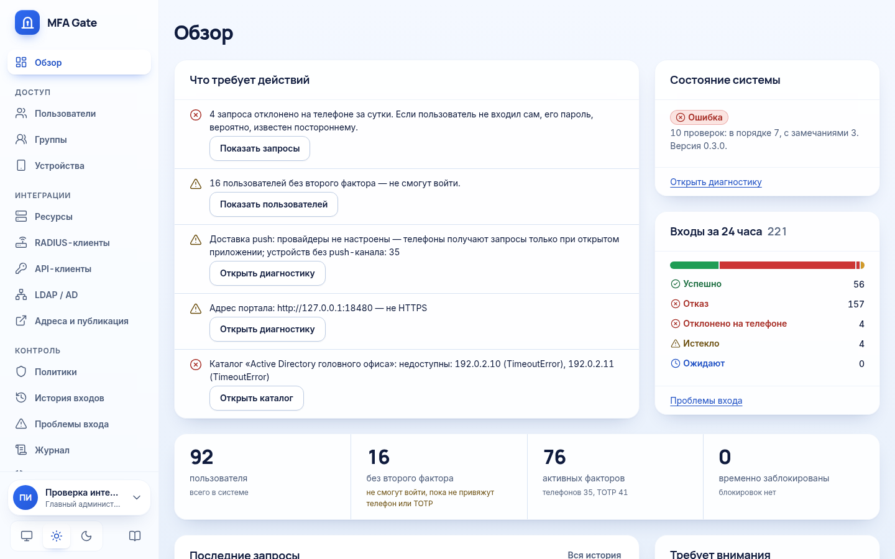

# MFA Gate

**An open-source, self-hosted multi-factor authentication platform for VPNs and internal applications.**

[](LICENSE)
[](https://github.com/calleograph/mfa-gate/actions/workflows/ci.yml)
[](https://github.com/calleograph/mfa-gate/releases)

The main documentation is in Russian: [README.md](README.md), [Wiki](https://github.com/calleograph/mfa-gate/wiki).

An employee types their password into the VPN client as usual and confirms the sign-in on their phone. The VPN gateway asks MFA Gate over RADIUS; MFA Gate checks the password (local or Active Directory / LDAP), applies a policy and waits for the confirmation.



## Features

- **RADIUS server**: PAP, Access-Challenge for one-time codes, mandatory Message-Authenticator (BlastRADIUS mitigation), gateway retransmissions deduplicated.
- **Push approval** in the MFA Gate Authenticator Android app; the decision is signed with an ECDSA P-256 key from Android Keystore after biometrics or PIN. The push carries only a request ID.
- **TOTP** (RFC 6238), works offline in any authenticator app.
- **Active Directory / LDAP**: multiple controllers, LDAPS/StartTLS, nested and allowed groups, step-by-step diagnostics.
- **Policies** by resource and group (`mfa` / `allow` / `deny`), web admin panel with roles, sign-in history with reject reasons, audit log.
- **REST API v1** with OpenAPI (`/api/docs`) and scoped API keys.
- **One-command operations**: `sudo ./install.sh`; `mfagatectl` for updates with automatic rollback, backups, restore and diagnostics.

## Android app

Two flavors, both on the [Releases](https://github.com/calleograph/mfa-gate/releases) page: `gms` (Firebase Cloud Messaging of your own Firebase project) and `foss` (no Google code; requests appear while the app is open). Android 8.0+.

## Requirements

Ubuntu 22.04+ or Debian 12 (x86_64/aarch64), 1 vCPU, 1 GB RAM, 5 GB free disk, Internet access to `ghcr.io` or `github.com`. The installer sets up Docker itself. Ports: UDP 1812 (RADIUS from gateways), TCP 8080 (panel and phones; later 443 via a reverse proxy).

## Quick install

```bash
git clone https://github.com/calleograph/mfa-gate.git
cd mfa-gate
sudo ./install.sh
```

The installer prints the panel URL (`http://<server IP>:8080`), the `admin` login and a one-time temporary password. On first sign-in you change the password and enrol TOTP. Keep a copy of `deploy/data/secrets/master.key` away from the server: backups are useless without it.

## HTTPS

Right after installation the panel runs over plain HTTP — use it only in an isolated network. Before rolling out to employees, put a TLS reverse proxy (nginx or Caddy) in front, set `MFA_GATE_PUBLIC_URL=https://…` and `MFA_GATE_HTTP_BIND=127.0.0.1`. Ready-to-use configs: [HTTPS через reverse proxy](https://github.com/calleograph/mfa-gate/wiki/HTTPS-через-reverse-proxy) (Russian).

## Operations

```bash
sudo mfagatectl status | logs [service] | diagnose
sudo mfagatectl check-update && sudo mfagatectl update X.Y.Z   # backup → image → migrations → health check → auto-rollback
sudo mfagatectl backup | restore <dir> | rollback
sudo mfagatectl admin <login> | emergency <login>                # reset admin password / one-time emergency code
```

Reference: [docs/install.md](docs/install.md), [docs/admin-guide.md](docs/admin-guide.md), [docs/integrations.md](docs/integrations.md), [docs/api.md](docs/api.md), [docs/push.md](docs/push.md), [docs/ldap.md](docs/ldap.md), [docs/protocol/device-api.md](docs/protocol/device-api.md).

## Status (0.2.0)

- **Verified** by end-to-end tests on a Docker stack: RADIUS PAP/Challenge, signed push, TOTP, policies, REST API, install/update/rollback/backup/restore lifecycle; LDAP against a real OpenLDAP.
- **Needs verification**: real VPN gateways (OpenVPN, NPS, Ideco, Cisco, FortiGate, MikroTik), a real Active Directory, real Android devices, FCM delivery, `install.sh` on a clean OS.
- **Experimental**: HMS and UnifiedPush (server side only).
- **Not implemented**: RADIUS Accounting, reply attributes (Class, Filter-Id, VSA), RADIUS "second factor only" mode.

Details: [docs/testing.md](docs/testing.md).

## License

[Apache License 2.0](LICENSE). Author: Stanislav. Contributing: [CONTRIBUTING.md](CONTRIBUTING.md). Security reports: [SECURITY.md](SECURITY.md).
