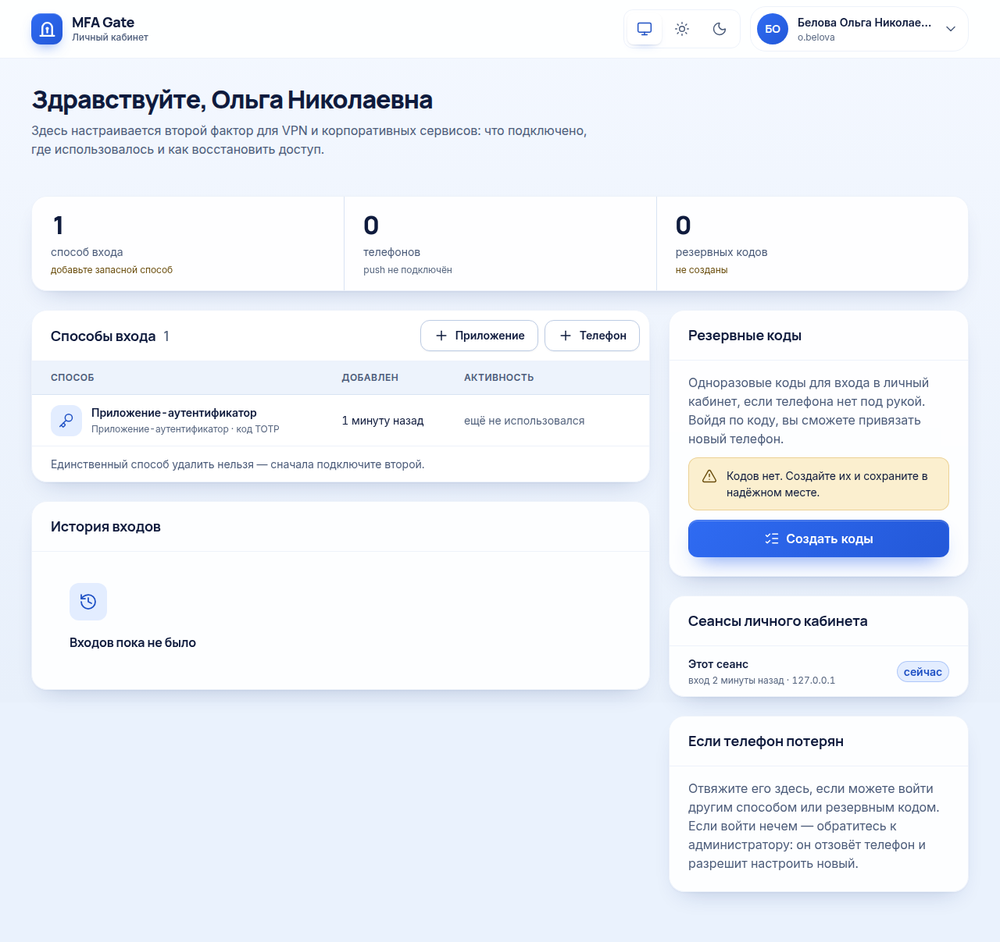
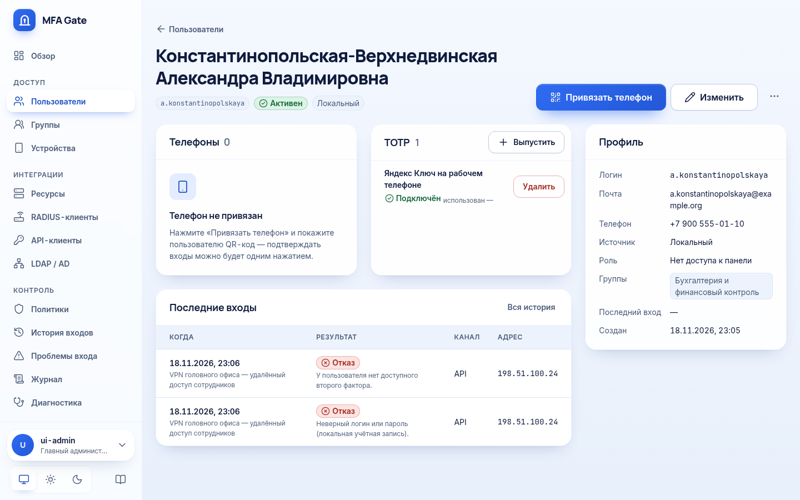
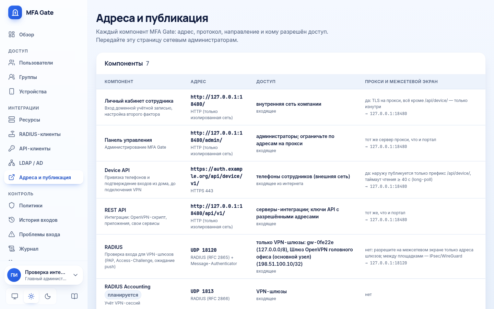
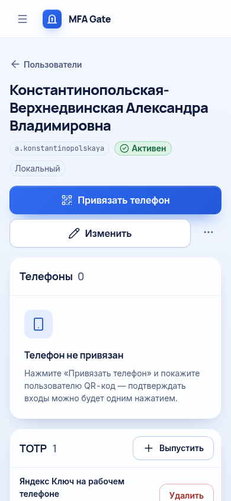
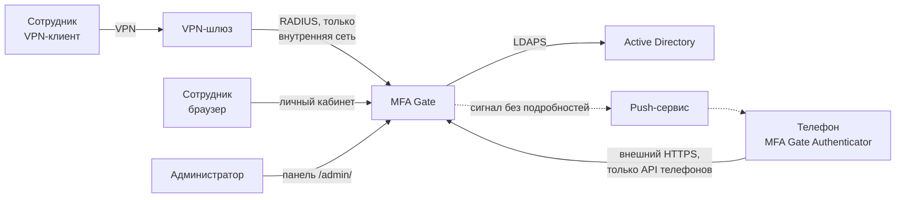

<div align="center">

# MFA Gate

### Второй фактор для VPN и корпоративных сервисов — на сервере вашей организации

[](https://github.com/calleograph/mfa-gate/actions/workflows/ci.yml)
[](https://github.com/calleograph/mfa-gate/releases)
[](LICENSE)


[English](README.en.md) · [Документация](wiki/Home.md) · [Выпуски](https://github.com/calleograph/mfa-gate/releases)

</div>

---

## Что такое MFA Gate

MFA Gate защищает удалённый доступ организации вторым фактором. Сотрудник вводит в VPN-клиенте свой обычный доменный пароль, а затем подтверждает вход на телефоне — одним нажатием с отпечатком пальца или кодом из приложения-аутентификатора. Если пароль утёк, посторонний всё равно не войдёт: у него нет телефона сотрудника.

Система ставится одной командой на ваш сервер и работает с вашим Active Directory. Пароли, ключи, журналы входов и сведения о сотрудниках остаются внутри организации: облачного сервиса-посредника нет, разработчик проекта не получает ваших данных. Наружу уходит только короткий сигнал телефону «есть новый запрос» — без логина, адреса и подробностей входа.

## Какие задачи решает

- Пароль от VPN подобран, украден фишингом или повторно использован — без телефона сотрудника он бесполезен.
- Требование регулятора или аудитора включить многофакторную аутентификацию для удалённого доступа.
- Отказ от облачных MFA-сервисов: данные о входах сотрудников не уходят третьей стороне.
- Сотрудники сами подключают второй фактор, служба поддержки не тратит время на каждого.
- Один источник правды о входах: кто, когда, откуда, через какой шлюз и почему получил отказ.

## Как это выглядит для сотрудника

1. **Подключение — один раз, за пару минут.** Сотрудник открывает личный кабинет в браузере, входит доменной учётной записью и выбирает способ: телефон с приложением MFA Gate Authenticator или любое приложение-аутентификатор с кодами. Сканирует QR-код — готово. Там же он получает резервные коды на случай потери телефона.
2. **Каждый вход в VPN — как раньше, плюс одно касание.** Сотрудник вводит логин и пароль в привычном VPN-клиенте. Телефон показывает запрос: какой ресурс, откуда, во сколько. Сотрудник подтверждает его отпечатком пальца — и подключается.
3. **Не хочет ставить наше приложение — пользуется кодами.** Вместо телефона с MFA Gate Authenticator можно подключить любое приложение-аутентификатор: шесть цифр работают без интернета, VPN-клиент спросит код после пароля.
4. **Потерял телефон — входит по резервному коду** и привязывает новый. Если кодов под рукой нет, администратор одной кнопкой разрешает повторную настройку на 24 часа.

## Основные возможности

| Возможность | Что входит |
| --- | --- |
| **Личный кабинет сотрудника** | вход доменной учётной записью, мастер подключения второго фактора, резервные коды, свои телефоны и приложения, история входов, активные сеансы |
| **Подтверждение на телефоне** | приложение для Android; решение подписывается ключом из защищённого хранилища телефона после отпечатка пальца или PIN, сервер принимает только подписанный ответ привязанного телефона |
| **Коды TOTP** | любое приложение-аутентификатор (RFC 6238), работает без сети, код нельзя использовать повторно |
| **VPN по RADIUS** | Cisco ASA, FortiGate, pfSense, OpenVPN, Windows NPS и любой шлюз с RADIUS PAP; защита от атаки BlastRADIUS; повторы шлюза не создают второй запрос на телефон |
| **Active Directory и LDAP** | несколько контроллеров, LDAPS и StartTLS, вложенные группы, пошаговая диагностика подключения с расшифровкой ошибок AD |
| **Политики доступа** | для каких ресурсов и групп второй фактор обязателен, кому вход по паролю, кому запрет; какие способы разрешены |
| **Безопасное первое подключение** | только из сети компании, только для разрешённых групп и только пока у сотрудника нет фактора — узнавший пароль не привяжет свой телефон |
| **Панель администратора** | пользователи, телефоны, шлюзы, политики, история входов с причиной каждого отказа, журнал действий администраторов с выгрузкой, роли, светлая и тёмная темы, работа с телефона |
| **Адреса и публикация** | экран для сетевых администраторов: какие адреса и порты открыть, кому, и готовые конфигурации nginx и Caddy |
| **REST API** | подключение своих приложений к проверке второго фактора, описание OpenAPI, ключи с правами и ограничением по адресам |
| **Эксплуатация** | установка одной командой, обновление с автоматическим откатом при сбое, резервные копии и восстановление, диагностика, аварийный доступ администратора |

## Для кого

| Кто | Что получает |
| --- | --- |
| Руководитель ИТ и безопасности | многофакторную защиту удалённого доступа без облачного посредника и без платы за пользователя |
| Системный администратор | установку за несколько минут, подключение к AD и VPN-шлюзу по инструкции, понятные причины отказов вместо догадок |
| Сетевой администратор | список адресов и портов, правила межсетевого экрана и готовые конфигурации прокси |
| Сотрудник | вход в VPN одним касанием и самостоятельное подключение без заявок в поддержку |
| Разработчик | REST API, чтобы добавить второй фактор во внутреннее приложение |

## Интерфейс

| Личный кабинет сотрудника | Карточка пользователя в панели |
| --- | --- |
|  |  |

| Адреса и публикация | Тёмная тема | С телефона |
| --- | --- | --- |
|  |  |  |

## Как устроено



MFA Gate — набор контейнеров Docker на одном сервере: веб-приложение (кабинет, панель, API), RADIUS-сервер, фоновые задачи и PostgreSQL. Наружу публикуется только API для телефонов, чтобы сотрудник мог подтвердить вход из дома до подключения VPN; кабинет, панель и RADIUS доступны только изнутри. Секреты в базе зашифрованы мастер-ключом. Подробно: [Архитектура](wiki/Архитектура.md), [Сетевая схема и публикация](wiki/Сетевая-схема-и-публикация.md).

## Установка

Нужен сервер с Ubuntu 22.04+ или Debian 12: 1 vCPU, 1 ГБ памяти, 5 ГБ на диске (рекомендуется 2 vCPU, 2 ГБ, 20 ГБ). Docker установщик поставит сам.

```bash
git clone https://github.com/calleograph/mfa-gate.git
cd mfa-gate
sudo ./install.sh
```

Установщик проверит сервер, создаст конфигурацию, запустит сервисы и покажет адрес панели и временный пароль первого администратора. Сразу сохраните копию `deploy/data/secrets/master.key` отдельно от сервера: без неё резервные копии не восстановить.

Дальше по шагам:

1. [Первоначальная настройка](wiki/Первоначальная-настройка.md) — первый вход в панель.
2. [Подключение Active Directory](wiki/Подключение-Active-Directory.md).
3. [Настройка RADIUS](wiki/Настройка-RADIUS.md) и [подключение VPN-шлюза](wiki/Подключение-VPN.md); если шлюз сам проверяет доменный пароль — [отдельная инструкция](wiki/Шлюзы-с-собственной-проверкой-пароля.md).
4. [HTTPS через reverse proxy](wiki/HTTPS-через-reverse-proxy.md) — до подключения сотрудников.
5. [Личный кабинет сотрудника](wiki/Личный-кабинет-сотрудника.md) — что разослать сотрудникам.

Обновление — из каталога проекта; перед обновлением делается копия базы, при сбое версия откатывается сама:

```bash
cd mfa-gate
sudo git pull
sudo mfagatectl update 0.3.2
```

Резервные копии, восстановление и диагностика: [Резервное копирование](wiki/Резервное-копирование.md), [Диагностика](wiki/Диагностика.md).

## Приложение для Android

**MFA Gate Authenticator** — подтверждение входов и коды TOTP. Android 8.0 и новее, телефон с блокировкой экрана. APK и контрольные суммы — на странице [Выпуски](https://github.com/calleograph/mfa-gate/releases); обновления ставятся поверх.

| Вариант | Для каких телефонов |
| --- | --- |
| `gms` | с сервисами Google: уведомление о входе приходит, даже когда приложение закрыто |
| `foss` | без сервисов Google, в том числе Huawei и телефоны с «чистым» Android: приложение держит своё соединение с сервером и тоже показывает запрос сразу |

## Что проверено

Каждое изменение проходит модульные тесты, тесты на настоящем OpenLDAP и полный сквозной стенд в Docker: установка, вход по RADIUS с подтверждением на телефоне, коды, политики, личный кабинет, обновление, откат, резервная копия и восстановление. Обновление и откат дополнительно проверяются на тестовом сервере в изолированной сети.

Ещё не проверено на реальном оборудовании: конкретные модели VPN-шлюзов (протокол покрыт тестами, профили составлены по документации производителей), Active Directory на настоящем контроллере (проверено на OpenLDAP), приложение на разных телефонах и доставка уведомлений через Firebase. Подробно — [docs/testing.md](docs/testing.md).

Если вы запустили MFA Gate со своим шлюзом, каталогом или телефоном, расскажите в [Issues](https://github.com/calleograph/mfa-gate/issues) — это самая ценная помощь проекту.

## В планах

Учёт VPN-сессий (RADIUS Accounting) и их список в панели, передача шлюзу групп доступа сотрудника, подтверждение входа вводом числа с экрана, аппаратные ключи (WebAuthn), вход в кабинет без пароля с доменных компьютеров.

## Документация

| Тема | Где |
| --- | --- |
| Установка, обновление, копии | [Быстрая установка](wiki/Быстрая-установка-All-in-One.md), [Обновление](wiki/Обновление.md), [docs/install.md](docs/install.md) |
| Администрирование | [Первоначальная настройка](wiki/Первоначальная-настройка.md), [docs/admin-guide.md](docs/admin-guide.md) — политики, роли, коды причин отказа |
| VPN и приложения | [Подключение VPN](wiki/Подключение-VPN.md), [docs/integrations.md](docs/integrations.md), [REST API](docs/api.md) |
| Сеть | [docs/network.md](docs/network.md), примеры прокси в [deploy/proxy/](deploy/proxy/) |
| Телефоны | [Регистрация Android-устройства](wiki/Регистрация-Android-устройства.md), [Настройка Push](wiki/Настройка-Push.md), [docs/android.md](docs/android.md) |
| Сотрудникам | [docs/user-guide.md](docs/user-guide.md) — памятка для рассылки |
| Безопасность | [модель угроз](docs/threat-model.md), [архитектурные решения](docs/adr/), [SECURITY.md](SECURITY.md) |
| Изменения | [CHANGELOG.md](CHANGELOG.md), [Выпуски](https://github.com/calleograph/mfa-gate/releases) |

## Лицензия

[Apache License 2.0](LICENSE): можно свободно использовать, изменять и встраивать, в том числе в коммерческих целях. Об уязвимостях сообщайте по правилам [SECURITY.md](SECURITY.md), предложения изменений — [CONTRIBUTING.md](CONTRIBUTING.md).
