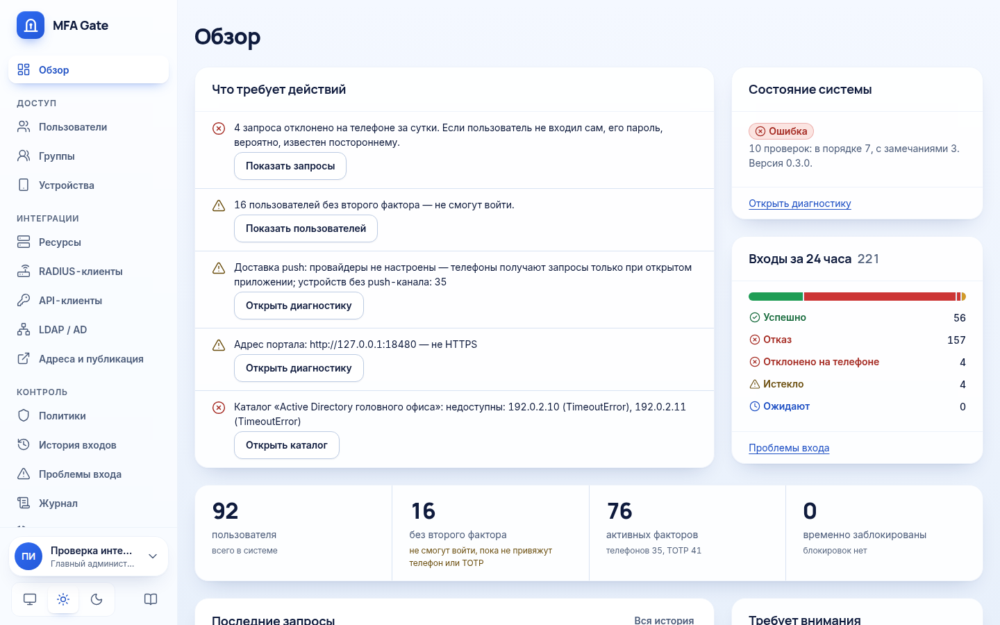
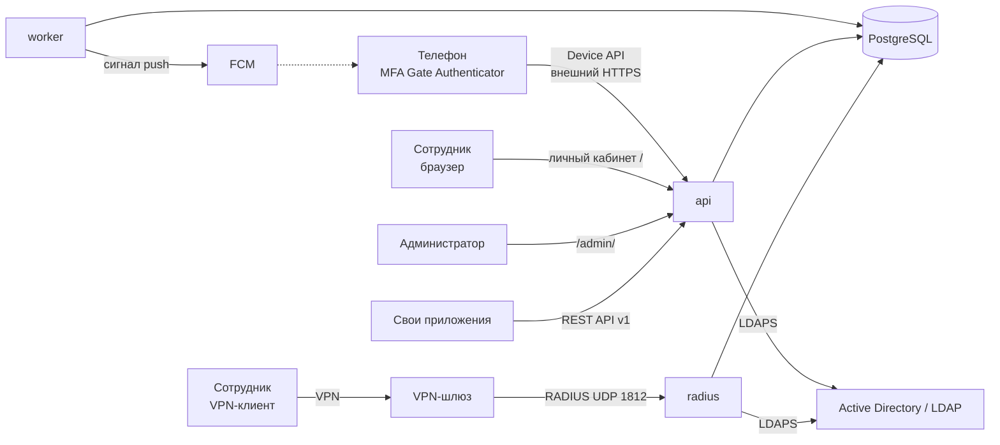
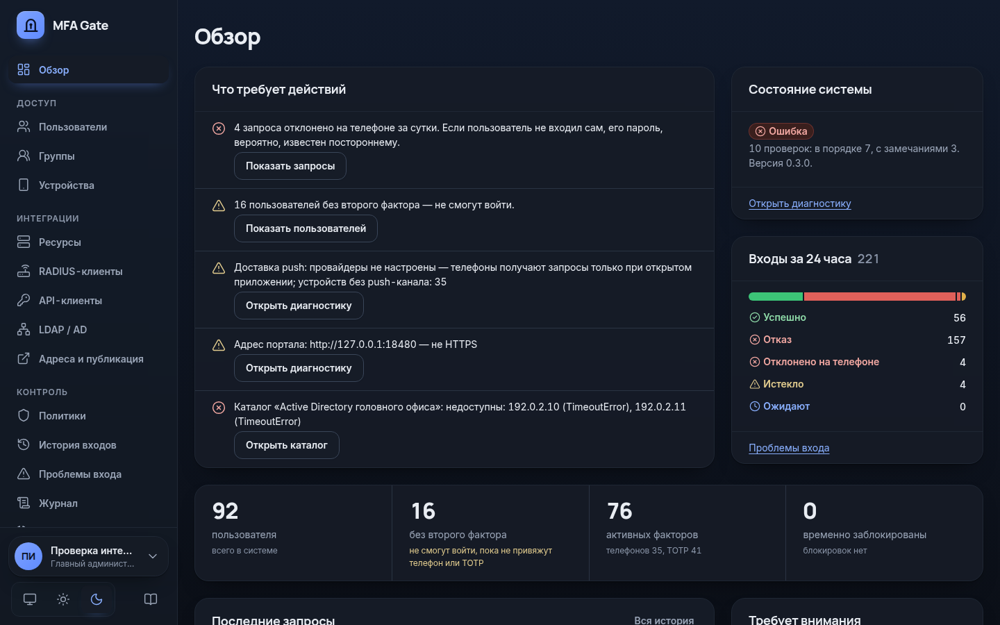

# MFA Gate

**Открытая платформа многофакторной аутентификации для VPN и внутренних приложений, которая работает на вашем сервере.**

[](LICENSE)
[](https://github.com/calleograph/mfa-gate/actions/workflows/ci.yml)
[](https://github.com/calleograph/mfa-gate/releases)

[English version](README.en.md) · [Документация (Wiki)](https://github.com/calleograph/mfa-gate/wiki) · [Выпуски](https://github.com/calleograph/mfa-gate/releases)

Сотрудник один раз входит в личный кабинет доменной учётной записью и сам настраивает второй фактор: приложение-аутентификатор или телефон с MFA Gate. Дальше он вводит пароль в VPN-клиенте, как раньше, — и подтверждает вход на телефоне отпечатком пальца или кодом. VPN-шлюз спрашивает MFA Gate по RADIUS, MFA Gate проверяет пароль в Active Directory (или доверяет проверке самого шлюза), применяет политику и ждёт подтверждения. Узнавший пароль посторонний войти не сможет.



## Возможности

- **Личный кабинет сотрудника** (`/`): вход доменной учётной записью, мастер первичной настройки (TOTP по умолчанию или телефон), резервные коды, свои телефоны и приложения, история входов, сеансы. Первая настройка — только из сети компании и только до первой регистрации фактора; после потери телефона — по разрешению администратора.
- **RADIUS-сервер** для VPN-шлюзов: PAP, Access-Challenge для одноразового кода, обязательный Message-Authenticator (защита от BlastRADIUS), распознавание повторов шлюза — один вход, одно уведомление. Для шлюзов, которые сами проверяют пароль (Ideco: режимы «Логин», «Логин и OTP-код»), — режим «пароль проверяет шлюз» для конкретного клиента.
- **Push-подтверждение** в приложении MFA Gate Authenticator для Android. Решение подписывается ключом ECDSA P-256 из Android Keystore после биометрии или PIN; через Google проходит только идентификатор запроса.
- **TOTP** (RFC 6238): коды без сети в любом приложении-аутентификаторе, защита от повторного использования кода.
- **Active Directory и LDAP**: несколько контроллеров, LDAPS/StartTLS, вложенные группы, разрешённые группы, пошаговая диагностика подключения с расшифровкой подкодов AD.
- **Политики** по ресурсам и группам: требовать второй фактор, пропустить по паролю, запретить; выбор методов.
- **Панель управления** (`/admin/`): пользователи, телефоны, ресурсы, RADIUS-клиенты, политики, история входов с причиной каждого отказа, журнал аудита с выгрузкой CSV, роли администраторов, экран «Адреса и публикация» с готовыми конфигурациями nginx и Caddy. Вход в панель — всегда со вторым фактором. Светлая и тёмная темы, работа с телефона.
- **REST API v1** с описанием OpenAPI (`/api/docs`): ключи API с правами и ограничением по адресам.
- **Эксплуатация одной командой**: установка `sudo ./install.sh`, `mfagatectl` — обновление с автооткатом, резервные копии, восстановление, диагностика, аварийный доступ администратора.

## Архитектура



Все компоненты справа от шлюза — на одном сервере в Docker Compose: `api` (личный кабинет, панель, REST API, Device API), `radius`, `worker` (push, сроки хранения), `migrate`, PostgreSQL 16. PostgreSQL наружу не публикуется, секреты в базе зашифрованы мастер-ключом. Подробнее: [Архитектура](https://github.com/calleograph/mfa-gate/wiki/Архитектура).

## Поддерживаемые интеграции

| Интеграция | Как | Статус |
|---|---|---|
| OpenVPN 2.5+ | скрипт [`integrations/openvpn`](integrations/openvpn/mfa-gate-openvpn.sh) через REST API, или RADIUS через PAM | требует проверки на стенде |
| Windows Server NPS / RRAS | RADIUS (только клиенты с PAP) | требует проверки на стенде |
| Ideco NGFW | RADIUS-сервер второго фактора, режимы «Логин» / «Логин и OTP-код», клиент MFA Gate с проверкой пароля шлюзом ([профиль](docs/integrations.md)) | требует проверки на стенде |
| Cisco ASA, FortiGate, pfSense | RADIUS | требует проверки на стенде |
| MikroTik RouterOS | RADIUS | надёжного сценария нет (короткий таймаут) |
| Любой шлюз с RADIUS PAP и таймаутом ≥ 60 с | RADIUS | протокол покрыт сквозными тестами |
| Свои приложения | REST API v1 | покрыто сквозными тестами |
| Active Directory / OpenLDAP | LDAPS, StartTLS | OpenLDAP — тесты на настоящем сервере; AD — юнит-тесты, требует проверки |

Настройка шлюзов: [Подключение VPN](https://github.com/calleograph/mfa-gate/wiki/Подключение-VPN).

## Интерфейс

| Обзор, тёмная тема | Карточка пользователя | С телефона |
|---|---|---|
|  |  |  |

| Личный кабинет сотрудника | Адреса и публикация |
|---|---|
|  |  |

## Android-приложение

**MFA Gate Authenticator** — подтверждение входов и коды TOTP. Android 8.0 и новее, телефон с блокировкой экрана.

| Вариант | Для кого |
|---|---|
| `gms` | телефоны с сервисами Google, push через Firebase Cloud Messaging вашей организации — уведомление приходит, даже когда приложение закрыто |
| `foss` | телефоны без сервисов Google; без кода Google. Мгновенные уведомления через постоянное соединение (постоянное уведомление «Ожидание запросов входа») |

APK обоих вариантов и `SHA256SUMS` — на странице [Выпуски](https://github.com/calleograph/mfa-gate/releases). Привязка телефона — по одноразовому QR-коду из панели: [Регистрация Android-устройства](https://github.com/calleograph/mfa-gate/wiki/Регистрация-Android-устройства). Исходники и сборка: [android/](android/README.md).

## Требования к серверу

- Ubuntu 22.04+ или Debian 12, x86_64 или aarch64. Другие Linux — [ручная установка](docs/install.md#ручная-установка).
- 1 vCPU, 1 ГБ ОЗУ, 5 ГБ свободного места (рекомендуется 2 vCPU, 2 ГБ, 20 ГБ).
- Доступ в Интернет к `ghcr.io` или `github.com` при установке и обновлении.
- Порты: UDP 1812 от VPN-шлюзов; TCP 8080 (потом 443 через reverse proxy) от администраторов и телефонов; LDAPS 636 до контроллеров домена.

Docker установщик поставит сам. Подробно: [Требования к серверу](https://github.com/calleograph/mfa-gate/wiki/Требования-к-серверу).

## Быстрая установка

```bash
git clone https://github.com/calleograph/mfa-gate.git
cd mfa-gate
sudo ./install.sh
```

Установщик проверит сервер, поставит Docker, создаст конфигурацию, запустит сервисы и покажет:

```text
  Панель администратора:  http://192.0.2.10:8080
  Логин:                  admin
  Временный пароль:       …   (показан один раз)
  RADIUS для VPN-шлюзов:  UDP-порт 1812 на адресе этого сервера
```

При первом входе панель попросит сменить временный пароль и подключить второй фактор. Журнал установки — `/var/log/mfa-gate/install-*.log`. Нестандартные порты и адрес: `sudo MFA_GATE_HTTP_PORT=8180 MFA_GATE_RADIUS_PORT=11812 ./install.sh`.

**Сразу сохраните копию `deploy/data/secrets/master.key` отдельно от сервера.** Без неё резервные копии бесполезны.

## Что дальше

Пошаговые инструкции — в [Wiki](https://github.com/calleograph/mfa-gate/wiki) (копия в репозитории: [`wiki/`](wiki/Home.md)):

1. [Первоначальная настройка](https://github.com/calleograph/mfa-gate/wiki/Первоначальная-настройка) — первый вход и план.
2. [Подключение Active Directory](https://github.com/calleograph/mfa-gate/wiki/Подключение-Active-Directory).
3. [Настройка RADIUS](https://github.com/calleograph/mfa-gate/wiki/Настройка-RADIUS) и [Подключение VPN](https://github.com/calleograph/mfa-gate/wiki/Подключение-VPN).
4. [Регистрация Android-устройства](https://github.com/calleograph/mfa-gate/wiki/Регистрация-Android-устройства), [Настройка TOTP](https://github.com/calleograph/mfa-gate/wiki/Настройка-TOTP), [Настройка Push](https://github.com/calleograph/mfa-gate/wiki/Настройка-Push).
5. [HTTPS через reverse proxy](https://github.com/calleograph/mfa-gate/wiki/HTTPS-через-reverse-proxy) и [Резервное копирование](https://github.com/calleograph/mfa-gate/wiki/Резервное-копирование).

## HTTPS

После установки панель и Device API работают по `http://IP:8080` — это удобно для первичной настройки, но пароли, cookie сессии и секреты при этом идут по сети открытым текстом. Используйте HTTP только в изолированной сети и до подключения сотрудников переведите сервер на HTTPS: reverse proxy (nginx или Caddy) с сертификатом перед MFA Gate, `MFA_GATE_PUBLIC_URL=https://…`, `MFA_GATE_HTTP_BIND=127.0.0.1`.

Два адреса: внутренний (`https://mfa.example.org/` — личный кабинет и `/admin/`) и внешний только для телефонов (`https://auth.example.org/api/device/`, `MFA_GATE_DEVICE_URL`): телефон сотрудника подтверждает VPN-вход из дома, до подключения VPN. Примеры — [`deploy/proxy/`](deploy/proxy/), схема, порты и правила межсетевого экрана — [docs/network.md](docs/network.md).

Готовые конфигурации и проверка: [HTTPS через reverse proxy](https://github.com/calleograph/mfa-gate/wiki/HTTPS-через-reverse-proxy). Что работает по HTTP и чем это опасно: [Работа по HTTP](https://github.com/calleograph/mfa-gate/wiki/Работа-по-HTTP). После перехода на HTTPS телефоны привязываются заново.

## Обновление

Каталог установки в примерах — `/opt/mfa-gate`.

```bash
sudo mfagatectl check-update
sudo git -C /opt/mfa-gate fetch --tags && sudo git -C /opt/mfa-gate checkout v0.3.0
sudo mfagatectl update 0.3.0
```

`update` делает копию базы, переключает версию, применяет миграции, проверяет сервисы и при сбое сам откатывается. Ручной откат — `sudo mfagatectl rollback`. Подробно: [Обновление](https://github.com/calleograph/mfa-gate/wiki/Обновление).

## Резервное копирование

```bash
sudo mfagatectl backup      # печатает путь: /opt/mfa-gate/deploy/backups/<время>-manual
sudo mfagatectl restore /opt/mfa-gate/deploy/backups/<время>-manual
```

Копия — дамп базы с контрольной суммой и манифестом; мастер-ключ в неё намеренно не входит. Расписание через cron или systemd timer, перенос на другой сервер: [Резервное копирование](https://github.com/calleograph/mfa-gate/wiki/Резервное-копирование), [Восстановление](https://github.com/calleograph/mfa-gate/wiki/Восстановление).

## Диагностика

```bash
sudo mfagatectl status            # контейнеры и версия
sudo mfagatectl logs radius -f    # журнал сервиса
sudo mfagatectl diagnose          # проверки + архив для поддержки без секретов
sudo mfagatectl radius-test ivanov
```

Типовые проблемы (порт занят, нет Интернета, Docker не стартует, панель не открывается, RADIUS не отвечает, неверный секрет): [Диагностика](https://github.com/calleograph/mfa-gate/wiki/Диагностика).

## Документация

| Для кого | Пошагово (Wiki) | Справочник (`docs/`) |
|---|---|---|
| Установка и эксплуатация | [Быстрая установка](https://github.com/calleograph/mfa-gate/wiki/Быстрая-установка-All-in-One), [Обновление](https://github.com/calleograph/mfa-gate/wiki/Обновление), [Диагностика](https://github.com/calleograph/mfa-gate/wiki/Диагностика) | [install.md](docs/install.md) — переменные, команды `mfagatectl` |
| Администратор | [Первоначальная настройка](https://github.com/calleograph/mfa-gate/wiki/Первоначальная-настройка), [Создание администратора](https://github.com/calleograph/mfa-gate/wiki/Создание-администратора) | [admin-guide.md](docs/admin-guide.md) — политики, роли, коды причин; [admin-ui.md](docs/admin-ui.md) |
| VPN и приложения | [Подключение VPN](https://github.com/calleograph/mfa-gate/wiki/Подключение-VPN), [Интеграция по REST API](https://github.com/calleograph/mfa-gate/wiki/Интеграция-по-REST-API) | [integrations.md](docs/integrations.md), [api.md](docs/api.md), [openapi.json](docs/openapi.json) |
| Каталоги | [Подключение Active Directory](https://github.com/calleograph/mfa-gate/wiki/Подключение-Active-Directory) | [ldap.md](docs/ldap.md) |
| Push и телефоны | [Настройка Push](https://github.com/calleograph/mfa-gate/wiki/Настройка-Push), [Регистрация Android-устройства](https://github.com/calleograph/mfa-gate/wiki/Регистрация-Android-устройства) | [push.md](docs/push.md), [android.md](docs/android.md), [protocol/device-api.md](docs/protocol/device-api.md) |
| Сотрудник | — | [user-guide.md](docs/user-guide.md) — памятка для рассылки |
| Безопасность и разработка | — | [threat-model.md](docs/threat-model.md), [adr/](docs/adr/), [testing.md](docs/testing.md), [CONTRIBUTING.md](CONTRIBUTING.md), [SECURITY.md](SECURITY.md), [CHANGELOG.md](CHANGELOG.md) |

## Статус готовности

Версия 0.2.0. Что проверено и что нет — честно, по [docs/testing.md](docs/testing.md):

| Компонент | Статус |
|---|---|
| RADIUS: PAP, Access-Challenge (TOTP), Message-Authenticator, повторы шлюза | **проверено**: сквозные тесты на стенде в Docker |
| Push с подписью, TOTP, политики, блокировка, REST API, вход администратора | **проверено**: сквозные тесты с эмуляцией телефона |
| Установка, повторная установка, обновление, откат, копия и восстановление | **проверено** сценарием жизненного цикла в Docker на сервере разработки; установка `install.sh` на чистую ОС **требует проверки** |
| LDAP | **проверено** на OpenLDAP в Docker (LDAPS, StartTLS, вложенные группы, отказ контроллера) |
| Active Directory | **требует проверки** на реальном контроллере (вложенные группы, подкоды AD покрыты только юнит-тестами) |
| Совместимость с конкретными VPN-шлюзами | **требует проверки на реальном шлюзе** |
| Android-приложение | собрано и покрыто JVM-тестами; **требует проверки на реальных телефонах** (биометрия, фон, экономия энергии) |
| Доставка через FCM | реализована; **требует проверки** на проекте Firebase и устройстве |
| HMS (Huawei Push Kit), UnifiedPush | **экспериментально**, только сервер, в приложении нет |
| RADIUS Accounting, атрибуты ответа (Class, Filter-Id, VSA), режим «только второй фактор» по RADIUS | **не реализовано** |
| Нагрузочное тестирование RADIUS | скрипт есть (`scripts/radius_load.py`), систематический прогон не выполнялся |

Если вы проверили MFA Gate со своим шлюзом, AD или телефоном — напишите в [Issues](https://github.com/calleograph/mfa-gate/issues): это самая ценная помощь проекту.

## Лицензия

[Apache License 2.0](LICENSE). Автор — Stanislav. Сообщения об уязвимостях: [SECURITY.md](SECURITY.md).
