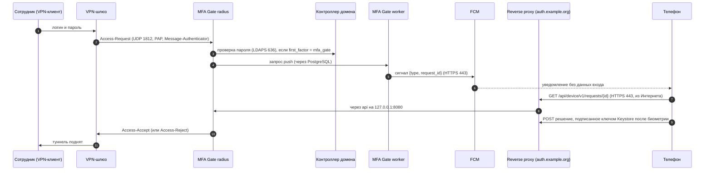

# Сетевая схема и публикация

Для сетевых администраторов: какие компоненты есть у MFA Gate, какие порты им нужны, что публикуется наружу и что подготовить до подключения VPN. Адреса в примерах: внутреннее имя `mfa.example.org`, внешнее имя `auth.example.org`, сервер MFA Gate `192.0.2.10`, VPN-шлюз `198.51.100.1`, контроллеры домена `dc1.corp.example.org` и `dc2.corp.example.org`.

Те же сведения по вашей установке (адреса, протоколы, нужен ли прокси, готовые фрагменты nginx и Caddy) показывает панель: «Адреса и публикация».

## Три части системы

| Часть | Адрес | Кто пользуется |
|---|---|---|
| Личный кабинет сотрудника | `https://mfa.example.org/` | сотрудники: вход доменным паролем и вторым фактором, первая настройка факторов, свои устройства, история входов, сессии |
| Панель администратора | `https://mfa.example.org/admin/` | администраторы; вход всегда со вторым фактором |
| Инфраструктура аутентификации | RADIUS UDP 1812, REST API `/api/v1/`, Device API `/api/device/v1/` | VPN-шлюзы, свои приложения, телефоны |

MFA Gate не строит VPN-туннель и не шифрует трафик сотрудника: это делает протокол VPN шлюза. MFA Gate отвечает шлюзу «пустить» или «не пускать». Пока шлюз не получил Access-Accept, сотрудник не получает доступа в сеть.

## Компоненты и порты

HTTP-пути одного веб-сервиса `api` (слушает `127.0.0.1:8080`, наружу — только через reverse proxy):

| Путь | Назначение | Где публикуется | Кто может обращаться |
|---|---|---|---|
| `/` | личный кабинет сотрудника | внутреннее имя | внутренняя сеть, пул адресов VPN |
| `/admin/` | панель администратора | внутреннее имя | сеть администраторов (рекомендуется сузить) |
| `/api/v1/` | REST API: кабинет, панель, интеграции | внутреннее имя | браузеры сотрудников и администраторов, серверы приложений, скрипт OpenVPN |
| `/api/docs`, `/api/openapi.json` | описание API (выключается `MFA_GATE_DOCS_ENABLED=false`) | внутреннее имя | администраторы, разработчики |
| `/api/device/v1/` | Device API: телефоны забирают запросы и отправляют подписанные решения | внутреннее **и внешнее** имя | телефоны сотрудников, в том числе из Интернета |
| `/assets/` | статика кабинета и панели | внутреннее имя | — |
| `/health/live`, `/health/ready` | проверки работоспособности | внутреннее имя | мониторинг |

Сетевые потоки:

| Компонент | Порт и протокол | Направление | Кто | Reverse proxy |
|---|---|---|---|---|
| Кабинет, панель, REST API | TCP 443, HTTPS | внутрь | внутренняя сеть, VPN | да, внутреннее имя |
| Device API | TCP 443, HTTPS | внутрь, из Интернета | телефоны | да, внешнее имя, только префикс `/api/device/` |
| Веб-сервис `api` | TCP 8080, HTTP | локально | только reverse proxy (`MFA_GATE_HTTP_BIND=127.0.0.1`) | — |
| RADIUS | UDP 1812 | внутрь | только адреса VPN-шлюзов | нет (UDP, прокси не нужен) |
| RADIUS Accounting | UDP 1813 | — | **не реализован** (запланирован): выключите на шлюзе | — |
| RadSec (RADIUS over TLS, RFC 6614) | TCP 2083 | — | **не реализован** | — |
| LDAPS | TCP 636 | наружу | сервер → контроллеры домена | — |
| FCM | TCP 443 | наружу | сервер → `fcm.googleapis.com`, `oauth2.googleapis.com` | — |
| HMS, UnifiedPush (экспериментально) | TCP 443 | наружу | сервер → хосты Huawei Push Kit; распределитель UnifiedPush из `MFA_GATE_PUSH_UNIFIEDPUSH_HOSTS` | — |
| Телефон → push-сервис | TCP 443 | наружу из сети телефона | телефон → сервисы Google (сборка `gms`) | — |
| Обновления | TCP 443 | наружу | сервер → `ghcr.io`, `github.com`, `api.github.com` | — |
| NTP | UDP 123 | наружу | сервер → ваш NTP; от точного времени зависят TOTP и сроки запросов | — |
| PostgreSQL | TCP 5432 | — | внутри Docker, на хост не публикуется | — |

## Как проходит вход в VPN

1. Сотрудник вводит логин и пароль в VPN-клиенте.
2. Шлюз отправляет Access-Request на UDP 1812. MFA Gate находит RADIUS-клиента по адресу источника и проверяет Message-Authenticator; чужие и неподписанные пакеты молча отбрасываются.
3. Первый фактор зависит от поля клиента «Первый фактор»: `mfa_gate` — MFA Gate проверяет пароль сам (каталог по LDAPS или локальная учётная запись); `gateway` — пароль уже проверил шлюз, MFA Gate только определяет пользователя ([ADR 0016](adr/0016-first-factor-per-radius-client.md)).
4. Политика выбирает метод. Для push фоновый процесс `worker` отправляет пустой сигнал через FCM; RADIUS-запрос удерживается до решения, но не дольше `MFA_GATE_PUSH_TIMEOUT` (45 с).
5. Телефон получает сигнал. Он дома, VPN ещё не поднят, поэтому обращается к **внешнему** адресу Device API (`MFA_GATE_DEVICE_URL`).
6. Телефон забирает подробности (ресурс, IP, время) и показывает их сотруднику.
7. Сотрудник подтверждает биометрией или PIN, телефон отправляет решение, подписанное ключом из Android Keystore.
8. MFA Gate отвечает шлюзу Access-Accept или Access-Reject. Шлюз поднимает туннель.

Для TOTP вместо шагов 4–7: MFA Gate отвечает Access-Challenge «Введите одноразовый код», шлюз показывает окно и присылает второй Access-Request с атрибутом State и кодом.

Без push-сервиса (сборка `foss`) телефон сам держит соединение с Device API: long-poll, пока приложение открыто, и постоянное фоновое соединение (foreground service), которое сейчас реализуется ([android.md](android.md)). Для сети это то же: исходящий HTTPS 443 с телефона на внешнее имя, запрос держится до 30 с.

## Публикация: два имени

| Имя | Переменная | Что публикуется | Откуда доступно |
|---|---|---|---|
| `mfa.example.org` | `MFA_GATE_PUBLIC_URL` | всё приложение | внутренняя сеть и пул адресов VPN |
| `auth.example.org` | `MFA_GATE_DEVICE_URL` | только `/api/device/`, остальное — 404 | Интернет |

Телефону нужен доступ к серверу **до** подключения VPN: подтверждение входа и есть условие подключения. Поэтому Device API публикуется наружу, а кабинет, панель и REST API — нет.

- `MFA_GATE_DEVICE_URL` попадает в QR-код привязки телефона. По умолчанию он равен `MFA_GATE_PUBLIC_URL` — так работает установка, где телефоны ходят во внутреннюю сеть (офисный Wi-Fi, пилот).
- Сертификат внешнего имени должен быть доверенным для Android (например, Let's Encrypt). Для внутреннего подойдёт корпоративный УЦ.
- Если имя хоста в `MFA_GATE_DEVICE_URL` отличается от имени в `MFA_GATE_PUBLIC_URL`, сервер сам отвечает 404 на любой запрос с `Host: auth.example.org`, путь которого не начинается с `/api/device/` или `/health/`. Это второй рубеж на случай ошибки в прокси, а не замена ограничения в прокси ([ADR 0015](adr/0015-external-device-api.md)). Поэтому прокси должен передавать исходный `Host`.
- Внутреннее имя на общем с внешним прокси закрывается по адресам источника (`allow`/`deny` в nginx, `remote_ip` в Caddy). Иначе запрос из Интернета с SNI `mfa.example.org` на внешний IP получит панель.
- Смена `MFA_GATE_DEVICE_URL` после привязки телефонов требует их перепривязки: адрес сервера телефон берёт из QR-кода.

Готовые примеры: [deploy/proxy/nginx.conf](../deploy/proxy/nginx.conf), [deploy/proxy/Caddyfile](../deploy/proxy/Caddyfile). Пошагово — [HTTPS через reverse proxy](../wiki/HTTPS-через-reverse-proxy.md).

Варианты размещения:

- **Прокси на сервере MFA Gate**, внешний межсетевой экран пробрасывает `auth.example.org:443` на него (DNAT, адрес клиента сохраняется). Самый простой вариант, примеры рассчитаны на него.
- **Прокси в DMZ** на отдельном сервере. Добавьте его адрес в `MFA_GATE_TRUSTED_PROXIES` (например, `auto,198.51.100.30/32`), `MFA_GATE_HTTP_BIND` — адрес интерфейса, к которому он подключается, и откройте TCP 8080 только с прокси. Во внешний прокси выносите только `/api/device/`.

Требования к прокси:

- перезаписывать `X-Forwarded-For` адресом клиента (MFA Gate берёт последнее значение и только от `MFA_GATE_TRUSTED_PROXIES`);
- передавать `X-Forwarded-Proto: https` и исходный `Host`;
- таймаут чтения не меньше 40 с (`proxy_read_timeout` в nginx; в примерах 75 с), буферизацию ответа выключить: телефоны держат `GET /api/device/v1/requests?wait=25` до 30 с.

## Таймауты

| Где | Значение | Почему |
|---|---|---|
| RADIUS-таймаут шлюза | больше `MFA_GATE_PUSH_TIMEOUT`, рекомендуется 60 с | MFA Gate держит Access-Request, пока сотрудник не ответит. Короче — сотрудник подтверждает, а VPN-клиент уже показал ошибку |
| Повторы шлюза | 1–3 | повторы распознаются и не создают второй push |
| `MFA_GATE_PUSH_TIMEOUT` | 45 с | время на ответ на телефоне; если шлюз не позволяет ждать дольше 30 с — уменьшите |
| `MFA_GATE_OTP_CHALLENGE_TIMEOUT` | 120 с | время на ввод кода после Access-Challenge |
| Таймаут чтения reverse proxy | ≥ 40 с (в примерах 75 с) | long-poll Device API до 30 с и ожидание REST API `?wait=30` |
| Ожидание в скрипте OpenVPN `MFA_GATE_WAIT` | 50 с | больше `MFA_GATE_PUSH_TIMEOUT` |

## Защита от спама push

Что уже работает:

- **Повторы шлюза.** Пакет с тем же адресом, портом, Identifier и Authenticator в течение 90 с не создаёт новую попытку и получает тот же ответ (RFC 5080).
- **Присоединение к открытой попытке.** Новый Access-Request того же пользователя к тому же ресурсу с того же Calling-Station-Id, клиента и NAS, пока push ждёт ответа, присоединяется к нему — второго уведомления нет.
- **Блокировка.** 8 ошибок первого фактора или кода подряд — блокировка учётной записи на 15 минут (`MFA_GATE_LOCKOUT_THRESHOLD`, `MFA_GATE_LOCKOUT_MINUTES`); во время блокировки push не отправляется.
- **Лимиты частоты** входа в кабинет, панель и привязки устройств по адресу клиента (`429`).
- **Срок push.** Запрос истекает через `MFA_GATE_PUSH_TIMEOUT`; позднее подтверждение отклоняется.
- **Пароль до push.** Push уходит только после первого фактора: проверенного MFA Gate или шлюзом в режиме `gateway`.
- «Отклонить» на телефоне сразу даёт отказ и попадает в историю: сотрудник сообщает администратору, пароль меняют.

Не сделано: подтверждение вводом числа (number matching) и лимит push на пользователя. См. [threat-model.md](threat-model.md).

## Правила межсетевого экрана

На сервере MFA Gate порты, опубликованные Docker, обходят `ufw` и `INPUT`: фильтруйте в цепочке `DOCKER-USER` ([install.md](install.md#межсетевой-экран)).

Входящие на сервер MFA Gate:

1. UDP 1812 — только с адресов VPN-шлюзов (после NAT). Остальным — DROP.
2. TCP 443 (reverse proxy) — из внутренних сетей и пула VPN для `mfa.example.org`; из Интернета — только через проброс для `auth.example.org`.
3. TCP 80 — только если нужен выпуск сертификата Let's Encrypt по HTTP-01 или перенаправление на HTTPS.
4. TCP 8080 — не публиковать (`MFA_GATE_HTTP_BIND=127.0.0.1`); с прокси в DMZ — только с его адреса.
5. TCP 22 — только из сети администраторов.

Исходящие с сервера MFA Gate:

6. TCP 636 — к контроллерам домена.
7. TCP 443 — к `fcm.googleapis.com`, `oauth2.googleapis.com` (если включён FCM), к хостам HMS и распределителю UnifiedPush (если используются), к `ghcr.io`, `github.com`, `api.github.com` (обновления).
8. UDP 123 — NTP; UDP/TCP 53 — DNS.

На периметре:

9. `auth.example.org:443` → reverse proxy. Кабинет, панель и REST API наружу не публикуются.
10. Между площадками по недоверенной сети RADIUS идёт только внутри IPsec или WireGuard: RADIUS шифрует только пароль (PAP), остальные атрибуты видны. RadSec не реализован.

RADIUS-клиенты на стороне MFA Gate: отдельный клиент и длинный случайный секрет (MFA Gate генерирует его сам) на каждый шлюз, Message-Authenticator обязателен (`MFA_GATE_RADIUS_REQUIRE_MESSAGE_AUTHENTICATOR=true`), режим `gateway` — только для шлюза, который сам проверяет доменный пароль.

## Что подготовить на стороне сети

- DNS: `mfa.example.org` во внутренней зоне → адрес сервера (или прокси); `auth.example.org` во внешней зоне → внешний адрес периметра.
- Сертификаты: публичный для `auth.example.org`, корпоративный или публичный для `mfa.example.org`.
- Проброс `auth.example.org:443` на прокси с сохранением адреса клиента (иначе в журнале и в лимитах будет адрес периметра).
- Список адресов VPN-шлюзов, с которых RADIUS-пакеты приходят на сервер (после NAT), и правило UDP 1812 для них.
- Маршрут и правило от сервера MFA Gate к контроллерам домена по TCP 636; корневой сертификат УЦ контроллеров.
- Исходящий HTTPS к push-сервисам; если исходящий трафик идёт через прокси, уточните, как его пропустить для контейнеров Docker.
- Сети, из которых разрешена первая регистрация фактора в кабинете (`MFA_GATE_PORTAL_ENROLL_NETWORKS`): офисные сети сотрудников; не включайте гостевой Wi-Fi и сети, куда можно попасть без второго фактора ([ADR 0017](adr/0017-self-enrollment-and-recovery.md)).
- Пул адресов VPN в списке разрешённых для `mfa.example.org`, чтобы сотрудники из дома открывали кабинет после подключения.

## Проверочный список

- [ ] `curl -fsS https://mfa.example.org/health/ready` из внутренней сети — `"status":"ok"`.
- [ ] `https://mfa.example.org/` — вход в кабинет, `https://mfa.example.org/admin/` — вход в панель.
- [ ] Из Интернета `https://mfa.example.org/` не открывается (таймаут, отказ TLS или 403).
- [ ] Из Интернета `curl -s -o /dev/null -w '%{http_code}' https://auth.example.org/admin/` — `404`; то же для `/`, `/api/v1/`, `/api/docs`.
- [ ] Из Интернета `curl -s https://auth.example.org/api/device/v1/requests` — JSON-ошибка MFA Gate (запрос без учётных данных устройства), а не страница прокси.
- [ ] С телефона в мобильной сети (Wi-Fi выключен) привязка по QR и подтверждение входа проходят.
- [ ] `sudo ss -ltnp 'sport = :8080'` — только `127.0.0.1:8080` (или адрес для прокси в DMZ).
- [ ] UDP 1812 с постороннего адреса — таймаут; со шлюза — ответ.
- [ ] Журнал панели показывает реальные адреса клиентов, а не адрес прокси или периметра.
- [ ] RADIUS-таймаут шлюза больше `MFA_GATE_PUSH_TIMEOUT`; подтверждение на 30–40-й секунде проходит.
- [ ] Повторы шлюза не дают второго уведомления на телефон.
- [ ] «Диагностика» в панели: каталог доступен по LDAPS, доставка push настроена.
