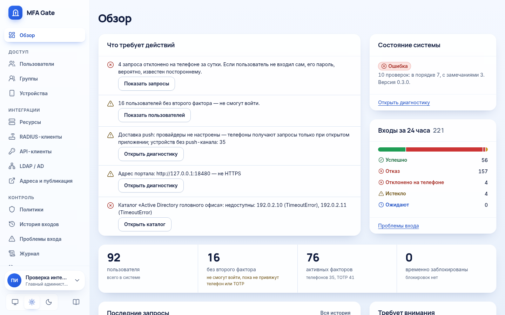

# MFA Gate

**MFA Gate — второй фактор для VPN и корпоративных сервисов, который работает на сервере вашей организации.** Сотрудник вводит в VPN-клиенте свой обычный доменный пароль и подтверждает вход на телефоне: одним касанием с отпечатком пальца или кодом из приложения-аутентификатора. Узнавший пароль посторонний не войдёт — у него нет телефона сотрудника.

Пароли, ключи, журналы входов и сведения о сотрудниках остаются на вашем сервере. Облачного посредника нет; наружу уходит только короткий сигнал телефону «есть новый запрос» — без логина, адреса и подробностей входа. Если вам нужен облачный сервис без своего сервера, MFA Gate не подойдёт; подробнее — [Когда продукт не подходит](Когда-продукт-не-подходит.md).



## С чего начать

Найдите себя в таблице: у каждой роли свой путь по статьям.

| Вы | Начните здесь | Что будете уметь |
| --- | --- | --- |
| Сотрудник | [Мой первый день с MFA Gate](Первый-день-с-MFA-Gate.md), затем [маршрут сотрудника](Маршрут-сотрудника.md) | подключить телефон или коды, входить в VPN, восстановить доступ |
| Администратор | [Маршрут администратора](Маршрут-администратора.md) | установить сервер, подключить каталог и VPN, вести сотрудников, обновлять и восстанавливать |
| Сетевой администратор | [Маршрут сетевого администратора](Маршрут-сетевого-администратора.md) | опубликовать адреса, открыть порты, настроить прокси и шлюз |
| Техническая поддержка | [Маршрут поддержки](Маршрут-поддержки.md) | принять обращение, найти причину отказа, помочь сотруднику |
| Специалист по безопасности | [Маршрут специалиста ИБ](Маршрут-специалиста-ИБ.md) | оценить модель угроз, хранение данных, журналы и ограничения |
| Разработчик, интегратор | [Маршрут интегратора](Маршрут-интегратора.md) | подключить своё приложение по REST API |

**Что-то не работает.** Раздел [Решение проблем](Решение-проблем.md) собирает неисправности по симптомам: что видно, почему, что сделать. Причину каждого отказа объясняет [справочник кодов](Справочник-коды-причин-отказа.md).

**Изучаете устройство.** [Архитектура](Архитектура.md) показывает компоненты, сетевые потоки, порты и последовательности входа.

## Сценарии от начала до конца

Практические курсы проводят через реальную задачу целиком:

1. [Внедрение с нуля](Сценарий-Внедрение-с-нуля.md) — от пустого сервера до первых сотрудников в VPN.
2. [Подключение VPN-шлюза](Сценарий-Подключение-VPN-шлюза.md) — от RADIUS-клиента до первого входа.
3. [Подключение отдела](Сценарий-Подключение-отдела.md) — запуск для группы сотрудников.
4. [Мой первый день с MFA Gate](Первый-день-с-MFA-Gate.md) — глазами сотрудника.
5. [Сотрудник потерял телефон](Сценарий-Сотрудник-потерял-телефон.md).
6. [Увольнение сотрудника](Сценарий-Увольнение-сотрудника.md).
7. [Переход на HTTPS и внешний адрес](Сценарий-Переход-на-HTTPS-и-внешний-адрес.md).
8. [Восстановление после сбоя](Сценарий-Восстановление-после-сбоя.md).

## Популярные вопросы

- [Как подключить телефон?](Как-подключить-телефон.md)
- [Не приходит запрос на телефон](Решение-проблем-телефона-и-push.md)
- [Что делать, если телефон потерян?](Если-телефон-потерян-или-заменён.md)
- [Пришёл запрос, а я не входил](Подозрительный-запрос-входа.md)
- [Почему VPN отказывает во входе?](Решение-проблем-входа-в-VPN.md)
- [Какие порты открыть?](Справочник-порты-и-сеть.md)

Ещё ответы — в [частых вопросах](Частые-вопросы.md).

## Что умеет система

Личный кабинет сотрудника с самостоятельным подключением второго фактора; подтверждение входа в приложении для Android с подписью ответа ключом телефона; коды TOTP в любом приложении-аутентификаторе; резервные коды; RADIUS для VPN-шлюзов, в том числе для шлюзов, которые сами проверяют пароль; Active Directory и LDAP; политики доступа; панель администратора с историей входов и журналом; REST API; установка, обновление и резервные копии одной командой. Полный перечень с ограничениями — [Возможности](Возможности.md).

## Как установить

На сервере с Ubuntu или Debian:

```bash
git clone https://github.com/calleograph/mfa-gate.git
cd mfa-gate
sudo ./install.sh
```

Установщик сам поставит Docker, создаст конфигурацию, запустит сервисы и покажет адрес панели и временный пароль первого администратора. Подробно — [Быстрая установка All-in-One](Быстрая-установка-All-in-One.md), требования — [Требования к серверу](Требования-к-серверу.md).

## Версии

- Сервер и приложение для Android — 0.3.3. Номер 0.X.Y означает, что продукт ещё не достиг версии 1.0.
- Приложение подписано постоянным ключом: следующие версии ставятся поверх с сохранением привязки.

Что проверено на настоящей инфраструктуре, а что ещё нет, — на странице [Что проверено](Что-проверено.md).
