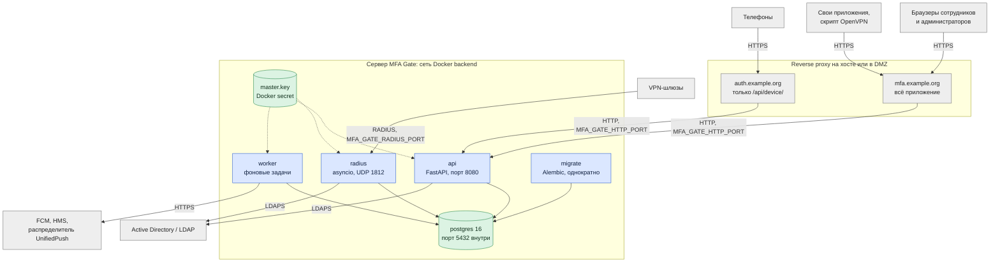
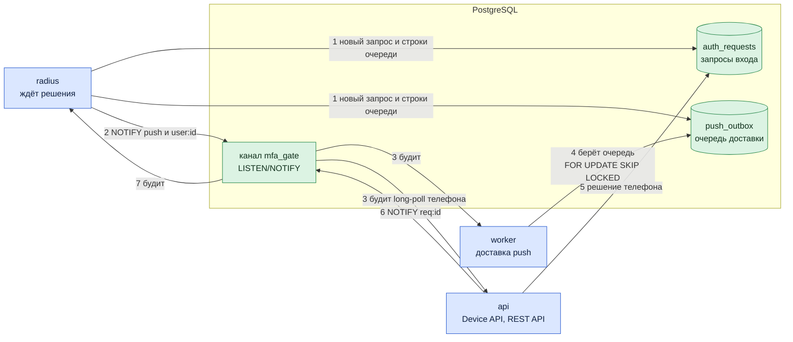

# Архитектура: компоненты и контейнеры

*Для кого: архитектор, администратор сервера, специалист по ИБ.*

Страница показывает, из каких контейнеров состоит MFA Gate, что делает каждый, как они связаны между собой и с внешним миром и какие ограничения наложены на них в `deploy/compose.yml`. Обзор системы: [Архитектура](Архитектура.md).

## Контейнеры и связи

Каталог опрашивают два контейнера: `radius` проверяет пароль при входе в VPN, `api` — при входе в кабинет, панель и в запросах REST API. `worker` к каталогу не обращается.

## Что делает каждый контейнер

| Контейнер | Команда | Что делает | Проверка здоровья |
|---|---|---|---|
| `postgres` | образ `postgres:16-alpine` | хранит все данные; передаёт события между процессами через `LISTEN/NOTIFY` | `pg_isready` каждые 5 с |
| `migrate` | `migrate` | применяет миграции схемы и завершается. Остальные контейнеры приложения стартуют только после его успешного завершения | — |
| `api` | `api` | кабинет `/`, панель `/admin/`, статика `/assets/`, REST API `/api/v1/`, Device API `/api/device/v1/`, описание API `/api/docs`, проверки `/health/live` и `/health/ready` | `/health/ready` каждые 10 с |
| `radius` | `radius` | принимает Access-Request, проверяет пароль, держит запрос до решения по push, отвечает Access-Accept, Access-Reject или Access-Challenge | файл пульса обновляется каждые 10 с; старше 45 с — контейнер нездоров |
| `worker` | `worker` | отправляет push, отмечает истёкшие запросы, удаляет старые записи по срокам хранения, чистит сессии и счётчики лимитов | файл пульса; старше 60 с — нездоров |

Почему `radius` и `api` разделены: у них разные порты, протоколы и профиль отказов. Перезапуск панели не должен обрывать входы в VPN, которые сейчас ждут ответа на телефоне. Дальше систему не дробят: при нагрузке второго фактора выигрыша нет, а эксплуатация усложнилась бы. Решение описано в [ADR 0002](https://github.com/calleograph/mfa-gate/blob/main/docs/adr/0002-containers.md).

## Как контейнеры общаются без брокера

Отдельного брокера сообщений нет. Всё идёт через PostgreSQL.

- **Ключи событий.** `push` будит `worker`, `user:<id>` будит long-poll телефонов этого пользователя, `req:<id>` будит того, кто ждёт решения: `radius`, REST API или страницу входа.
- **Событие не обгоняет данные.** PostgreSQL доставляет NOTIFY только после фиксации транзакции, поэтому разбуженный процесс уже видит новую запись.
- **Потеря события не теряет вход.** Ожидающие перечитывают базу не реже раза в 2 с. Если соединение `LISTEN` оборвалось, процесс переподключается, а ответ лишь задерживается на эти секунды.
- **Очередь push** — таблица `push_outbox`. `worker` забирает до 50 строк с блокировкой `SKIP LOCKED` и отправляет параллельно, с таймаутом 5 с на запрос. На устройство до 3 попыток. Строка, которая ждёт дольше 10 минут, помечается как неудачная.

## Ограничения контейнеров

Все контейнеры приложения (`api`, `radius`, `worker`, `migrate`) запускаются с одинаковыми ограничениями из `deploy/compose.yml`:

| Ограничение | Значение |
|---|---|
| Файловая система | только чтение (`read_only: true`); запись — во временный `tmpfs` `/tmp` |
| Возможности ядра | все сняты (`cap_drop: [ALL]`), `no-new-privileges` |
| Пользователь | непривилегированный `mfagate`, uid 10001 |
| Мастер-ключ | Docker secret `/run/secrets/master_key` из файла `data/secrets/master.key` |
| Сеть | одна внутренняя сеть проекта `backend` |
| Журналы | драйвер `json-file`, до 5 файлов по 10 МБ на контейнер |
| Перезапуск | `unless-stopped` |

Имена контейнеров, сетей и томов строит Compose из `COMPOSE_PROJECT_NAME`. Поэтому на одном хосте можно держать несколько экземпляров MFA Gate и чужие проекты. Порты хоста задаются только обязательными переменными: если переменная не заполнена, запуск остановится с ошибкой, а не займёт порт молча.

## Что опубликовано на хосте

| Контейнер | Публикация | Переменные | Рекомендация |
|---|---|---|---|
| `api` | `${MFA_GATE_HTTP_BIND}:${MFA_GATE_HTTP_PORT}` → 8080/tcp | `MFA_GATE_HTTP_BIND`, `MFA_GATE_HTTP_PORT` | за reverse proxy на том же хосте — `127.0.0.1` |
| `radius` | `${MFA_GATE_RADIUS_BIND}:${MFA_GATE_RADIUS_PORT}` → 1812/udp | `MFA_GATE_RADIUS_BIND`, `MFA_GATE_RADIUS_PORT` | адрес, который видят шлюзы; ограничить межсетевым экраном |
| `postgres` | не публикуется | — | — |

Порты, опубликованные Docker, обходят правила `ufw` и цепочки `INPUT`. Фильтровать их нужно в цепочке `DOCKER-USER`: [Сетевая схема и публикация](Сетевая-схема-и-публикация.md).

## Масштабирование

Для одной организации хватает одного экземпляра каждого контейнера. Если понадобится больше, `api` и `radius` можно запускать в нескольких копиях за балансировщиком. Ограничитель частоты входа уже общий: счётчик лежит в PostgreSQL. Распознавание повторов RADIUS держится в памяти копии `radius`, поэтому балансировщик должен отправлять повторы шлюза на ту же копию. Это расчётная схема, в нескольких копиях MFA Gate не испытывался.

Замер нагрузки: на тестовом окружении при 40 одновременных запросах RADIUS ошибок не было. Отказ по неверному паролю — около 30 запросов в секунду, медиана 1,2 с: время определяет хеш argon2id, это намеренная защита от перебора. Подтверждение push в том же прогоне — медиана 1,2 с. Статус: проверено в ограниченном сценарии, на одном тестовом сервере.

## Что дальше

- [Архитектура: последовательности входа](Архитектура-Последовательности-входа.md)
- [Архитектура: данные и шифрование](Архитектура-Данные-и-шифрование.md)
- [Справочник: порты и сеть](Справочник-порты-и-сеть.md)
