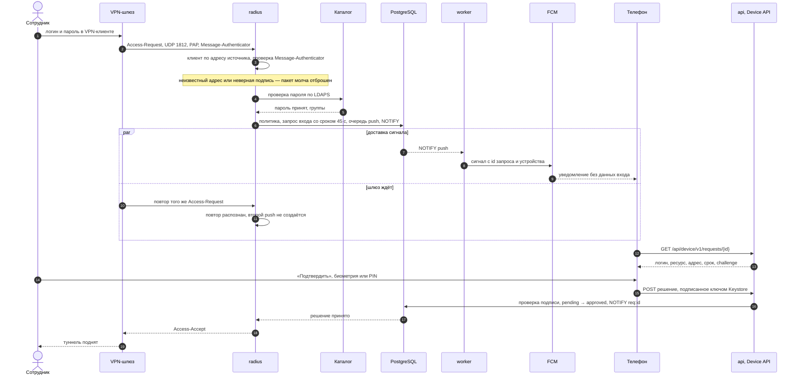
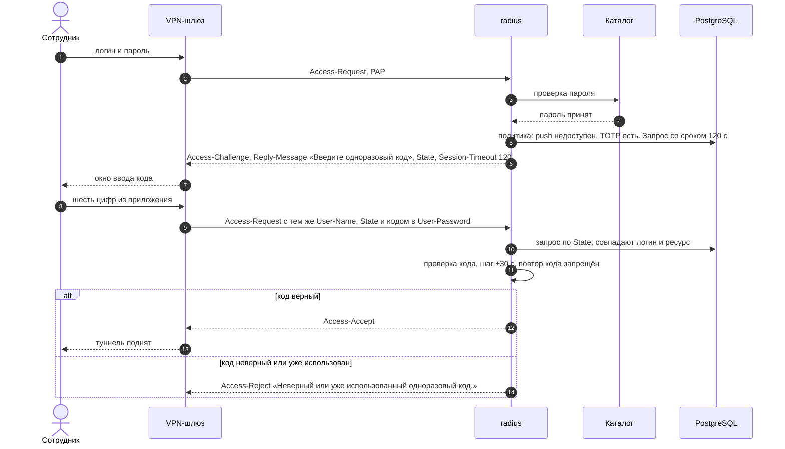
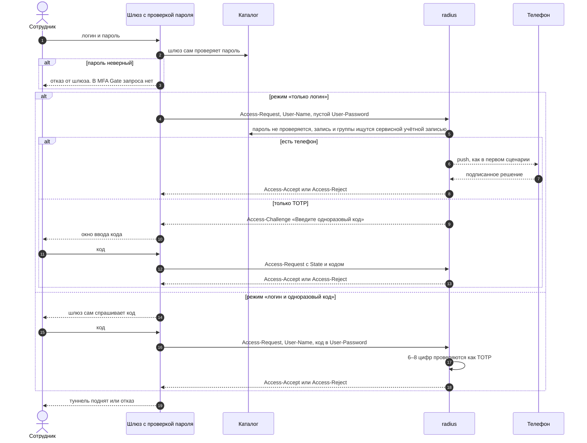
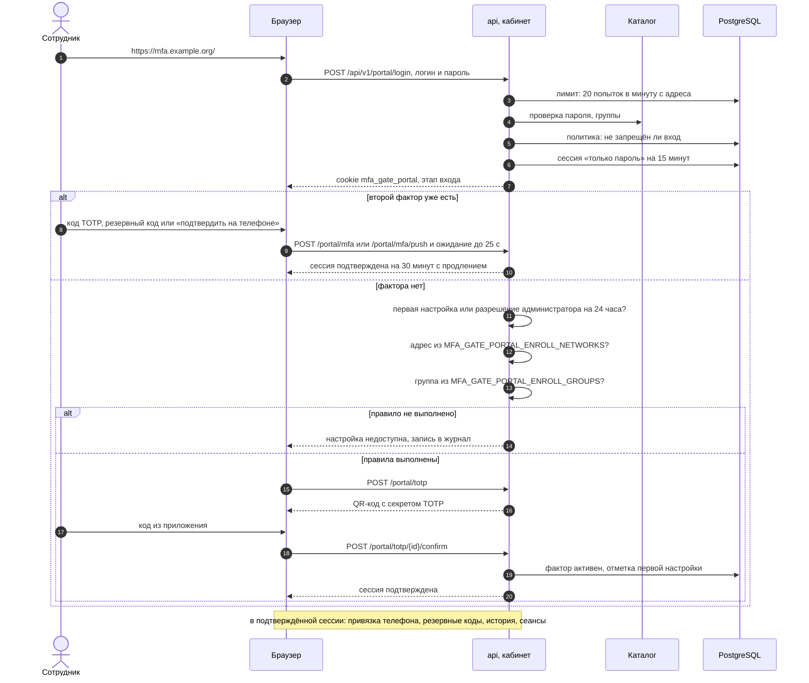
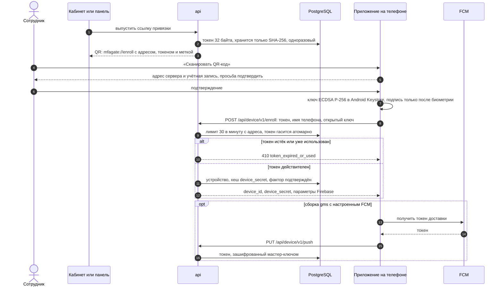
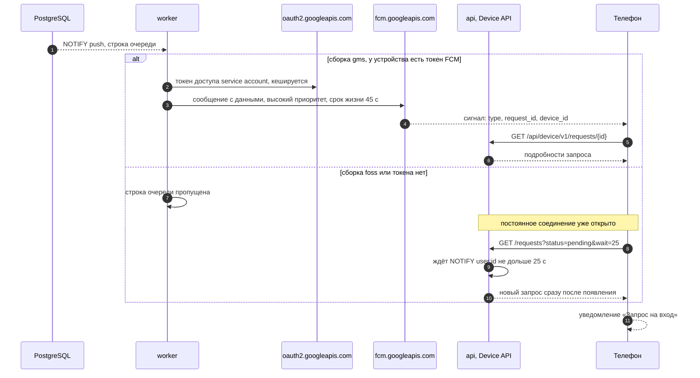

# Архитектура: последовательности входа

*Для кого: сетевой администратор, интегратор, инженер сопровождения, специалист по ИБ.*

Страница показывает по шагам, как проходит каждый вид входа: кто кого вызывает, что проверяется, где запрос ждёт и чем заканчивается. Схемы соответствуют коду `server/mfa_gate/radius/server.py`, `services/authflow.py`, `api/device.py`, `api/portal.py` и `worker.py`. Контейнеры описаны на странице [Архитектура: компоненты и контейнеры](Архитектура-Компоненты-и-контейнеры.md).

## Общий порядок проверки

Любой вход, откуда бы он ни пришёл, проходит один и тот же порядок:

1. **Ресурс.** Выключенный ресурс сразу даёт отказ `resource_disabled`.
2. **Блокировка.** После 8 ошибок пароля или кода подряд учётная запись блокируется на 15 минут. Отказы каталога (запись отключена или истекла, нет разрешённой группы) в счётчик не идут.
3. **Первый фактор.** Пароль проверяется у локальной учётной записи или в каталоге. Если пароль уже проверил шлюз или приложение, пароль не проверяется, а запись и группы доменного пользователя MFA Gate берёт из каталога сервисной учётной записью.
4. **Политика.** По ресурсу и группам выбирается действие: запретить, пропустить без второго фактора или потребовать второй фактор указанными способами.
5. **Второй фактор.** Если у пользователя есть активный телефон и политика разрешает push — push. Если телефона нет, но есть TOTP и политика его разрешает — запрос кода. Если нет ни того, ни другого — отказ `no_factor` или вход по одному паролю, если в политике выбрано **Пропустить по паролю**.

Наружу причины до второго фактора не различаются: неверный пароль, неизвестный логин, блокировка, отключённая учётная запись и отказ каталога дают один текст «Неверный логин или пароль, либо учётная запись временно заблокирована.». Точная причина видна только в **Истории входов**: [Справочник: коды причин отказа](Справочник-коды-причин-отказа.md).

## Вход в VPN: пароль и подтверждение на телефоне

Самый частый сценарий. Шлюз пересылает логин и пароль по RADIUS (PAP), MFA Gate проверяет пароль в каталоге и ждёт ответа на телефоне. RADIUS-клиент шлюза настроен с вариантом **MFA Gate** в поле **Кто проверяет доменный пароль**.

Что важно в этой схеме:

- **Шлюз ждёт ответа всё время, пока сотрудник отвечает.** MFA Gate держит Access-Request открытым до решения, но не дольше `MFA_GATE_PUSH_TIMEOUT` (по умолчанию 45 с). Поэтому таймаут RADIUS на шлюзе должен быть больше: не меньше 60 с. Если шлюз ждёт меньше, сотрудник подтверждает вход, а VPN-клиент уже показал ошибку.
- **Повторы шлюза безопасны.** Пакет с тем же адресом, портом, Identifier и Request Authenticator в течение 90 с не создаёт новую попытку: MFA Gate ждёт ту же обработку и отвечает тем же ответом. Если ответ потерялся в сети, повтор получает его ещё раз.
- **Новый запрос той же попытки присоединяется к открытому push.** Если шлюз прислал новый Access-Request того же пользователя к тому же ресурсу, пока push ещё ждёт ответа, второго уведомления не будет. Условие: совпадают Calling-Station-Id (адрес сотрудника), RADIUS-клиент и NAS. Без Calling-Station-Id присоединения нет, и каждый новый запрос даёт новый push.
- **Отказ на телефоне приходит сразу.** «Отклонить» переводит запрос в `denied`, шлюз получает Access-Reject с текстом «Пользователь отклонил запрос.».
- **Нет ответа — отказ.** По истечении срока запрос помечается `expired`, шлюз получает Access-Reject «Нет ответа на push в отведённое время.». Позднее подтверждение уже ничего не откроет: сервер принимает решение только у незавершённого и неистёкшего запроса.

## Вход в VPN: код из приложения-аутентификатора

Если у сотрудника нет привязанного телефона, но есть TOTP, а политика ресурса разрешает TOTP, MFA Gate просит код через Access-Challenge.

- **State** — 16 байт, идентификатор попытки. MFA Gate принимает ответ, только если логин и ресурс совпадают с исходным запросом.
- **Время на ввод кода** — `MFA_GATE_OTP_CHALLENGE_TIMEOUT`, 120 с. Позже ответ получит отказ «Время на ввод кода истекло».
- **Повтор кода.** Принятый код фиксируется номером шага: тот же код второй раз не пройдёт. Ошибки кода идут в тот же счётчик блокировки, что и ошибки пароля.
- **Кириллица.** Reply-Message передаётся в UTF-8. Проверьте, что ваш VPN-клиент показывает его без искажений.

Пароль и код в одной строке («пароль123456») по RADIUS не поддерживаются: [Планы развития](Планы-развития.md).

## Вход через шлюз, который сам проверяет пароль

Некоторые шлюзы сами проверяют доменный пароль, а у внешнего RADIUS-сервера спрашивают только второй фактор. Для такого шлюза в RADIUS-клиенте выбирают **Кто проверяет доменный пароль → Сам шлюз**. Подробности и настройка: [Шлюзы с собственной проверкой пароля](Шлюзы-с-собственной-проверкой-пароля.md).

Как MFA Gate читает поле пароля в этом режиме:

| `User-Password` | Что происходит |
|---|---|
| пусто | второй фактор: push или запрос кода |
| 6–8 цифр | проверяется как код TOTP |
| любое другое значение | не проверяется и ошибкой не считается; дальше как пустое |

Пароль в этом режиме до MFA Gate не доходит, поэтому запись сотрудника и его группы MFA Gate при каждом входе берёт из каталога сервисной учётной записью. Новый доменный сотрудник заводится сам. Отключённый в каталоге, удалённый из него или не входящий в разрешённые группы получает отказ `directory_denied`. Если каталог не отвечает — отказ `directory_unavailable`, как и при входе с паролем: MFA Gate не пускает по записи, которую не смог проверить. Если у каталога нет сервисной учётной записи, поиск без пароля невозможен, и решение принимается по сохранённой записи; сотрудник, которого ещё нет в MFA Gate, тогда получит `directory_unavailable`. Локальных пользователей это не касается.

## Вход в личный кабинет и первичная настройка

Сотрудник входит в кабинет доменным паролем. Если второй фактор уже есть, кабинет просит его. Если нет — предлагает настроить, но только при соблюдении правил первичной настройки.

- По умолчанию первичная настройка разрешена из частных сетей RFC 1918 и `fc00::/7`, для всех групп. Сузьте список сетей до офисных: [Первичная настройка сотрудниками](Первичная-настройка-сотрудниками.md).
- После первой настройки повторная настройка по одному паролю закрыта. Открыть её на 24 часа может администратор кнопкой **Разрешить повторную настройку** в карточке сотрудника.
- Добавлять и удалять способы входа можно только в сессии, подтверждённой вторым фактором. Последний способ удалить нельзя.
- Резервные коды действуют только для входа в кабинет, не для VPN.

Вход в панель `/admin/` устроен так же, но второй фактор там обязателен всегда, для любой роли и независимо от политик. Сессия до второго фактора живёт 10 минут и не даёт доступа к данным.

## Привязка телефона по QR-коду

QR-код выпускает администратор в карточке сотрудника (срок 24 часа) или сам сотрудник в кабинете (срок 15 минут). В QR лежит внешний адрес Device API — `MFA_GATE_DEVICE_URL`.

- **`device_secret`** нужен для служебных запросов: список запросов, обновление токена. Подтвердить вход он не позволяет — для этого нужна подпись ключом из Keystore.
- **Подтверждение фактора** гасит все неиспользованные ссылки привязки, которые сотрудник выпустил сам. Параллельно полученный QR второй телефон уже не добавит.
- **Смена `MFA_GATE_DEVICE_URL`** требует перепривязки телефонов: адрес сервера телефон берёт из QR.

## Доставка запроса на телефон

Есть два пути. Сборка приложения `gms` получает сигнал через Firebase Cloud Messaging. Сборка `foss` работает без сервисов Google и сама держит соединение с сервером.

- **Через Google проходят только идентификаторы** запроса и устройства и номер версии сигнала. Логина, ресурса и адреса в сигнале нет.
- **Отправка повторяется** до 3 раз на устройство. Если FCM сообщил, что токен недействителен, токен сбрасывается, и телефон дальше получает запросы своим соединением.
- **Постоянное соединение `foss`** работает как служба переднего плана с уведомлением «Ожидание запросов входа». Запасной путь — проверка раз в 15 минут через WorkManager: для входа в VPN этого мало. Работу службы на реальных телефонах ещё не проверяли.
- **Для сети это одно и то же:** исходящий HTTPS 443 с телефона на внешний адрес. Запрос висит до 30 с, поэтому таймаут чтения reverse proxy должен быть не меньше 40 с.

Настройка доставки: [Настройка Push](Настройка-Push.md). Поведение приложения: [Приложение MFA Gate Authenticator](Приложение-MFA-Gate-Authenticator.md).

## Что дальше

- [Архитектура: данные и шифрование](Архитектура-Данные-и-шифрование.md)
- [Подключение VPN](Подключение-VPN.md)
- [Интеграция по REST API](Интеграция-по-REST-API.md)
- [Решение проблем входа в VPN](Решение-проблем-входа-в-VPN.md)
