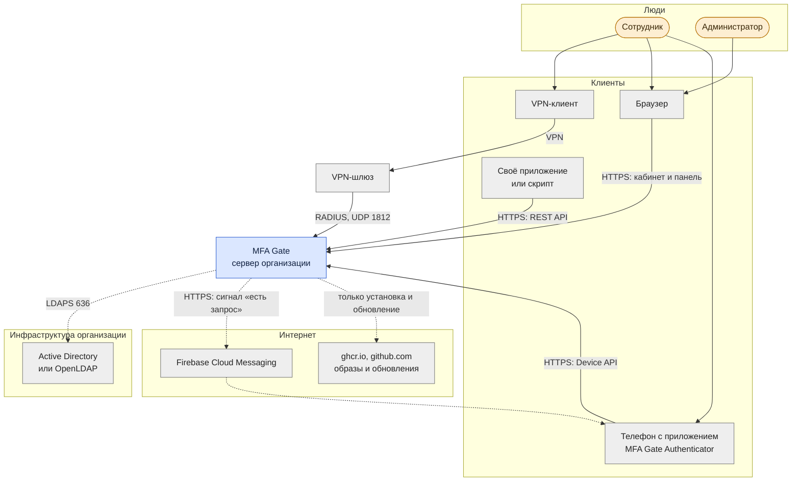

# Архитектура

*Для кого: архитектор, сетевой администратор, специалист по ИБ, инженер сопровождения.*

Страница коротко описывает, как устроен MFA Gate, и ведёт к подробным разделам технической базы. Прочитав её, вы будете знать, из каких частей состоит система, где она стоит в сети организации и на какой странице искать подробности.

## Что делает MFA Gate

MFA Gate добавляет второй фактор к входу в VPN и в приложения организации. Первый фактор — доменный пароль, его проверяет MFA Gate в Active Directory или сам VPN-шлюз. Второй фактор — подтверждение на телефоне сотрудника (push) или одноразовый код из приложения-аутентификатора (TOTP).

MFA Gate не строит VPN-туннель и не пропускает через себя трафик сотрудника. Он отвечает шлюзу «пустить» или «не пускать». Шифрование трафика остаётся задачей протокола VPN.

## Система целиком

Пунктиром показаны необязательные и редкие связи: каталог подключают в панели, FCM — файлом учётных данных Firebase, к GitHub сервер обращается только при установке и обновлении. Без FCM телефон сам держит соединение с сервером, подробнее в разделе [Архитектура: последовательности входа](Архитектура-Последовательности-входа.md).

## Из чего состоит сервер

Сервер — пять контейнеров Docker Compose на одном хосте. Четыре из них запускаются из одного образа `ghcr.io/calleograph/mfa-gate` с разной командой.

| Контейнер | Роль | Порт на хосте |
|---|---|---|
| `api` | личный кабинет `/`, панель `/admin/`, REST API `/api/v1/`, Device API `/api/device/v1/`, проверки `/health/` | TCP `MFA_GATE_HTTP_PORT`, по умолчанию 8080 |
| `radius` | RADIUS-сервер для VPN-шлюзов | UDP `MFA_GATE_RADIUS_PORT`, по умолчанию 1812 |
| `worker` | доставка push, истечение запросов, очистка по срокам хранения | нет |
| `migrate` | применяет миграции базы и завершается | нет |
| `postgres` | PostgreSQL 16, все данные | не публикуется |

Redis и брокер сообщений не нужны. Процессы обмениваются событиями через PostgreSQL (`LISTEN/NOTIFY`), очередь push — обычная таблица. Подробно: [Архитектура: компоненты и контейнеры](Архитектура-Компоненты-и-контейнеры.md).

## Два адреса

У MFA Gate два HTTP-адреса на одном reverse proxy:

| Пример | Переменная | Что публикуется | Откуда доступно |
|---|---|---|---|
| `mfa.example.org` | `MFA_GATE_PUBLIC_URL` | всё приложение: кабинет, панель, REST API | внутренняя сеть и пул адресов VPN |
| `auth.example.org` | `MFA_GATE_DEVICE_URL` | только `/api/device/` | интернет |

Внешний адрес нужен телефонам. Сотрудник дома подтверждает вход в VPN, пока VPN ещё не подключён, и телефон в мобильной сети должен достучаться до сервера. Кабинет, панель и REST API наружу не публикуются. Подробно: [Сетевая схема и публикация](Сетевая-схема-и-публикация.md).

## Главные решения

- **Один сценарий входа для всех каналов.** RADIUS, REST API, кабинет и панель вызывают один и тот же код: блокировка, первый фактор, политика, второй фактор. Причины отказа одинаковы во всех каналах: [Справочник: коды причин отказа](Справочник-коды-причин-отказа.md).
- **RADIUS держит запрос открытым.** Пока сотрудник отвечает на телефоне, шлюз ждёт ответа на свой Access-Request. Отсюда главное сетевое требование: таймаут RADIUS на шлюзе не меньше 60 с.
- **Push — только сигнал.** Через сервис доставки (FCM) проходят только идентификаторы запроса и устройства. Логин, ресурс и адрес телефон забирает с сервера сам, по HTTPS.
- **Решение подписывает телефон.** Ключ ECDSA P-256 создаётся в Android Keystore и не покидает телефон. Каждая подпись требует биометрии или PIN.
- **Секреты зашифрованы мастер-ключом.** Ключ лежит в файле на хосте и не входит в резервную копию. Подробно: [Архитектура: данные и шифрование](Архитектура-Данные-и-шифрование.md).
- **Отказ по умолчанию.** Каталог недоступен, телефон не ответил, база недоступна — вход запрещён. Пропустить без второго фактора можно только явной политикой, и каждое такое решение пишется в журнал.

## Что проверено

Протокол RADIUS, push с подписанным подтверждением, TOTP через Access-Challenge и REST API покрыты сквозными тестами на изолированном Docker-окружении. Установка, обновление и откат проверены на чистом Ubuntu Server, вход в кабинет — с настоящим каталогом OpenLDAP.

Не проверены на настоящей инфраструктуре: реальные VPN-шлюзы, Active Directory (проверено на OpenLDAP), приложение на реальных телефонах, доставка через Firebase. Подробно: [Что проверено](Что-проверено.md).

## Путеводитель по технической базе

| Вопрос | Страница |
|---|---|
| Какие контейнеры, кто с кем говорит, что внутри сети Docker | [Архитектура: компоненты и контейнеры](Архитектура-Компоненты-и-контейнеры.md) |
| Как идёт вход по шагам: RADIUS с push, код TOTP, режим «Сам шлюз», кабинет, привязка телефона, доставка push | [Архитектура: последовательности входа](Архитектура-Последовательности-входа.md) |
| Что хранится, чем зашифровано, сколько хранится, что уходит наружу | [Архитектура: данные и шифрование](Архитектура-Данные-и-шифрование.md) |
| Что публиковать, какие правила межсетевого экрана | [Сетевая схема и публикация](Сетевая-схема-и-публикация.md) |
| Все порты одной таблицей | [Справочник: порты и сеть](Справочник-порты-и-сеть.md) |
| Угрозы и меры защиты | [Безопасность и модель угроз](Безопасность-и-модель-угроз.md) |

Архитектурные решения с обоснованиями лежат в репозитории: [docs/adr](https://github.com/calleograph/mfa-gate/tree/main/docs/adr).

## Что дальше

- [Архитектура: компоненты и контейнеры](Архитектура-Компоненты-и-контейнеры.md)
- [Архитектура: последовательности входа](Архитектура-Последовательности-входа.md)
- [Сетевая схема и публикация](Сетевая-схема-и-публикация.md)
- [Требования к серверу](Требования-к-серверу.md)
