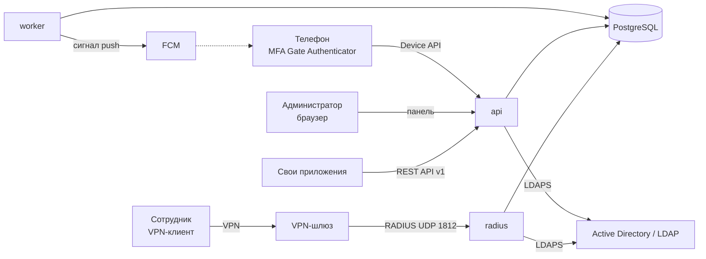

# Архитектура

## Схема

Все компоненты справа от шлюза работают на одном сервере в Docker Compose (установка All-in-One).

## Компоненты

| Сервис | Что делает | Слушает на хосте |
|---|---|---|
| `api` | веб-панель, REST API `/api/v1`, Device API для телефонов `/api/device/v1`, проверки `/health/live` и `/health/ready` | TCP `MFA_GATE_HTTP_PORT` (по умолчанию 8080) |
| `radius` | RADIUS-сервер: принимает Access-Request от шлюзов | UDP `MFA_GATE_RADIUS_PORT` (по умолчанию 1812) |
| `worker` | отправка push, истечение запросов, очистка истории по срокам хранения | — |
| `migrate` | применяет миграции базы и завершается; остальные сервисы стартуют после него | — |
| `postgres` | PostgreSQL 16, все данные | наружу не публикуется |

`api`, `radius`, `worker` и `migrate` собраны из одного образа `ghcr.io/calleograph/mfa-gate`. Контейнеры работают с файловой системой только для чтения, без привилегий, от непривилегированного пользователя (uid 10001).

## Как проходит вход по VPN

1. Сотрудник вводит логин и пароль в VPN-клиенте. Шлюз отправляет Access-Request в `radius`.
2. `radius` проверяет, что пакет пришёл от зарегистрированного RADIUS-клиента и подписан верным секретом (Message-Authenticator). Чужие пакеты молча отбрасываются.
3. Первый фактор: пароль проверяется локально или в каталоге LDAP/AD.
4. Политика: по ресурсу и группам решается, нужен ли второй фактор и какой.
5. Второй фактор:
   - **push** — `worker` отправляет на телефон пустой сигнал «есть запрос». Телефон сам забирает подробности по Device API, сотрудник подтверждает биометрией, телефон отправляет подписанное решение. `radius` всё это время держит Access-Request открытым (до `MFA_GATE_PUSH_TIMEOUT`, по умолчанию 45 с);
   - **TOTP** — `radius` отвечает Access-Challenge «Введите одноразовый код», шлюз показывает окно ввода и присылает код вторым запросом.
6. `radius` отвечает Access-Accept или Access-Reject. Каждая попытка пишется в историю входов с причиной.

Подробный порядок и коды причин: [docs/admin-guide.md](https://github.com/calleograph/mfa-gate/blob/main/docs/admin-guide.md#как-проходит-вход).

## Где хранятся данные

Всё лежит внутри каталога установки (по умолчанию `/opt/mfa-gate/deploy`):

| Путь | Что | Что делать |
|---|---|---|
| `deploy/.env` | настройки экземпляра и пароль базы (права 600) | хранить копию отдельно |
| `deploy/data/postgres/` | файлы PostgreSQL | не трогать руками, копировать через `mfagatectl backup` |
| `deploy/data/secrets/master.key` | мастер-ключ: им зашифрованы секреты TOTP, RADIUS, LDAP и push-токены | **сохранить копию вне сервера** |
| `deploy/backups/` | резервные копии и архивы диагностики | регулярно переносить на другой носитель |
| `deploy/compose.override.yml` | локальные дополнения (файл FCM и т. п.), создаётся вручную | хранить копию отдельно |
| `/var/log/mfa-gate/install-*.log` | журналы установщика | приложить при обращении за помощью |

## Безопасность в двух словах

- Push-сигнал не содержит логина, ресурса и IP: через Google проходит только идентификатор запроса.
- Решение на телефоне подписывается ключом ECDSA P-256 из Android Keystore, ключ не покидает телефон.
- Секреты в базе зашифрованы мастер-ключом, пароли хранятся как argon2id, ключи API — как SHA-256.
- Вход в панель всегда требует второго фактора, для любой роли.
- Резервная копия не содержит мастер-ключа: копия без ключа бесполезна.

Модель угроз: [docs/threat-model.md](https://github.com/calleograph/mfa-gate/blob/main/docs/threat-model.md). Архитектурные решения: [docs/adr/](https://github.com/calleograph/mfa-gate/tree/main/docs/adr).

Дальше: [Требования к серверу](Требования-к-серверу.md).
