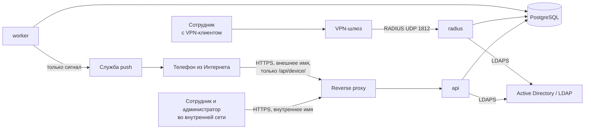

# Безопасность и модель угроз

*Для кого: служба информационной безопасности, архитектор, администратор, руководитель, который согласует внедрение.*

Здесь объяснено, от чего защищает MFA Gate, кому и чему система доверяет, какие меры против каких атак приняты и какой риск остаётся. Точные факты для проверки (что где хранится, какие соединения уходят наружу, какие сроки и пределы) собраны в [Справочнике для проверки ИБ](Справочник-для-проверки-ИБ.md). Полная модель угроз с указанием тестов лежит в репозитории: [docs/threat-model.md](https://github.com/calleograph/mfa-gate/blob/main/docs/threat-model.md).

## Что защищает MFA Gate

Главная задача — чтобы украденного пароля было недостаточно для входа в VPN и другие ресурсы. Для этого после пароля MFA Gate требует второе подтверждение: нажатие на телефоне, защищённое биометрией, или одноразовый код. Всё работает на сервере организации: данные о входах не уходят в облако, а службы доставки push получают только сигнал «есть запрос» без подробностей.

MFA Gate не заменяет защиту самого VPN-шлюза, каталога и сервера. Он не защищает от злоумышленника с правами root на сервере MFA Gate и от того, кто держит в руках разблокированный телефон сотрудника.

## Участники и границы доверия

| Граница | Чему система доверяет | Чему не доверяет |
| --- | --- | --- |
| VPN-шлюз → `radius` | Пакетам с верным Message-Authenticator от зарегистрированного адреса. В режиме «Сам шлюз» — ещё и тому, что этот шлюз проверил пароль | Содержимому атрибутов: длины, State, Calling-Station-Id проверяются и используются только для сопоставления и отображения |
| Телефон → `api` | Подписи ключом из Android Keystore (решение) и секрету устройства (чтение своих запросов) | Каналу push и часам телефона |
| `api`, `radius` → каталог | Ответу каталога по проверенному TLS | Каталогу без TLS: диагностика предупреждает |
| Служба push | Ничему: в уведомлении нет данных входа | — |
| Администратор → панель | Сессии после второго фактора и токена CSRF | Сессии до второго фактора и сессии личного кабинета |
| Сотрудник → личный кабинет | Сессии после второго фактора | Сессии после одного пароля (только ввод второго фактора и первая настройка по правилам); адресу клиента как доказательству личности |
| Интернет → reverse proxy | Запросам к `/api/device/` на внешнем имени | Всем остальным путям и именам: `404` в прокси и в самом сервере |

## Основные угрозы и меры

### Украденный пароль

| Угроза | Мера | Что остаётся |
| --- | --- | --- |
| Вход по украденному паролю | Второй фактор обязателен, если политика явно не разрешает иное. Без способа входа сотрудник не войдёт | Политика с действием **Пропустить без MFA** или вариантом **Пропустить по паролю** пропускает без второго фактора — это явное исключение, каждый такой вход пишется в журнал |
| Подбор пароля через RADIUS, API, панель | Блокировка на 15 минут после 8 ошибок подряд, общая для `user`, `DOMAIN\user` и UPN; в панели и личном кабинете — не больше 20 попыток входа в минуту с адреса; медленный argon2id | Счётчик блокировки ведётся только по пользователю: перебором можно временно заблокировать чужую учётную запись |
| Перечисление логинов | Один и тот же ответ для неверного пароля, неизвестного логина, блокировки и отключения | — |
| Привязка своего телефона к чужой учётной записи в кабинете | Первая настройка по одному паролю возможна, только если способа входа никогда не было или администратор выдал разрешение на 24 часа, и только из сетей регистрации и для разрешённых групп; новые способы — только после второго фактора | Сотрудник, ещё не настроивший способ входа, уязвим в разрешённой сети. Снижается ранней рассылкой и узкими сетями |

### Подделка подтверждения

| Угроза | Мера | Что остаётся |
| --- | --- | --- |
| Подтверждение чужого запроса | Запрос виден и подтверждается только устройством его владельца; идентификатор устройства входит в подпись | — |
| Подмена решения «отклонить» на «подтвердить» | Решение входит в подписываемую строку | — |
| Повтор подтверждения, гонка двух ответов | Одноразовый challenge и атомарная смена статуса; повтор — `409` | — |
| Позднее подтверждение после таймаута | Истёкший запрос фиксируется как `expired`, решение принимается только до срока | — |
| Кража секрета устройства | Даёт только чтение своих запросов; подтверждение требует ключа Keystore и биометрии | — |
| Кража телефона | Биометрия или PIN-код на каждое подтверждение; отзыв устройства | Злоумышленник с разблокированным телефоном и паролем войдёт |
| «Усталость от push»: поток запросов в надежде на случайное нажатие | Push только после верного пароля; один push на попытку; блокировка; срок ответа; кнопка **Отклонить** и журнал | Нет подтверждения вводом числа и предела push на пользователя. Злоумышленник с паролем жертвы за тем же NAT в те же секунды может «пристроиться» к её попытке |

### RADIUS

| Угроза | Мера | Что остаётся |
| --- | --- | --- |
| Подделка ответа RADIUS (BlastRADIUS) | Message-Authenticator обязателен во входящих пакетах и стоит первым в ответах | — |
| Неизвестный шлюз | Пакет молча отбрасывается | — |
| Повторы шлюза создают несколько push | Распознавание повторов по RFC 5080, присоединение к открытой попытке при полном совпадении | — |
| Подмена State в запросе кода | State — идентификатор запроса; проверяются логин, ресурс и статус | — |
| Поддельный шлюз в режиме «Сам шлюз» | Режим задаётся только у конкретного клиента; клиент определяется по адресу; свой длинный секрет; UDP 1812 открыт только адресам шлюзов | Взлом самого шлюза: тот, кто управляет шлюзом, получает push или проверку кода без пароля |
| Перехват трафика между площадками | — | RADIUS шифрует только пароль. Между площадками его нужно пускать через IPsec или WireGuard; RadSec не реализован |

### Сервер и панель

| Угроза | Мера | Что остаётся |
| --- | --- | --- |
| Доступ к панели и кабинету из Интернета | Наружу публикуется только Device API; сервер сам отвечает `404` на остальное по внешнему имени | Внутреннее имя закрывается только правилами прокси |
| Захват учётной записи администратора оператором или ключом API | Учётные записи администраторов, их пароли и факторы меняет только главный администратор; ключ API не получает права на администраторов | — |
| Повышение прав | Права проверяются сервером на каждом запросе; последнего главного администратора нельзя лишить прав | — |
| CSRF и XSS в панели | `SameSite=Strict`, токен CSRF, строгая CSP без встроенных скриптов, данные выводятся только как текст | — |
| Утечка базы | Секреты зашифрованы мастер-ключом, пароли — argon2id, токены — SHA-256, резервные коды — HMAC-SHA256 на ключе, производном от мастер-ключа | Учётные записи, история входов и журнал не шифруются |
| Утечка резервной копии | Мастер-ключ в копию не входит | Если ключ хранится рядом с копией, защита теряется |
| Утечка секретов в журналы | Маскирование полей с признаками секрета; архив диагностики проверяется на значения секретов | — |
| SSRF через адрес UnifiedPush | Только `https://` и только хосты из списка | — |
| Злоумышленник с root на сервере | — | Вне модели: такой доступ даёт всё. Ограничивайте доступ к серверу как к роли главного администратора |

## Политика отказа

MFA Gate по умолчанию отказывает, если не может убедиться в личности:

| Сбой | Поведение |
| --- | --- |
| Каталог недоступен | Отказ |
| Не удалось вычислить вложенные группы AD | Отказ, без отката к прямым группам |
| Нет способа входа, push не доставлен, нет ответа | Отказ |
| База данных недоступна | RADIUS молчит или отказывает, `api` отвечает `503`; после возврата базы работа продолжается сама |
| Нужен вход без второго фактора | Только явной политикой для указанных ресурсов и групп; каждый такой вход пишется в журнал. На вход администраторов в панель политики не действуют |
| Администратор потерял второй фактор | Одноразовый аварийный код из консоли сервера, 15 минут, событие «Критичное» |

## Архитектурные решения

Причины ключевых решений записаны в репозитории ([docs/adr](https://github.com/calleograph/mfa-gate/tree/main/docs/adr)):

| Решение | О чём |
| --- | --- |
| [0003](https://github.com/calleograph/mfa-gate/blob/main/docs/adr/0003-push-protocol.md) | Подпись решения ключом ECDSA P-256 из Android Keystore |
| [0004](https://github.com/calleograph/mfa-gate/blob/main/docs/adr/0004-push-delivery.md) | Push — только сигнал, данные телефон забирает сам |
| [0005](https://github.com/calleograph/mfa-gate/blob/main/docs/adr/0005-secrets.md) | Мастер-ключ, AES-256-GCM с привязкой к записи, argon2id, SHA-256 |
| [0006](https://github.com/calleograph/mfa-gate/blob/main/docs/adr/0006-radius.md) | Собственный RADIUS-сервер, обязательный Message-Authenticator |
| [0009](https://github.com/calleograph/mfa-gate/blob/main/docs/adr/0009-policies.md) | Политики: первое совпадение, иначе второй фактор; отказ по умолчанию |
| [0015](https://github.com/calleograph/mfa-gate/blob/main/docs/adr/0015-external-device-api.md) | Наружу — только Device API, защита по имени хоста |
| [0016](https://github.com/calleograph/mfa-gate/blob/main/docs/adr/0016-first-factor-per-radius-client.md) | Режим «Сам шлюз» только у конкретного RADIUS-клиента |
| [0017](https://github.com/calleograph/mfa-gate/blob/main/docs/adr/0017-self-enrollment-and-recovery.md) | Самостоятельная настройка и восстановление |

## Как сообщить об уязвимости

Не открывайте публичную задачу. Сообщите закрыто через GitHub: вкладка **Security → Report a vulnerability** в репозитории `calleograph/mfa-gate`. Получение подтверждают в течение 7 дней, срок раскрытия согласуют, обычно не позже 90 дней. Исправления безопасности выходят только для последнего выпуска 0.x. Правила — [SECURITY.md](https://github.com/calleograph/mfa-gate/blob/main/SECURITY.md).

## Что дальше

- [Справочник для проверки ИБ](Справочник-для-проверки-ИБ.md)
- [Архитектура: последовательности входа](Архитектура-Последовательности-входа.md)
- [Что проверено](Что-проверено.md)
- [Маршрут специалиста ИБ](Маршрут-специалиста-ИБ.md)
