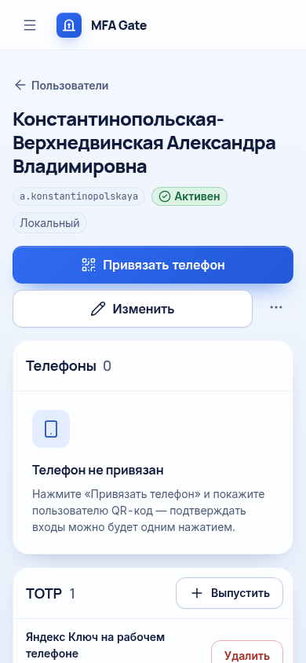

# Возможности

*Для кого: тот, кто оценивает продукт, и администратор, который планирует внедрение.*

На этой странице перечислены функции MFA Gate и их ограничения. Ограничение указано рядом с функцией, которой оно касается. Чего в продукте нет, собрано в конце страницы.

## Личный кабинет сотрудника

- **Вход рабочей учётной записью.** Логин принимается в любом привычном виде: `ivanov`, `DOMAIN\ivanov` или `ivanov@example.org`. После пароля нужен второй фактор: подтверждение на телефоне, код из приложения или резервный код: [Личный кабинет сотрудника](Личный-кабинет-сотрудника.md).
- **Самостоятельная первая настройка.** Сотрудник сам подключает приложение с кодами или телефон с MFA Gate, без заявки в поддержку. По одному паролю это возможно, только если у сотрудника ещё никогда не было второго фактора, только из сети компании и только для разрешённых групп. Так человек, укравший пароль, не привяжет свой телефон к чужой учётной записи: [Первичная настройка сотрудниками](Первичная-настройка-сотрудниками.md).
- **Несколько способов входа.** Можно подключить и телефон, и приложение с кодами, и несколько телефонов. Новый способ добавляется только после входа со вторым фактором. Последний способ удалить нельзя.
- **Резервные коды.** Десять одноразовых кодов, показываются один раз. Действуют только для входа в личный кабинет, для VPN — нет: [Резервные коды](Резервные-коды.md).
- **История входов** — последние 50 попыток с результатом и причиной отказа. **Сеансы личного кабинета** — список открытых сеансов, чужой можно завершить.
- **Восстановление при потере телефона.** С резервным кодом сотрудник справляется сам. Без кодов администратор разрешает повторную настройку на 24 часа: [Если телефон потерян или заменён](Если-телефон-потерян-или-заменён.md).
- Светлая и тёмная темы, работа с экрана телефона.

## Подтверждение на телефоне

- **Приложение MFA Gate Authenticator для Android 8.0 и новее.** Запрос показывает учётную запись, ресурс, адрес, с которого входят, и время. Подтверждение и отклонение требуют отпечатка пальца или PIN; на Android 8–10 — только отпечатка: [Приложение MFA Gate Authenticator](Приложение-MFA-Gate-Authenticator.md).
- **Подпись решения.** Ответ телефона подписан ключом, который хранится в защищённом хранилище телефона и не покидает его. Сервер принимает только подписанный ответ привязанного телефона. Запрос, на который не ответили в срок, закрывается, и позднее подтверждение ничего не открывает.
- **Две сборки приложения.** `gms` получает уведомления через Firebase Cloud Messaging. `foss` обходится без сервисов Google: приложение держит собственное соединение с сервером: [Настройка Push](Настройка-Push.md).
- **Срок ответа** по умолчанию 45 с. Повторные пакеты от VPN-шлюза не создают второй запрос на телефон.
- Ограничения: приложение пока не проверялось на реальных телефонах, доставка через Firebase не проверялась на настоящем проекте Firebase. Подтверждения вводом числа с экрана компьютера нет: запрос подтверждается нажатием.

## Одноразовые коды

- **Коды TOTP** — шесть цифр, которые меняются каждые 30 с. Подходит любое приложение-аутентификатор, в том числе на iPhone, и вкладка **Коды** в MFA Gate Authenticator: [Как подключить приложение с кодами](Как-подключить-приложение-с-кодами.md), [Настройка TOTP](Настройка-TOTP.md).
- Коды работают без интернета на телефоне. Нужно только точное время.
- Один и тот же код дважды не принимается.
- Ограничение: если у сотрудника привязан телефон с MFA Gate, при обычном входе в VPN всегда приходит запрос на телефон. Код спрашивается, когда телефона нет, когда политика ресурса разрешает только коды или когда VPN-клиент сам просит код в отдельном поле.

## VPN и внутренние приложения

- **RADIUS-сервер** для VPN-шлюзов с проверкой пароля по PAP. Атрибут Message-Authenticator по умолчанию обязателен — это защита от атаки BlastRADIUS: [Настройка RADIUS](Настройка-RADIUS.md).
- **Запрос кода через шлюз.** Если подтверждение на телефоне недоступно, MFA Gate просит шлюз показать сотруднику поле для кода. Это работает, только если шлюз поддерживает такой дополнительный запрос.
- **Режим «пароль проверяет шлюз».** Шлюз сам проверяет доменный пароль, а MFA Gate спрашивает только второй фактор: [Шлюзы с собственной проверкой пароля](Шлюзы-с-собственной-проверкой-пароля.md).
- **OpenVPN** — через готовый скрипт и REST API: [Подключение OpenVPN](Подключение-OpenVPN.md).
- **Профили распространённых шлюзов:** [Подключение VPN](Подключение-VPN.md). Профили составлены по документации производителей; на настоящих шлюзах их ещё не проверяли.
- **REST API** для собственных приложений: запрос входа с подтверждением на телефоне или кодом, описание в формате OpenAPI, ключи с правами и ограничением по адресам: [Интеграция по REST API](Интеграция-по-REST-API.md), [Ключи API](Ключи-API.md).

## Каталог пользователей

- **Active Directory и другие LDAP-каталоги.** Несколько контроллеров, шифрование LDAPS или StartTLS, вложенные группы, пошаговая диагностика подключения с расшифровкой ошибок: [Подключение Active Directory](Подключение-Active-Directory.md).
- Несколько каталогов с порядком проверки.
- Если каталог недоступен, вход запрещается, а не пропускается.
- **Локальные учётные записи** заводятся в панели, если каталога нет.
- Ограничение: работа с каталогом проверена на OpenLDAP, на настоящем Active Directory — нет.

## Политики доступа

- Для каждого ресурса и группы можно выбрать действие: **Второй фактор**, **Без MFA** (в таблице политик — **Пропустить без MFA**) или **Запретить**, а для второго фактора — разрешённые способы: подтверждение на телефоне, коды или оба: [Политики доступа](Политики-доступа.md).
- Без политик второй фактор обязателен для всех, разрешены оба способа.
- На время раздачи телефонов политика может временно пропускать по паролю тех, у кого фактора ещё нет. Каждый такой вход попадает в журнал с пометкой.

## Панель администратора

- Разделы: **Обзор**; **Доступ** — **Пользователи**, **Группы**, **Устройства**, **Политики**; **Интеграции** — **Ресурсы**, **RADIUS-клиенты**, **API-клиенты**, **LDAP / AD**; **Контроль** — **История входов** (с видом **Проблемы входа**), **Журнал**; **Система** — **Адреса и публикация**, **Диагностика**: [Руководство администратора](Руководство-администратора.md).
- **Карточка сотрудника:** привязать телефон, выпустить код, отозвать устройство, снять блокировку, отключить учётную запись, сбросить резервные коды, разрешить повторную настройку: [Управление пользователями](Управление-пользователями.md).
- **Роли:** главный администратор, администратор, оператор, аудитор: [Роли администраторов](Роли-администраторов.md).
- **Адреса и публикация** — экран для сетевого администратора: какие адреса и порты открыть и готовые фрагменты конфигурации nginx и Caddy: [Адреса и публикация](Адреса-и-публикация.md).
- Вход в панель всегда со вторым фактором. Светлая и тёмная темы, работа с телефона.

## Журналы

- **История входов** — каждая попытка: кто, куда, откуда, каким способом, результат и причина отказа. Вид **Проблемы входа** на той же странице группирует отказы по сотруднику и причине: [История входов и журнал аудита](История-входов-и-журнал-аудита.md).
- **Журнал** действий администраторов и событий безопасности с выгрузкой в CSV.
- По умолчанию история входов хранится 180 дней, журнал — 365 дней.

## Установка и эксплуатация

- **Установка одной командой** на сервер с Ubuntu 22.04 и новее или Debian 12. Минимум — 1 vCPU, 1 ГБ памяти, 5 ГБ диска: [Требования к серверу](Требования-к-серверу.md), [Быстрая установка All-in-One](Быстрая-установка-All-in-One.md).
- **Обновление** командой `mfagatectl update` с копией базы перед обновлением и автоматическим откатом при сбое: [Обновление](Обновление.md).
- **Резервные копии и восстановление:** [Резервное копирование](Резервное-копирование.md), [Восстановление](Восстановление.md).
- **Диагностика** с архивом для поддержки без секретов: [Диагностика](Диагностика.md).
- **Аварийный доступ администратора** — одноразовый код из консоли сервера на 15 минут: [Аварийный доступ администратора](Аварийный-доступ-администратора.md).
- Все команды: [Справочник: команды mfagatectl](Справочник-команды-mfagatectl.md).

## Чего нет

| Чего нет | Что вместо этого | Статус |
| --- | --- | --- |
| Приложения для iPhone | коды в любом приложении-аутентификаторе на iPhone | нет в текущих планах |
| Подтверждения вводом числа с экрана | подтверждение нажатием с отпечатком или PIN | в планах |
| Аппаратных ключей и ключей доступа (WebAuthn) | телефон или коды | в планах |
| Входа в кабинет без пароля с доменного компьютера (Kerberos) | вход доменным паролем | отложено |
| Учёта VPN-сессий (RADIUS Accounting) и передачи шлюзу групп сотрудника | — | в планах |
| Кодов по SMS, звонку или почте | приложение с кодами | нет в текущих планах |
| Пароля и кода в одной строке по RADIUS | отдельное поле для кода или режим «пароль проверяет шлюз» | не реализовано |
| Проверки пароля по MS-CHAPv2 и EAP | PAP | не реализовано |
| RADIUS поверх TLS (RadSec) | RADIUS внутри IPsec или WireGuard между площадками | не реализовано |
| Готовой отказоустойчивой схемы из нескольких серверов | резервные копии и восстановление на новом сервере | не реализовано |

Доставка уведомлений через Huawei Push Kit и UnifiedPush есть только на стороне сервера и считается экспериментальной: в приложении её поддержки пока нет. Подробнее о планах: [Планы развития](Планы-развития.md).

## Что дальше

- [Когда продукт не подходит](Когда-продукт-не-подходит.md)
- [Как работает вход с подтверждением](Как-работает-вход-с-подтверждением.md)
- [Что проверено](Что-проверено.md)
- [Маршрут администратора](Маршрут-администратора.md)
