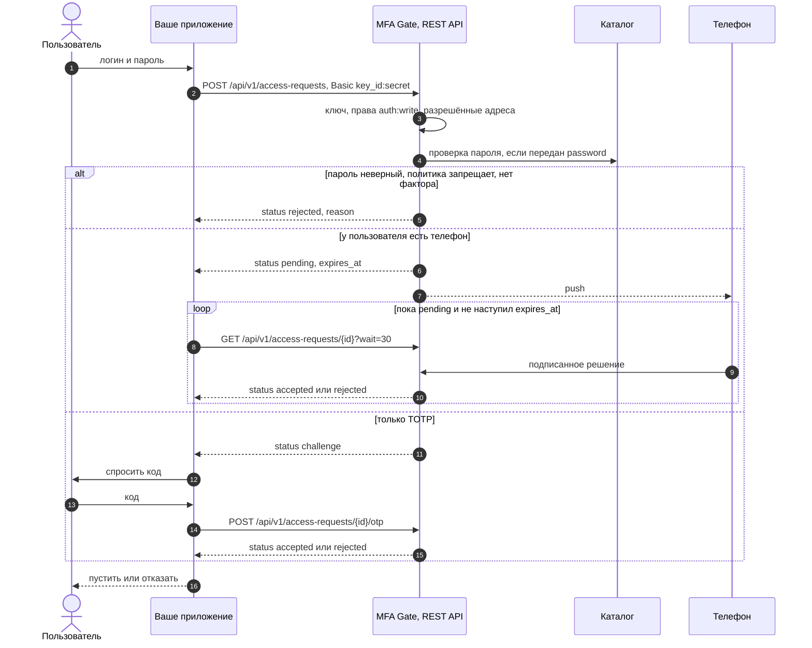

# Интеграция по REST API

*Для кого: разработчик или интегратор, который добавляет второй фактор в своё приложение.*

Если ваше приложение — внутренний портал, сервис, скрипт — само принимает логин и пароль, оно может спросить MFA Gate через REST API. RADIUS для этого не нужен. После интеграции приложение отправляет запрос входа, MFA Gate проверяет пароль и второй фактор, а приложение получает ответ «пустить» или «отказать».

## Зачем это нужно

REST API даёт тот же вход с подтверждением, что и RADIUS, но по HTTPS и в формате JSON. Политики, блокировки, история входов и журнал работают одинаково для обоих каналов. Приложению не нужно знать о телефонах, кодах и каталоге.

## Когда пригодится

- Внутренний портал или сервис со своей формой входа.
- Шлюз или сервер без RADIUS, который умеет вызвать внешний скрипт. Готовый пример — скрипт для OpenVPN: [Подключение OpenVPN](Подключение-OpenVPN.md).
- Приложение, которое уже проверило пароль само и хочет добавить только второй фактор.

## Что потребуется

- Роль **Главный администратор** или **Администратор** для создания ключа API.
- Доступ с сервера приложения к внутреннему адресу MFA Gate, например `https://mfa.example.org`, по TCP 443. REST API на внешнем адресе телефонов не публикуется.
- Пользователь с привязанным телефоном или TOTP для проверки.

Интерактивное описание всех методов (OpenAPI): `https://mfa.example.org/api/docs`. Ссылка есть и в панели: кнопка **Документация API** в разделе **API-клиенты** и значок книги в подвале боковой панели. Справочник по аутентификации, правам, ошибкам и пагинации: [docs/api.md](https://github.com/calleograph/mfa-gate/blob/main/docs/api.md).

## Как идёт запрос



## Где найти

**Панель → Интеграции → API-клиенты → Создать ключ**.

## Как это сделать

### Шаг 1. Ресурс и ключ

1. **Панель → Интеграции → Ресурсы → Добавить ресурс**: **Название** `Портал`, **Тип** **Приложение**.
2. **Панель → Интеграции → API-клиенты → Создать ключ**:

   | Поле | Значение |
   |---|---|
   | **Название** | `Портал самообслуживания` |
   | **Права ключа** | только «Запросы доступа: изменение» (`auth:write`) |
   | **Ресурс по умолчанию** | `Портал` |
   | **Разрешённые адреса** | адрес сервера приложения, например `192.0.2.30/32` |
   | **Ключ действует** | включено |

   Нажмите **Создать**.

   **Что увидите:** окно «Ключ API «Портал самообслуживания»» с полями **Идентификатор ключа (key_id)** и **Секрет**. Секрет показывается один раз.

Ключ передаётся в заголовке `Authorization: Basic base64(key_id:secret)`. Храните его в файле с правами 600, а не в командной строке: аргументы процессов видны другим пользователям системы.

```bash
install -m 600 /dev/null ~/.config/mfa-gate.curl
printf 'user = "%s"\n' 'tf_xxxxxxxxxxxx:СЕКРЕТ' > ~/.config/mfa-gate.curl
```

Если MFA Gate стоит за reverse proxy, адрес клиента для проверки **Разрешённых адресов** берётся из `X-Forwarded-For` — только от доверенных прокси `MFA_GATE_TRUSTED_PROXIES`. Подробно о ключах, правах и смене секрета: [Ключи API](Ключи-API.md).

### Шаг 2. Запрос входа

```bash
curl -fsS -K ~/.config/mfa-gate.curl -H 'Content-Type: application/json' \
  -d @- https://mfa.example.org/api/v1/access-requests <<'EOF'
{"login": "ivanov", "password": "<пароль>", "source_ip": "203.0.113.25", "client_name": "Портал"}
EOF
```

| Поле | Обязательно | Что передать |
|---|---|---|
| `login` | да | логин пользователя: `ivanov`, `CORP\ivanov` или `ivanov@corp.example.org` |
| `password` | нет | пароль. Не передавайте, если приложение уже проверило пароль само |
| `otp` | нет | код TOTP, если пользователь ввёл его сразу |
| `resource_id` | нет | идентификатор ресурса. Если у ключа задан **Ресурс по умолчанию**, поле можно не передавать; переданное значение должно с ним совпадать, иначе — `403 resource_mismatch` |
| `source_ip` | нет, но желательно | адрес пользователя: его покажет телефон, по нему повторный запрос присоединяется к открытому push |
| `client_name` | нет | название клиента в истории и на телефоне. По умолчанию — название ключа |

**Что увидите** (у пользователя привязан телефон):

```json
{"id": "6f1c…", "status": "pending", "reason": null, "message": "", "method": "push", "expires_at": "2026-11-19T09:01:00+00:00"}
```

### Шаг 3. Ожидание решения

```bash
curl -fsS -K ~/.config/mfa-gate.curl "https://mfa.example.org/api/v1/access-requests/6f1c…?wait=30"
```

Запрос ждёт решения до 30 с и возвращается сразу, как только оно принято. Повторяйте, пока `status` равен `pending` и не наступил `expires_at`. Время ожидания push — `MFA_GATE_PUSH_TIMEOUT`, по умолчанию 45 с.

После `expires_at` статус сменится на `rejected` с причиной `push_expired` не сразу: истёкшие запросы отмечает фоновый процесс, обычно в течение 10 с. Поэтому считайте запрос отклонённым, как только наступил `expires_at`, и не ждите дольше.

| `status` | Что делать приложению |
|---|---|
| `accepted` | пустить пользователя |
| `rejected` | отказать; `reason` — код причины |
| `pending` | ждать решения на телефоне |
| `challenge` | спросить код и отправить `POST /api/v1/access-requests/{id}/otp` с телом `{"code": "123456"}` |

### Пример цикла ожидания на bash

```bash
resp=$(curl -fsS -K ~/.config/mfa-gate.curl -H 'Content-Type: application/json' \
  -d @- https://mfa.example.org/api/v1/access-requests < request.json)
id=$(jq -r .id <<<"$resp"); status=$(jq -r .status <<<"$resp")
deadline=$((SECONDS + 50))
while [[ $status == pending && $SECONDS -lt $deadline ]]; do
  status=$(curl -fsS -K ~/.config/mfa-gate.curl \
    "https://mfa.example.org/api/v1/access-requests/$id?wait=25" | jq -r .status)
done
[[ $status == accepted ]] && echo "пустить" || echo "отказать: $status"
```

Любую ошибку сети или HTTP приложение должно считать отказом.

## Что получится

Пользователь вводит логин и пароль в вашем приложении, подтверждает вход на телефоне, приложение получает `accepted`. В **Истории входов** MFA Gate запись с каналом «API», ресурсом `Портал` и клиентом из `client_name`.

## Полезно знать

- **Только второй фактор.** Без поля `password` MFA Gate не проверяет пароль, но пользователь должен быть ему известен: из каталога он в этом случае не создаётся. Неизвестный логин получит отказ `unknown_user`.
- **Код сразу.** Код TOTP можно передать в поле `otp` первого запроса — ответ придёт сразу.
- **Видимость.** Ключ видит только свои запросы: чужой `id` вернёт 404.
- **Тексты для пользователя.** Поле `message` в ответе REST API содержит точный текст причины, например «Пользователь не найден ни локально, ни в каталогах.». Не показывайте его пользователю до второго фактора: по нему можно перебирать логины. Для причин `local_password`, `ldap_password`, `unknown_user`, `user_disabled`, `locked` и `directory_denied` выводите один общий текст: «Неверный логин или пароль».
- **Повторы.** Если приложение отправит новый `POST` того же пользователя с тем же `source_ip`, пока push ждёт ответа, второго уведомления не будет: ответ вернёт тот же `id`. Без `source_ip` каждый запрос даёт новый push.
- **Перебор.** Отдельного лимита частоты на ключ нет. От подбора защищает блокировка учётной записи после 8 ошибок пароля или кода.
- **Управление.** Через тот же API можно управлять пользователями, ресурсами, RADIUS-клиентами и читать журнал — нужны соответствующие права ключа. Примеры: [docs/api.md](https://github.com/calleograph/mfa-gate/blob/main/docs/api.md#примеры).

## Ошибки

Ошибки возвращаются одним форматом: `{"code": "…", "message": "…"}`. Отказ во входе — не ошибка, а обычный ответ `200` со `status: rejected`.

| HTTP | `code` | Когда |
|---|---|---|
| 401 | `unauthenticated` | нет заголовка `Authorization` |
| 401 | `bad_credentials` | неверный или выключенный ключ, неверный формат заголовка |
| 403 | `forbidden` | у ключа нет права `auth:write` |
| 403 | `ip_not_allowed` | адрес приложения не входит в **Разрешённые адреса** |
| 403 | `resource_mismatch` | ключ привязан к ресурсу, а в запросе указан другой `resource_id` |
| 404 | `not_found` | запрос не найден или создан другим ключом; ресурс не найден |
| 422 | `validation` | ошибка в полях, список — в `fields` |

Коды причин отказа (`reason`) стабильны и подходят для программной обработки: [Справочник: коды причин отказа](Справочник-коды-причин-отказа.md).

## Если не получается

| Что видно | Почему | Что сделать |
|---|---|---|
| `curl` не соединяется | приложение обращается к внешнему адресу или прокси не пускает его адрес | используйте внутренний адрес; добавьте сервер приложения в правила доступа прокси |
| 403 `ip_not_allowed`, хотя адрес верный | прокси не передаёт `X-Forwarded-For` или не входит в `MFA_GATE_TRUSTED_PROXIES` | исправьте прокси; посмотрите в **Журнале**, какой адрес видит MFA Gate |
| `status` остаётся `pending` после `expires_at` | фоновый процесс ещё не отметил истечение | считайте отказом по `expires_at` |
| Сразу `rejected` с `no_factor` | у пользователя нет телефона и TOTP или политика не разрешает доступный способ | [Управление пользователями](Управление-пользователями.md), [Политики доступа](Политики-доступа.md) |
| `challenge`, а приложение его не обрабатывает | у пользователя только TOTP | спросите код и отправьте его на `/otp` |

## Что дальше

- [Ключи API](Ключи-API.md)
- [Подключение OpenVPN](Подключение-OpenVPN.md)
- [Маршрут интегратора](Маршрут-интегратора.md)
