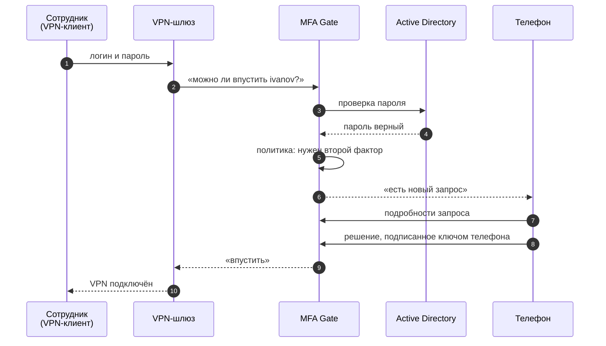

# Как работает вход с подтверждением

*Для кого: сотрудник, который хочет понять, что происходит при входе в VPN, и руководитель, который решает о внедрении.*

Вход с подтверждением состоит из двух проверок. Сначала проверяется пароль, затем телефон сотрудника. Ниже описано, что видит сотрудник на каждом шаге, что происходит на сервере и какие сведения при этом покидают организацию.

## Два фактора простыми словами

Фактор — это доказательство, что входит именно вы.

- **Первый фактор — то, что вы знаете.** Это ваш обычный рабочий пароль, тот же, что для входа в компьютер.
- **Второй фактор — то, что у вас есть.** Это ваш телефон: на нём приходит запрос на вход или показывается одноразовый код.

Чужой человек может узнать пароль, но телефона у него нет. Поэтому войти он не сможет, а вы увидите на телефоне запрос, которого не ждали.

## Что видит сотрудник

### Подтверждение на телефоне

Этот способ работает с приложением MFA Gate Authenticator на Android-телефоне.

1. Вы вводите логин и пароль в VPN-клиенте, как раньше. VPN-клиент ждёт.
2. На телефоне появляется уведомление **Запрос на вход**. На заблокированном экране подробностей в нём нет.
3. Вы открываете уведомление. Приложение показывает экран **Это вы входите?**: учётную запись, ресурс (например, «VPN офис»), IP-адрес, с которого входят, и время. Внизу идёт обратный отсчёт.
4. Если всё совпадает, вы нажимаете **Подтвердить** и прикладываете палец или вводите PIN телефона.
5. Приложение показывает **Вход подтверждён**, а VPN-клиент подключается.

Если вы не входили, нажмите **Отклонить**. Вход будет запрещён, а в истории входов останется отметка **Отклонён на телефоне**. Что делать дальше, описано в статье [Подозрительный запрос входа](Подозрительный-запрос-входа.md).

На ответ даётся 45 с, если администратор не изменил этот срок. Если не успели, запрос закрывается, и VPN не подключится. Войдите заново: придёт новый запрос.

### Одноразовый код

Этот способ работает в любом приложении-аутентификаторе на любом телефоне, в том числе на iPhone.

1. Вы вводите логин и пароль в VPN-клиенте.
2. VPN-клиент показывает поле для кода, например с подписью «Введите одноразовый код».
3. Вы открываете приложение-аутентификатор и вводите шесть цифр, которые оно показывает.

Код меняется каждые 30 с и вычисляется на самом телефоне из секрета и текущего времени. Интернет для этого не нужен, нужно только точное время на телефоне. Каждый код подходит один раз.

### Какой способ спросит VPN

Это зависит от настройки вашей организации.

- Если к учётной записи привязан телефон с MFA Gate, VPN обычно присылает запрос на телефон.
- Если телефона нет, а приложение с кодами подключено, VPN-клиент попросит код.
- В некоторых организациях VPN-клиент сразу показывает отдельное поле для кода. Тогда введите код или, если так принято у вас, оставьте поле пустым и подтвердите вход на телефоне.

Точный порядок для вашего VPN скажет администратор. Ежедневный вход по шагам: [Как войти в VPN](Как-войти-в-VPN.md).

## Что происходит на сервере

1. VPN-шлюз получает логин и пароль и спрашивает MFA Gate, можно ли впустить сотрудника.
2. MFA Gate проверяет пароль в Active Directory. Если пароль неверный, вход сразу запрещается, и телефон ничего не получает.
3. MFA Gate смотрит политику: нужен ли этому сотруднику на этом ресурсе второй фактор и какой.
4. MFA Gate создаёт запрос и сообщает телефону, что он есть. Телефон забирает подробности с сервера организации по защищённому соединению.
5. Сотрудник подтверждает вход. Телефон подписывает решение ключом, который хранится в защищённом хранилище телефона и без отпечатка или PIN не работает. Сервер проверяет подпись.
6. MFA Gate отвечает шлюзу «впустить». Шлюз подключает сотрудника.

Пока шлюз ждёт ответа, сотрудник в сеть не попадает. Подтверждение, присланное после истечения срока, уже ничего не открывает.

Иногда пароль проверяет сам VPN-шлюз, а у MFA Gate спрашивает только второй фактор. Для сотрудника вход выглядит так же: [Шлюзы с собственной проверкой пароля](Шлюзы-с-собственной-проверкой-пароля.md).

## Что уходит в интернет

Сервер MFA Gate стоит в сети организации. Наружу уходит немногое.

| Что | Куда | Какие сведения |
| --- | --- | --- |
| Телефон забирает запросы и отправляет решения | на сервер организации по внешнему адресу, например `https://auth.example.org` | подробности входа идут только между телефоном и вашим сервером, по HTTPS |
| Сигнал «есть новый запрос» (сборка `gms`, если администратор включил доставку через Google) | Firebase Cloud Messaging | только номер запроса: без логина, ресурса, адреса и времени входа |
| Собственное соединение приложения (сборка `foss`) | только сервер организации | сторонние службы не участвуют |
| Одноразовые коды | никуда | код вычисляется на телефоне |

Пароль проверяет ваш Active Directory, MFA Gate его не хранит. История входов и журнал хранятся на сервере организации. Разработчики MFA Gate этих данных не получают.

По внешнему адресу доступна только часть системы, которая обслуживает телефоны. Личный кабинет и панель администратора открываются только из внутренней сети.

## Что хранится

- учётная запись сотрудника из каталога: логин, имя, почта, группы;
- привязанные телефоны: модель, версия приложения, открытый ключ для проверки подписи и, если включены уведомления через Google, адрес для их доставки в зашифрованном виде;
- секреты одноразовых кодов, зашифрованные мастер-ключом сервера;
- резервные коды — только в виде, из которого сам код восстановить нельзя;
- история входов (по умолчанию 180 дней) и журнал действий администраторов (365 дней).

Подробнее для специалистов: [Архитектура: данные и шифрование](Архитектура-Данные-и-шифрование.md).

## Что дальше

- [Первый день с MFA Gate](Первый-день-с-MFA-Gate.md) — подключение от начала до первого входа в VPN
- [Как войти в VPN](Как-войти-в-VPN.md)
- [Подозрительный запрос входа](Подозрительный-запрос-входа.md)
- [Безопасность и модель угроз](Безопасность-и-модель-угроз.md)
