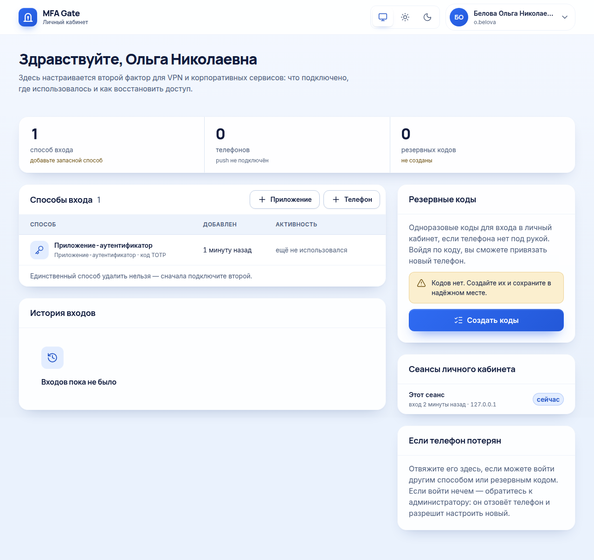

# Личный кабинет сотрудника

*Для кого: сотрудник, который подключает и проверяет свои способы входа; администратор и поддержка, которые помогают сотруднику.*

В личном кабинете вы сами подключаете телефон и приложение с кодами, создаёте резервные коды, смотрите историю своих входов и завершаете лишние сеансы. Эта страница описывает все экраны кабинета по порядку: вход, первую настройку и разделы кабинета.

## Зачем это нужно

Кабинет — единственное место, где сотрудник управляет своей защитой без заявки в поддержку. Здесь видно, что подключено, когда и где использовалось и как вернуть доступ, если телефон потерян.

## Когда пригодится

- Вы подключаете второй фактор впервые.
- Вы хотите добавить запасной способ входа или новый телефон.
- Нужно создать резервные коды или получить новые.
- Вы хотите проверить, кто и когда входил под вашей учётной записью.

## Что потребуется

- Адрес кабинета, например `https://mfa.example.org/`. Его сообщает администратор.
- Рабочий логин и пароль — те же, что для входа в компьютер.
- Доступ к внутренней сети. Кабинет открывается в офисе или после подключения к VPN. Первую настройку обычно можно пройти только из офисной сети.

## Вход в кабинет

1. Откройте адрес кабинета в браузере.

   **Что увидите:** карточку **Личный кабинет** и над ней два шага: **Учётная запись** и **Второй фактор**.
2. В поле **Логин** введите логин так же, как при входе в рабочий компьютер: `ivanov`, `DOMAIN\ivanov` или `ivanov@example.org`.
3. В поле **Пароль** введите рабочий пароль и нажмите **Продолжить**.
4. Подтвердите вход вторым фактором. Какой экран появится, зависит от того, что у вас уже подключено:
   - есть телефон с MFA Gate — экран **Подтвердите вход** с надписью **Ждём подтверждения на телефоне** и отсчётом времени. Подтвердите запрос в приложении. Если подключено приложение с кодами или созданы резервные коды, кнопка **Ввести код вместо этого** открывает поле для кода;
   - есть только приложение с кодами — поле **Код подтверждения**. Введите шесть цифр и нажмите **Войти**. Здесь же подходит резервный код;
   - есть только резервные коды — поле **Резервный код** в формате `xxxxx-xxxxx`;
   - ещё ничего не подключено — откроется мастер **Настройте второй фактор**, см. ниже.

**Что увидите:** кабинет с приветствием **Здравствуйте, …** и вашим именем.

Кабинет закрывает сеанс примерно через полчаса без действий. Тогда появится надпись **Сессия истекла — войдите снова**: войдите ещё раз. Чтобы выйти самостоятельно, нажмите на своё имя в правом верхнем углу и выберите **Выйти**.

## Первая настройка

Мастер **Настройте второй фактор** открывается, если у вас ещё нет ни одного способа входа. На выбор два способа — какие именно, решает администратор:

- **Приложение-аутентификатор** с пометкой **Рекомендуется** — шестизначные коды в любом приложении: Яндекс Ключ, Google или Microsoft Authenticator, Aegis и другие. Подходит для любого телефона, в том числе iPhone. Пошагово: [Как подключить приложение с кодами](Как-подключить-приложение-с-кодами.md).
- **Телефон с MFA Gate** — запрос на Android-телефон, подтверждение одним касанием и отпечатком пальца. Пошагово: [Как подключить телефон](Как-подключить-телефон.md).

На настройку даётся 15 минут после входа. Не закрывайте страницу, пока не закончите. Кнопка **Выбрать другой способ** возвращает к выбору.

Позже можно добавить второй способ. Удобнее всего иметь оба: телефон для ежедневного входа и приложение с кодами как запасной вариант.

### Если вместо мастера написано «Настройка недоступна»

Самостоятельная настройка по одному паролю ограничена, чтобы человек, узнавший ваш пароль, не привязал свой телефон. На экране будет одна из причин:

| Сообщение | Что сделать |
| --- | --- |
| **Первую настройку можно пройти только из сети компании. Подключитесь к офисной сети и войдите снова.** | откройте кабинет с компьютера в офисе |
| **Второй фактор для вашей учётной записи уже настраивался. Если телефон потерян или сброшен, обратитесь к администратору — он разрешит повторную настройку на сутки.** | обратитесь к администратору: [Если телефон потерян или заменён](Если-телефон-потерян-или-заменён.md) |
| **Самостоятельная настройка второго фактора для вашей учётной записи не разрешена. Обратитесь к администратору.** | попросите администратора подключить вас или включить вас в нужную группу |

Кнопка **Выйти** возвращает к форме входа.

## Разделы кабинета

### Сводка

Три числа в верхней полосе:

| Число | Подпись под ним | Что означает |
| --- | --- | --- |
| способов входа | **есть запасной способ**, **добавьте запасной способ** или **вход в VPN невозможен** | сколько у вас подключено телефонов и приложений с кодами |
| телефонов | **подтверждение одним касанием** или **push не подключён** | сколько телефонов с MFA Gate привязано |
| резервных кодов | **на случай потери телефона** или **не созданы** | сколько неиспользованных резервных кодов осталось |

Предупреждающие подписи выделены цветом: на них стоит обратить внимание.

### Способы входа

Таблица подключённых способов: название, дата добавления и последняя активность.

- Телефон показан названием производителя и модели и подписью **Телефон · push-уведомления** или **Телефон · уведомления через постоянное соединение**. В колонке **Активность** — когда телефон последний раз был **на связи**.
- Приложение с кодами показано как **Приложение-аутентификатор** с подписью **Приложение-аутентификатор · код TOTP**. В колонке **Активность** — когда код последний раз **использован**.

Кнопки над таблицей:

- **Приложение** — подключить ещё одно приложение с кодами;
- **Телефон** — привязать телефон с MFA Gate.

Кнопка есть, только если этот способ разрешён администратором.

Чтобы убрать способ, нажмите кнопку действий в конце строки и выберите **Отвязать телефон** или **Удалить**, затем подтвердите. Единственный способ удалить нельзя: под таблицей будет надпись **Единственный способ удалить нельзя — сначала подключите второй.**

Если вы вошли по резервному коду и способов не осталось, вместо таблицы будет надпись **Нет ни одного способа входа**. Подключите приложение или телефон сразу: без них VPN не подключится.

### История входов

Последние 50 попыток входа под вашей учётной записью: в VPN, в другие ресурсы организации и подтверждения входа в кабинет с телефона.

| Колонка | Что показывает |
| --- | --- |
| **Когда** | дата, время и IP-адрес, с которого входили |
| **Куда** | название ресурса, например «VPN офис», и служебная пометка канала |
| **Способ** | **Push** (подтверждение на телефоне), **TOTP-код**, **Политика** (вход без второго фактора по правилу организации) |
| **Результат** | **Подтверждён**, **Пропущен политикой**, **Ожидает ответа**, **Отклонён на телефоне**, **Отказ** с причиной, **Истекло время** |

Незнакомая строка — повод действовать: [Подозрительный запрос входа](Подозрительный-запрос-входа.md).

### Резервные коды

Одноразовые коды для входа в кабинет, если телефона нет под рукой. Здесь видно, сколько кодов осталось. Кнопка **Создать коды** выдаёт первый набор, **Создать новые** — заменяет старый. Подробно: [Резервные коды](Резервные-коды.md).

### Приложение для телефона

Ссылки на MFA Gate Authenticator той же версии, что и сервер: **Android с сервисами Google** — для большинства телефонов, **Android без сервисов Google** — для Huawei и телефонов без Google. На компьютере рядом с каждым вариантом QR-код: наведите на него камеру телефона, и файл скачается. На телефоне — кнопка **Скачать APK**. Тот же блок есть на главной кабинета под формой входа, так что скачать приложение можно ещё до входа. Для iPhone подойдёт любое приложение-аутентификатор с кодами.

### Сеансы личного кабинета

Список открытых сеансов кабинета. Ваш текущий отмечен **Этот сеанс** и меткой **сейчас**. У остальных указаны IP-адрес и время входа. Кнопка **Завершить** закрывает чужой или забытый сеанс.

### Если телефон потерян

Короткая памятка: потерянный телефон можно отвязать здесь, если вы вошли другим способом или резервным кодом. Если войти нечем, обратитесь к администратору: он отзовёт телефон и разрешит настроить новый. Подробно: [Если телефон потерян или заменён](Если-телефон-потерян-или-заменён.md).

### Оформление

Переключатель в правом верхнем углу выбирает тему: **Как в системе**, **Светлая** или **Тёмная**.

## Если не получается

| Что видно | Почему | Что сделать |
| --- | --- | --- |
| Страница не открывается | вы не в сети компании | подключитесь в офисе или через VPN |
| **Неверный логин или пароль, либо учётная запись временно заблокирована.** | ошибка в логине или пароле, либо после восьми ошибок подряд вход заблокирован на 15 минут | проверьте раскладку и Caps Lock; если ошибок не было, подождите 15 минут или обратитесь к администратору |
| **Доступ запрещён политикой** | организация закрыла вам вход | обратитесь к администратору |
| **Слишком много попыток, повторите через минуту** | с вашего адреса много попыток входа | подождите минуту |
| **Неверный или уже использованный код** | опечатка, код устарел или уже использован | дождитесь нового кода; проверьте время на телефоне |
| **Слишком много ошибок, вход временно заблокирован** | много неверных кодов подряд | подождите 15 минут |
| **Время ожидания вышло** | телефон не ответил | проверьте интернет на телефоне и нажмите **Отправить снова** |
| **Запрос отклонён на телефоне** | на телефоне нажали **Отклонить** | если это были не вы: [Подозрительный запрос входа](Подозрительный-запрос-входа.md) |
| **Сначала смените временный пароль в панели управления** | учётная запись локальная, и пароль выдан временно | смените пароль, как сказал администратор |

Доменный пароль меняется в домене, а не в MFA Gate. Если вы его забыли, обратитесь в службу поддержки организации.

## Для администратора и поддержки

- Кабинет открывается по внутреннему адресу MFA Gate, панель — по тому же адресу с `/admin/`. Публикация: [Сетевая схема и публикация](Сетевая-схема-и-публикация.md).
- Правила самостоятельной настройки: сети, группы, повторная настройка на 24 часа — [Первичная настройка сотрудниками](Первичная-настройка-сотрудниками.md).
- Карточка сотрудника, отзыв телефона, сброс резервных кодов: [Управление пользователями](Управление-пользователями.md).

## Что дальше

- [Первый день с MFA Gate](Первый-день-с-MFA-Gate.md)
- [Как подключить телефон](Как-подключить-телефон.md)
- [Резервные коды](Резервные-коды.md)
- [Как войти в VPN](Как-войти-в-VPN.md)
