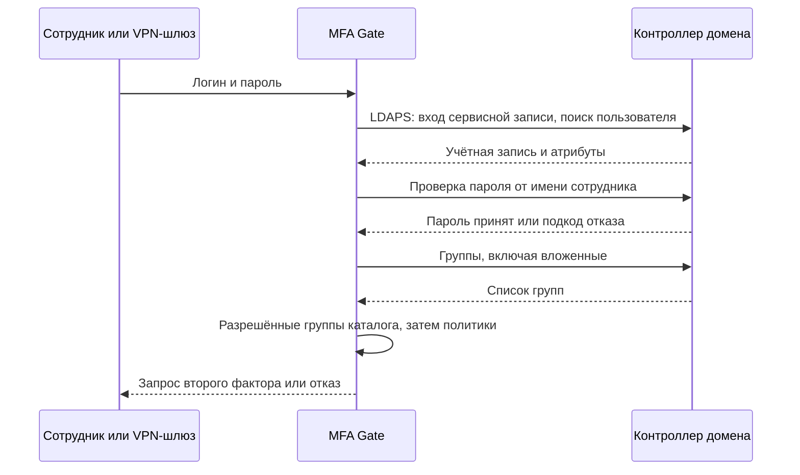

# Подключение Active Directory

*Для кого: администратор MFA Gate и администратор домена.*

После подключения сотрудники входят в VPN и личный кабинет своим доменным логином и паролем. MFA Gate проверяет пароль в Active Directory, читает имя, почту, телефон и группы сотрудника и учитывает группы в политиках. Заводить доменных пользователей вручную не нужно: запись появляется при первом успешном входе.

На настоящем Active Directory подключение пока не проверялось. Логика разбора ответов AD покрыта автоматическими тестами на записанных ответах, а вход, поиск и вложенные группы проверены на настоящем сервере OpenLDAP. Начните с тестовой учётной записи и пройдите проверку из этой статьи до конца. Что проверено, а что нет: [Что проверено](Что-проверено.md).

## Зачем это нужно и когда пригодится

- В организации есть домен, и отдельные пароли для VPN не нужны.
- Доступ к VPN должен зависеть от групп AD: отдел продаж входит, подрядчики нет.
- Нужно заранее завести доменного сотрудника и выдать ему телефон до первого входа.

Без каталога работают только локальные пользователи, которых администратор создаёт в панели с паролем.

## Как это устроено

MFA Gate только читает каталог и ничего в нём не меняет. Пароль сотрудника проверяется в домене при каждом входе и в базе MFA Gate не хранится.



Что важно знать заранее:

- **Формы логина.** Принимаются `ivanov`, `CORP\ivanov` и `ivanov@example.org`. Все три ведут к одной записи в MFA Gate, у неё общий счётчик ошибок и общая блокировка.
- **Несколько каталогов.** Можно подключить несколько доменов. Они опрашиваются по возрастанию поля **Приоритет**. Каталог, из которого сотрудник уже приходил, опрашивается первым.
- **Несколько контроллеров.** Контроллеры одного домена перечисляются в порядке опроса. Недоступный контроллер пропускается на 60 с, вход идёт через следующий.
- **Отказ при недоступности.** Если ни один контроллер не ответил, вход с паролем запрещается с причиной **Каталог недоступен**. Пропуска «по старому паролю» нет.
- **Связь с записью.** Сотрудник связывается с записью MFA Gate по `objectGUID`. Переименование учётной записи в AD не создаёт дубль.
- **Обновление профиля.** Имя, почта, телефон и группы обновляются при каждом входе. Если пароль уже проверил шлюз (режим **Сам шлюз**) или приложение по REST API, MFA Gate берёт запись и группы сервисной учётной записью; если каталог не отвечает — отказ, если сервисная учётная запись не задана — решение по сохранённой записи.
- **Блокировка.** В счётчик ошибок идут только неверный пароль и неверный код. Отказ каталога (учётная запись отключена или истекла, нет разрешённой группы) временной блокировки не вызывает.

## Что потребуется

- Роль **Главный администратор** или **Администратор** в панели. **Аудитор** видит каталог, но не меняет его; **Оператору** раздел недоступен.
- Сетевой доступ с сервера MFA Gate к контроллерам: TCP 636 для LDAPS или 389 для StartTLS.
- DNS-имена контроллеров, которые совпадают с именем в их сертификате. Подключение по IP-адресу не проходит проверку сертификата.
- Корневой сертификат внутреннего центра сертификации в формате PEM, если сертификаты контроллеров выпущены им.
- Сервисная учётная запись домена только для чтения. Она нужна, чтобы искать пользователей и группы, заводить доменных сотрудников заранее и проверять сотрудников в режиме **Сам шлюз** и в REST API без пароля.
- Тестовая учётная запись сотрудника для проверки, например `ivanov`.

## Где найти

**Панель → LDAP / AD** (раздел меню **Интеграции**). Здесь кнопка **Подключить каталог**, карточки подключённых каталогов, кнопка **Диагностика** и меню **Изменить** / **Удалить**.

## Как это сделать

В примерах домен `example.org` с NetBIOS-именем `CORP`, контроллеры `dc1.example.org` и `dc2.example.org`.

### Шаг 1. Создайте сервисную учётную запись

Обычной учётной записи домена достаточно: читать пользователей и группы по умолчанию может любой пользователь домена. На контроллере в PowerShell:

```powershell
New-ADUser -Name "svc-mfa-gate" -SamAccountName "svc-mfa-gate" `
  -UserPrincipalName "svc-mfa-gate@example.org" `
  -Path "OU=Service,DC=example,DC=org" `
  -AccountPassword (Read-Host -AsSecureString "Пароль") `
  -Enabled $true -PasswordNeverExpires $true -CannotChangePassword $true
```

Запишите DN: `CN=svc-mfa-gate,OU=Service,DC=example,DC=org`.

Без сервисной записи MFA Gate тоже работает: поиск выполняется правами входящего сотрудника. Но тогда нельзя завести доменного пользователя до его первого входа.

### Шаг 2. Проверьте LDAPS с сервера MFA Gate

```bash
getent hosts dc1.example.org
openssl s_client -connect dc1.example.org:636 -servername dc1.example.org </dev/null 2>/dev/null \
  | openssl x509 -noout -subject -issuer -enddate
```

**Что увидите:** адрес контроллера, затем `subject=` с именем контроллера, `issuer=` с именем вашего центра сертификации и дату окончания в будущем.

### Шаг 3. Подготовьте корневой сертификат

На компьютере в домене выгрузите сертификат центра сертификации и переведите его в PEM:

```powershell
certutil -ca.cert C:\Temp\corp-ca.cer
```

```bash
openssl x509 -inform der -in corp-ca.cer -out corp-ca.pem
openssl s_client -connect dc1.example.org:636 -servername dc1.example.org -CAfile corp-ca.pem </dev/null 2>/dev/null | grep 'Verify return code'
```

**Что увидите:** `Verify return code: 0 (ok)`. Содержимое `corp-ca.pem` понадобится на следующем шаге.

### Шаг 4. Подключите каталог

1. Откройте **Панель → LDAP / AD** и нажмите **Подключить каталог**.
2. Заполните форму. Для Active Directory атрибуты уже подставлены, обычно их не меняют.

   | Раздел формы | Поле | Пример |
   |---|---|---|
   | **Подключение** | **Название** | `Домен example.org` |
   | | **Тип каталога** | **Active Directory** |
   | | **Контроллеры** | `dc1.example.org`, `dc2.example.org` |
   | | **Шифрование** | **LDAPS** |
   | | **Порт** | 636 |
   | | **Тайм-аут, с** | 5 |
   | | **Проверять сертификат контроллера** | включено |
   | | **Корневой сертификат (PEM)** | содержимое `corp-ca.pem` |
   | **Сервисная учётная запись** | **DN или UPN** | `CN=svc-mfa-gate,OU=Service,DC=example,DC=org` |
   | | **Пароль** | пароль сервисной записи |
   | **Поиск пользователей** | **Base DN** | `DC=example,DC=org` |
   | | **Фильтр пользователей** | `(&(objectClass=user)(objectCategory=person))` |
   | | **Атрибут логина** / **Атрибут идентификатора** | `sAMAccountName` / `objectGUID` |
   | **Доступ** | **Разрешённые группы** | пусто или `VPN-Users` |
   | | **Учитывать вложенные группы** | включено |
   | | **Приоритет** | 10 |
   | | **Каталог включён** | включено |

3. Нажмите **Подключить**.

**Что увидите:** сообщение «Каталог подключён — запустите диагностику» и карточку каталога с контроллерами, Base DN и отметкой о связи с контроллерами.

Пароль сервисной записи хранится зашифрованным и больше не показывается. При изменении каталога поле можно оставить пустым, тогда сохранится прежний пароль.

### Шаг 5. Решите, где ограничивать доступ группами

Группы влияют на доступ в трёх местах, и их легко перепутать:

| Где | Что делает | Когда использовать |
|---|---|---|
| **Разрешённые группы** в каталоге | Сотрудник вне этих групп не проходит даже проверку пароля, причина **Каталог отклонил вход** | Жёсткая граница: в MFA Gate вообще входят только члены группы |
| **Политики** | Решают, что делать после пароля: второй фактор, запрет или вход без MFA, для каких ресурсов | Разные правила для разных отделов и VPN, см. [Политики доступа](Политики-доступа.md) |
| Переменная `MFA_GATE_PORTAL_ENROLL_GROUPS` | Кому разрешено самому настроить первый фактор в личном кабинете | См. [Первичная настройка сотрудниками](Первичная-настройка-сотрудниками.md) |

Пока **Разрешённые группы** пусты, пароль проверяется у всех найденных сотрудников, а доступ решают политики. Это удобная отправная точка. Группы указываются как CN (`VPN-Users`) или полный DN.

### Шаг 6. Запустите диагностику

1. В карточке каталога нажмите **Диагностика**.
2. Укажите **Логин для проверки** и **Пароль** тестового сотрудника. Без логина проверяются только сеть, TLS и сервисная запись.
3. Нажмите **Запустить проверку**.

**Что увидите:** список шагов и итог «Все шаги пройдены — каталог готов к входу пользователей». Пароль никуда не сохраняется и не пишется в журнал. Проверка останавливается на первой ошибке:

| Шаг | Что проверяет | Частая причина ошибки |
|---|---|---|
| **Имя контроллера (DNS)** | имя разрешается | сервер MFA Gate не использует DNS домена |
| **Соединение с портом** | порт 636 или 389 открыт | межсетевой экран, на контроллере не включён LDAPS |
| **Шифрование (TLS)** | сертификат доверенный, имя совпадает | нет корневого сертификата, подключение по IP |
| **Сервисная учётная запись** | вход сервисной записи | неверный DN или пароль, пароль истёк |
| **База поиска (Base DN)** | Base DN существует | опечатка |
| **Поиск пользователя** | сотрудник найден | логин, фильтр, сотрудник вне Base DN |
| **Пароль пользователя** | пароль принят | пароль, подкод AD в подробностях |
| **Группы пользователя** | группы прочитаны | сотрудник не входит в **Разрешённые группы** |

### Шаг 7. Проверьте вход

Войдите тестовым сотрудником в личный кабинет или, если RADIUS уже настроен, в VPN. Затем откройте **Панель → Пользователи**.

**Что увидите:** сотрудник с источником **Каталог**, именем, почтой и группами из AD. В карточке, в блоке **Профиль**, поле **Группы каталога** показывает группы домена.

## Что получится

- Сотрудники входят доменным паролем, MFA Gate сам заводит их записи.
- Группы AD доступны в политиках и при сопоставлении с группами MFA Gate (**Панель → Группы → Создать группу**, поле **Группа каталога**).
- Изменения каталога записываются в **Журнал**: «Добавлен каталог», «Изменён каталог», «Диагностика каталога».

## Если не получается

| Что видно | Почему | Что сделать |
|---|---|---|
| Шаг **Шифрование (TLS)** с ошибкой | нет корневого сертификата или подключение по IP | вставьте PEM, укажите DNS-имя контроллера |
| В карточке «Шифрование выключено…» или «Сертификат контроллера не проверяется…» | выбран режим **Без шифрования** или снята проверка сертификата | включите LDAPS и проверку, иначе пароли можно перехватить |
| Все входы с причиной **Каталог недоступен** | контроллеры не отвечают, ошибка TLS или сервисной записи | **Диагностика** без логина, затем [Решение проблем каталога](Решение-проблем-каталога.md) |
| Причина **Каталог отклонил вход** | учётная запись отключена или заблокирована в AD, пароль истёк, нужно сменить пароль, сотрудник вне **Разрешённых групп** | подкод AD виден в шаге **Пароль пользователя** диагностики; смена пароля через VPN не выполняется |
| Причина **Пользователь не найден** | логин, фильтр или Base DN не те | **Поиск пользователя** в диагностике |
| Сотрудник не появляется в **Пользователях** | он ещё не входил | попросите войти или заведите его заранее, см. [Управление пользователями](Управление-пользователями.md) |

Сотруднику при любой ошибке пароля показывается одинаковый текст «Неверный логин или пароль, либо учётная запись временно заблокирована». Так по ответу нельзя перебирать логины. Точная причина видна только администратору в **Истории входов**.

Для OpenLDAP шаги те же. Выберите **Тип каталога** **OpenLDAP и совместимые**: подставятся фильтр `(objectClass=inetOrgPerson)`, атрибуты `uid` и `entryUUID`. Группы ищутся по `member` и `uniqueMember` с вложенностью до 10 уровней.

## Что дальше

- [Управление пользователями](Управление-пользователями.md)
- [Политики доступа](Политики-доступа.md)
- [Настройка RADIUS](Настройка-RADIUS.md)
- [Решение проблем каталога](Решение-проблем-каталога.md)
