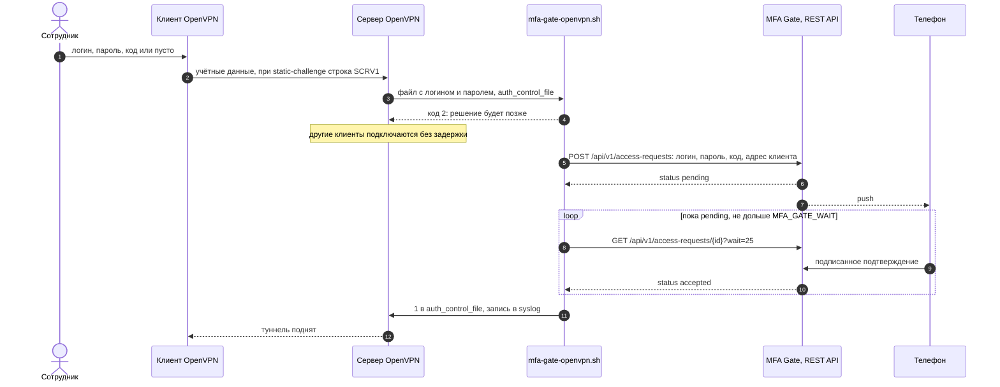

# Подключение OpenVPN

*Для кого: администратор сервера OpenVPN и администратор MFA Gate.*

Страница описывает два способа добавить второй фактор к OpenVPN Community: готовый скрипт MFA Gate, который работает через REST API, и классическую цепочку через модуль PAM RADIUS. После настройки сотрудник подключается к OpenVPN своим логином и паролем, подтверждает вход на телефоне или вводит код, и туннель поднимается.

## Какой способ выбрать

| | Скрипт MFA Gate | Модуль PAM RADIUS |
|---|---|---|
| Как работает | обработчик `auth-user-pass-verify` вызывает REST API MFA Gate | плагин PAM OpenVPN передаёт пароль модулю `pam_radius`, тот — в MFA Gate по RADIUS |
| Ожидание подтверждения | отложенная проверка: ожидание push не задерживает подключение других клиентов | зависит от плагина |
| Ввод кода TOTP | через `static-challenge` в конфигурации клиента | через Access-Challenge, работа зависит от версий плагина и клиента |
| Что нужно на сервере OpenVPN | OpenVPN 2.5+, `bash`, `curl` | `libpam-radius-auth` версии 3.0 и новее |
| Учётная запись в MFA Gate | ключ API с правом `auth:write` | RADIUS-клиент |
| Рекомендация | **основной способ** | если политика организации требует RADIUS |

Сквозные тесты проверяют оба способа только со стороны MFA Gate: скрипт запускали против настоящего сервера MFA Gate (push даёт допуск, неверный код — отказ), RADIUS — собственным тестовым клиентом. **С настоящим сервером OpenVPN эти настройки не проверялись.**

## Скрипт MFA Gate через REST API

### Как это работает



Скрипт возвращает OpenVPN код 2 и продолжает работу в фоне. Когда приходит ответ, он записывает `1` (пустить) или `0` (отказать) в `auth_control_file`. Любая ошибка — сеть, HTTP-ошибка, таймаут, неизвестный ответ — даёт `0`.

### Что потребуется

- OpenVPN 2.5 или новее: отложенный ответ через `auth_control_file` появился в этой версии.
- `curl` и `bash` на сервере OpenVPN.
- Доступ с сервера OpenVPN к внутреннему адресу MFA Gate `https://mfa.example.org` по TCP 443. Если внутреннее имя закрыто в прокси по адресам, адрес сервера OpenVPN должен быть в списке разрешённых.
- Роль **Главный администратор** или **Администратор** в панели MFA Gate.

### Шаг 1. Ресурс и ключ API

1. **Панель → Интеграции → Ресурсы → Добавить ресурс**: **Название** `VPN OpenVPN`, **Тип** **VPN**.
2. **Панель → Интеграции → API-клиенты → Создать ключ**:

   | Поле | Значение |
   |---|---|
   | **Название** | `OpenVPN офис` |
   | **Права ключа** | только «Запросы доступа: изменение» (`auth:write`) |
   | **Ресурс по умолчанию** | `VPN OpenVPN` |
   | **Разрешённые адреса** | адрес сервера OpenVPN, например `192.0.2.20/32` |
   | **Ключ действует** | включено |

   Нажмите **Создать**.

   **Что увидите:** окно «Ключ API «OpenVPN офис»» с полями **Идентификатор ключа (key_id)** и **Секрет**. Секрет показывается один раз. В настройках скрипта они записываются через двоеточие: `key_id:секрет`.

Ключ, привязанный к ресурсу, не может запросить вход в другой ресурс: попытка получит 403 `resource_mismatch`. Подробно о ключах: [Ключи API](Ключи-API.md).

### Шаг 2. Скрипт и файл настроек

Скрипт лежит в репозитории: [integrations/openvpn/mfa-gate-openvpn.sh](https://github.com/calleograph/mfa-gate/blob/main/integrations/openvpn/mfa-gate-openvpn.sh).

```bash
sudo apt-get install -y curl
sudo install -m 755 mfa-gate-openvpn.sh /etc/openvpn/mfa-gate-openvpn.sh
sudo tee /etc/openvpn/mfa-gate.conf >/dev/null <<'EOF'
MFA_GATE_URL=https://mfa.example.org
MFA_GATE_KEY=tf_xxxxxxxxxxxx:СЕКРЕТ_КЛЮЧА
MFA_GATE_WAIT=50
EOF
sudo chown root:nogroup /etc/openvpn/mfa-gate.conf
sudo chmod 640 /etc/openvpn/mfa-gate.conf
```

| Переменная | Значение |
|---|---|
| `MFA_GATE_URL` | внутренний адрес MFA Gate, `MFA_GATE_PUBLIC_URL`. Внешний адрес телефонов `auth.example.org` не подойдёт: REST API на нём не публикуется |
| `MFA_GATE_KEY` | `key_id:секрет` из шага 1 |
| `MFA_GATE_WAIT` | сколько секунд ждать решения, по умолчанию 50. Должно быть больше `MFA_GATE_PUSH_TIMEOUT` (45 с) |

Другой путь к файлу настроек задаёт переменная окружения `MFA_GATE_OPENVPN_CONF`.

Скрипт выполняется от имени пользователя OpenVPN после понижения прав. Поэтому файл настроек должен быть читаем группой из строки `group` вашего `server.conf`: часто это `nogroup` или `openvpn`. Ключ и пароль в аргументы процессов не попадают: ключ передаётся `curl` через дескриптор файла, пароль — в теле запроса.

**Что увидите:** `sudo -u nobody cat /etc/openvpn/mfa-gate.conf` выводит содержимое файла. Вместо `nobody` подставьте пользователя из строки `user`.

### Шаг 3. Настройки сервера OpenVPN

Добавьте в `server.conf`:

```text
script-security 2
auth-user-pass-verify /etc/openvpn/mfa-gate-openvpn.sh via-file
auth-gen-token 0 external-auth
reneg-sec 0
```

- `auth-gen-token` выдаёт клиенту токен сеанса после успешного входа. Без него OpenVPN спрашивал бы подтверждение при каждой смене ключей.
- `reneg-sec 0` отключает пересогласование ключей по времени на сервере.

Перезапустите службу:

```bash
sudo systemctl restart openvpn-server@server
```

Имя службы зависит от дистрибутива и имени файла конфигурации.

### Шаг 4. Ввод кода в клиенте

Если часть сотрудников входит с кодом из приложения-аутентификатора, добавьте в конфигурацию клиента (`.ovpn`):

```text
static-challenge "Код MFA (пусто — подтверждение на телефоне)" 1
```

Клиент покажет второе поле. Скрипт разберёт ответ вида `SCRV1:<пароль>:<код>` и передаст код в поле `otp`. Пустое поле — подтверждение на телефоне.

Без `static-challenge` сотрудник, у которого есть только TOTP, войти не сможет: REST API вернёт `challenge`, а скрипт считает любой ответ, кроме `accepted`, отказом.

### Что получится

Сотрудник подключается к OpenVPN своим доменным логином и паролем, оставляет поле кода пустым, подтверждает вход на телефоне — туннель поднимается. Пароль проверяет MFA Gate: поле **Кто проверяет доменный пароль** RADIUS-клиента к скрипту не относится.

### Как проверить

1. Подключитесь под `ivanov` с пустым полем кода → подтвердите на телефоне → туннель поднят.
2. `journalctl -t mfa-gate-openvpn` на сервере OpenVPN показывает `user=ivanov result=accepted`.
3. В **Истории входов** MFA Gate канал «API», клиент `OpenVPN <имя сертификата>`, ресурс `VPN OpenVPN`, адрес клиента.
4. «Отклонить» на телефоне → отказ, в журнале `result=rejected`.
5. Неверный код в поле кода → отказ сразу.
6. Нет ответа на телефоне → отказ примерно через 45–55 с.

## Модуль PAM RADIUS

Используйте, если подключение должно идти именно по RADIUS. Сначала заведите в MFA Gate ресурс и RADIUS-клиент с адресом сервера OpenVPN и вариантом **MFA Gate** в поле **Кто проверяет доменный пароль**: [Подключение VPN](Подключение-VPN.md).

```bash
sudo apt-get install -y libpam-radius-auth
```

`/etc/pam_radius_auth.conf` — сервер, секрет, таймаут в секундах:

```text
192.0.2.10:1812  СЕКРЕТ  60
```

`/etc/pam.d/openvpn`:

```text
auth    required  pam_radius_auth.so
account required  pam_permit.so
```

`server.conf`:

```text
plugin /usr/lib/x86_64-linux-gnu/openvpn/plugins/openvpn-plugin-auth-pam.so openvpn
verify-client-cert require
auth-gen-token 28800
hand-window 75
```

- Путь к плагину зависит от дистрибутива: `dpkg -L openvpn | grep auth-pam`.
- `hand-window 75` даёт клиенту время дождаться ответа на телефоне.
- `pam_radius` до версии 3.0 не отправляет Message-Authenticator. MFA Gate отбрасывает такие пакеты, в **Журнале** появляется «Неверный RADIUS-аутентификатор». Обновите модуль.
- Ввод кода через Access-Challenge в цепочке плагина PAM нужно проверять на ваших версиях. Надёжнее скрипт через REST API.

## Если не получается

| Что видно | Почему | Что сделать |
|---|---|---|
| Клиент сразу получает отказ, в syslog `result=error` | сервер MFA Gate недоступен, неверный ключ или адрес не разрешён | проверьте `curl -fsS https://mfa.example.org/health/ready` с сервера OpenVPN; сверьте ключ; добавьте адрес в **Разрешённые адреса** |
| В журнале OpenVPN «не передал auth_control_file» | OpenVPN старше 2.5 или не указан `via-file` | обновите OpenVPN, проверьте строку `auth-user-pass-verify` |
| Скрипт не читает файл настроек | файл недоступен пользователю OpenVPN после понижения прав | права 640 и группа из строки `group` |
| Сотрудник с TOTP получает отказ | в конфигурации клиента нет `static-challenge` | добавьте строку из шага 4 |
| OpenVPN снова спрашивает подтверждение посреди сеанса | нет `auth-gen-token` или клиент пересогласует ключи | добавьте `auth-gen-token 0 external-auth` и `reneg-sec 0` |
| `result=rejected`, в **Истории входов** «Ресурс отключён» или «Запрещено политикой» | ресурс выключен или политика запрещает вход | проверьте ресурс и [Политики доступа](Политики-доступа.md) |

## Что дальше

- [Интеграция по REST API](Интеграция-по-REST-API.md)
- [Подключение VPN](Подключение-VPN.md)
- [Решение проблем входа в VPN](Решение-проблем-входа-в-VPN.md)
