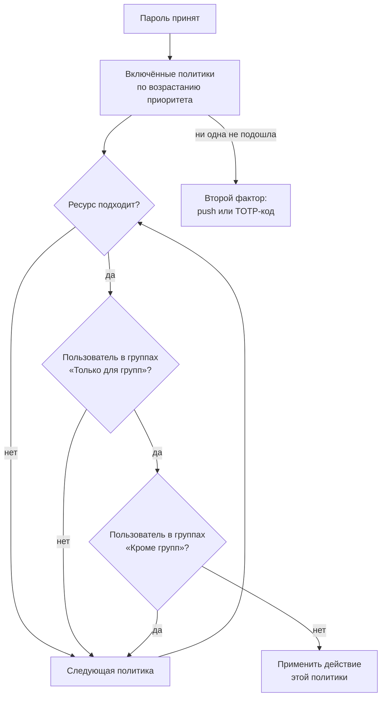

# Политики доступа

*Для кого: администратор MFA Gate.*

Политика решает, что происходит после того, как пароль сотрудника принят: потребовать второй фактор, запретить вход или, в редких служебных случаях, пропустить без него. С политиками можно закрыть VPN подрядчикам, оставить для старого шлюза только коды из приложения или разрешить отделу только подтверждение на телефоне.

## Зачем это нужно

Без единой политики второй фактор требуется всем и для всех ресурсов. Это безопасное значение по умолчанию, и для многих организаций его достаточно. Политики нужны для исключений: разные отделы, разные VPN, временные правила на период раздачи телефонов.

## Когда пригодится

- Подрядчикам вход в офисный VPN запрещён, даже с верным паролем.
- Старый шлюз не умеет долго ждать ответа телефона: для него оставляют только TOTP-код.
- Отдел продаж подключается первым, остальные пока работают по старым правилам.
- Служебная учётная запись мониторинга входит без второго фактора.

## Как работает проверка

Правила:

- Политики проверяются по возрастанию поля **Приоритет**, применяется **первая совпавшая**. Остальные не смотрятся.
- Выключенные политики не участвуют.
- Если не подошла ни одна, второй фактор обязателен, разрешены push и TOTP-код, а при отсутствии фактора вход запрещается.
- Группы сравниваются без учёта регистра. В условиях можно указать имя группы MFA Gate, CN (`VPN-Sales`) или полный DN группы каталога.
- Вход администраторов в панель всегда требует второй фактор. Политики на него не влияют.

Где действует политика:

| Канал | Какие политики учитываются |
|---|---|
| VPN через RADIUS | политики ресурса, к которому относится RADIUS-клиент, и политики без ресурсов |
| REST API | политики ресурса из запроса или ключа; запрос без ресурса совпадает только с политиками без ресурсов |
| Личный кабинет | только политики без ресурсов: они решают, пустить ли в кабинет и какие способы предложить при настройке |

## Что потребуется

- Роль **Главный администратор** или **Администратор**. **Оператор** и **Аудитор** политики только просматривают.
- Созданные ресурсы, если политика должна действовать для конкретного VPN: **Панель → Ресурсы**.
- Понятные группы. Удобнее всего — группы AD, например `VPN-Sales` (CN группы). Можно также создать группу MFA Gate в **Панель → Группы** и сопоставить её группе каталога.

## Где найти

**Панель → Политики** (раздел меню **Контроль**). В таблице колонки **Приоритет**, **Политика**, **Кому**, **Действие** и **Если фактор недоступен**. Кнопка **Создать политику**, в меню строки — **Изменить** и **Удалить**.

## Как это сделать

### Создать политику

1. Откройте **Панель → Политики** и нажмите **Создать политику**.
2. Заполните поля:

   | Поле | Что указать |
   |---|---|
   | **Название** | понятное имя, например «Подрядчики — VPN закрыт» |
   | **Приоритет** | число от 0 до 100 000, по умолчанию 100. Меньше — проверяется раньше |
   | **Ресурсы** | отметьте нужные. Ничего не выбрано — политика действует для всех ресурсов |
   | **Только для групп** | пусто — для всех пользователей |
   | **Кроме групп** | участники этих групп пропускают политику |
   | **Действие** | **Второй фактор**, **Запретить** или **Без MFA** |
   | **Разрешённые способы** | для действия **Второй фактор**: **Push на телефон**, **TOTP-код** или оба |
   | **Если у пользователя нет подходящего фактора** | **Запретить вход** (рекомендуется) или **Пропустить по паролю** |
   | **Политика включена** | включено |

3. Нажмите **Создать**.

**Что увидите:** сообщение «Политика создана», строка в таблице. Политика действует со следующей попытки входа.

Группы в полях **Только для групп** и **Кроме групп** вводятся как метки: напишите название и нажмите Enter.

### Пример набора

| Приоритет | Политика | Кому | Действие |
|---|---|---|---|
| 10 | Подрядчики — VPN закрыт | ресурс «VPN головного офиса», группа `Contractors` | **Запретить** |
| 20 | Мониторинг без MFA | ресурс «VPN головного офиса», группа `svc-monitoring` | **Без MFA** |
| 30 | Старый шлюз — только коды | ресурс «VPN филиала» | **Второй фактор**, только **TOTP-код** |
| — | все остальные | — | второй фактор, push и TOTP-код |

Порядок важен. Если поставить политику для всех ресурсов с приоритетом 5, до политик 10–30 очередь не дойдёт.

### Ограничить способы для отдела

Отдел продаж (`CORP\VPN-Sales`) работает только с телефонами MFA Gate:

1. **Создать политику**, **Название** — «Продажи — только телефон», **Приоритет** — 50.
2. **Только для групп** — `VPN-Sales`.
3. **Действие** — **Второй фактор**, **Разрешённые способы** — только **Push на телефон**.
4. **Если у пользователя нет подходящего фактора** — **Запретить вход**.

У сотрудника отдела, у которого есть только TOTP, вход будет отклонён с причиной **Нет второго фактора**.

### Как MFA Gate выбирает способ

Если политика требует второй фактор, порядок такой:

1. VPN-шлюз сам передал одноразовый код (так работают шлюзы, которые сами проверяют пароль) — проверяется TOTP-код.
2. У сотрудника есть активный телефон, и push разрешён — отправляется запрос на телефон.
3. Иначе, если есть TOTP и он разрешён, шлюз просит ввести код.
4. Иначе применяется поле **Если у пользователя нет подходящего фактора**.

Если у сотрудника есть и телефон, и TOTP, при входе в VPN всегда приходит push.

### Режим «Пропустить по паролю» и действие «Без MFA»

Оба варианта пропускают вход по одному паролю, панель помечает их как риск.

- **Без MFA** пропускает всех, кто попал под политику. Используйте только для служебных учётных записей и только вместе с **Только для групп**. Такие входы видны в **Истории входов** со статусом **Пропущен политикой**.
- **Пропустить по паролю** срабатывает, только когда у сотрудника нет подходящего фактора: не привязан телефон и нет TOTP, либо привязанный способ запрещён политикой. Если телефон есть, но сотрудник не ответил, вход отклоняется с причиной **Нет ответа на push** — об этом напоминает и подсказка у варианта. Каждый пропуск записывается в **Журнал** с важностью **Внимание**. Режим удобен на неделю раздачи телефонов, потом его выключают.

Сохранение политики с любым из этих вариантов тоже записывается в журнал с важностью **Внимание**.

## Что получится

- **История входов** показывает итог каждой попытки: **Подтверждён**, **Пропущен политикой** или **Отказ** с причиной **Запрещено политикой**.
- Создание, изменение и удаление политик видны в **Журнале**: «Создана политика», «Изменена политика», «Удалена политика».

## Если не получается

| Что видно | Почему | Что сделать |
|---|---|---|
| Политика не срабатывает | выше стоит другая совпавшая политика | проверьте порядок по **Приоритету** |
| Политика не срабатывает для доменного сотрудника | группа указана с ошибкой или группы не обновились | сравните с полем **Группы каталога** в карточке; группы обновляются при входе |
| В строке «выключена — не применяется» | снят переключатель **Политика включена** | **Изменить** → включите |
| «Выберите хотя бы один способ» | для **Второго фактора** не отмечен способ | отметьте **Push на телефон** или **TOTP-код** |
| Отказ **Нет второго фактора** | у сотрудника нет фактора, разрешённого политикой | выдайте телефон или TOTP, проверьте **Разрешённые способы** |
| Сотрудник не может войти в кабинет | политика **Запретить** без ресурсов затронула его группу | добавьте ресурсы в политику или исключение в **Кроме групп** |

Если ресурс выключен, MFA Gate отклоняет вход с причиной **Ресурс отключён** до проверки политик. Удалённая группа MFA Gate перестаёт совпадать в политиках, которые ссылались на неё по имени.

Условий по времени суток, стране, адресу сотрудника и типу устройства в политиках нет: см. [Планы развития](Планы-развития.md).

## Что дальше

- [Настройка RADIUS](Настройка-RADIUS.md)
- [История входов и журнал аудита](История-входов-и-журнал-аудита.md)
- [Сценарий: подключение отдела](Сценарий-Подключение-отдела.md)
- [Справочник: коды причин отказа](Справочник-коды-причин-отказа.md)
