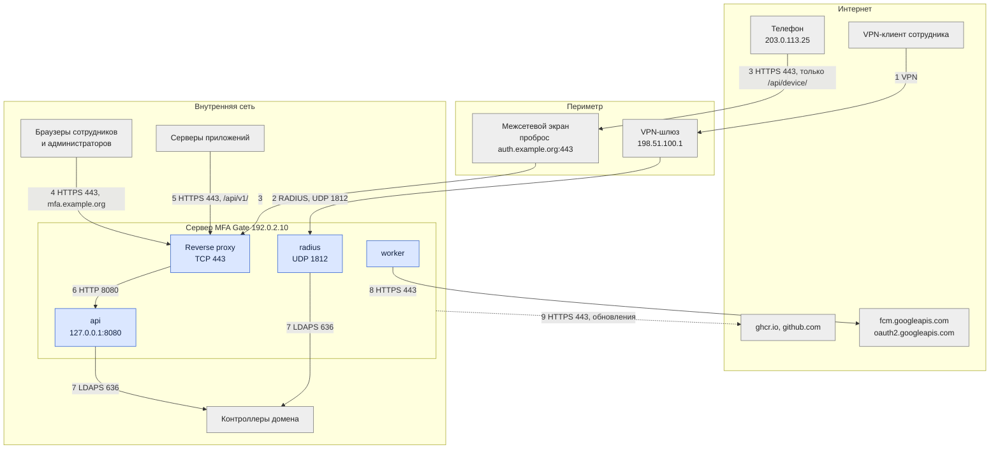
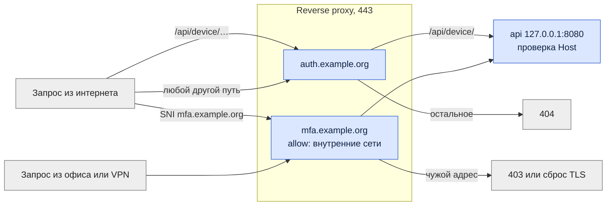

# Сетевая схема и публикация

*Для кого: сетевой администратор, администратор сервера, специалист по ИБ.*

Страница объясняет, какие соединения нужны MFA Gate, что публиковать в интернет, а что держать внутри, и какие правила поставить на межсетевом экране и reverse proxy. После неё вы сможете подготовить сеть до подключения первого VPN-шлюза. Все порты одной таблицей: [Справочник: порты и сеть](Справочник-порты-и-сеть.md).

Адреса в примерах: внутреннее имя `mfa.example.org`, внешнее имя `auth.example.org`, сервер MFA Gate `192.0.2.10`, VPN-шлюз `198.51.100.1`, телефон сотрудника в мобильной сети `203.0.113.25`.

## Зачем это нужно

Без внешнего адреса для телефонов подтверждение работает только в офисе. Сотрудник дома вводит пароль в VPN-клиенте, а телефон в мобильной сети не видит внутренний сервер — и вход отклоняется по таймауту. Без ограничений по адресам наружу утекает панель администратора или RADIUS-порт.

## Сетевые потоки

Стрелка идёт от того, кто начинает соединение.



| № | Откуда → куда | Протокол, порт | Зачем | Защита |
|---|---|---|---|---|
| 1 | VPN-клиент → шлюз | протокол VPN | туннель сотрудника | задача шлюза, MFA Gate в нём не участвует |
| 2 | шлюз → `radius` | RADIUS, UDP 1812 | проверка входа | общий секрет, Message-Authenticator, фильтр по адресу шлюза |
| 3 | телефон → периметр → прокси | HTTPS, TCP 443 | Device API: запросы и решения | TLS с публичным сертификатом, подпись решения ключом телефона |
| 4 | браузеры → прокси | HTTPS, TCP 443 | кабинет и панель | TLS, доступ только из внутренних сетей и пула VPN |
| 5 | приложения → прокси | HTTPS, TCP 443 | REST API | TLS, ключ API, разрешённые адреса ключа |
| 6 | прокси → `api` | HTTP, TCP 8080 | всё веб-приложение | только `127.0.0.1` или адрес прокси в DMZ |
| 7 | `api`, `radius` → каталог | LDAPS, TCP 636 (или StartTLS на 389) | проверка пароля и групп | TLS с проверкой сертификата |
| 8 | `worker` → FCM | HTTPS, TCP 443 | сигнал «есть запрос» | TLS, ключ service account |
| 9 | сервер → GitHub | HTTPS, TCP 443 | образы и сведения о версиях | TLS |

Ещё нужны DNS (UDP и TCP 53) и NTP (UDP 123). От точного времени на сервере зависят коды TOTP и сроки запросов.

## Два адреса на одном прокси

| Имя | Переменная | Что публикуется | Откуда доступно | Сертификат |
|---|---|---|---|---|
| `mfa.example.org` | `MFA_GATE_PUBLIC_URL` | всё приложение: `/`, `/admin/`, `/api/v1/`, `/api/docs`, `/assets/`, `/health/` | внутренняя сеть и пул адресов VPN | корпоративный УЦ или публичный |
| `auth.example.org` | `MFA_GATE_DEVICE_URL` | только `/api/device/`, на всё остальное — 404 | интернет | публичный, которому доверяет Android, например Let's Encrypt |



Как устроены рубежи:

- **Прокси.** На внешнем имени публикуется только префикс `/api/device/`, остальное — 404. Внутреннее имя закрыто по адресам источника: `allow`/`deny` в nginx, `remote_ip` в Caddy. Без этого запрос из интернета с SNI `mfa.example.org` на внешний адрес получил бы панель.
- **Сервер.** Если имя в `MFA_GATE_DEVICE_URL` отличается от имени в `MFA_GATE_PUBLIC_URL`, `api` сам отвечает 404 на любой запрос с `Host: auth.example.org`, путь которого не начинается с `/api/device/` или `/health/`. Это второй рубеж на случай ошибки в прокси, а не замена правилам прокси. Работает, только если прокси передаёт исходный `Host`.
- **Неизвестное имя.** В примере nginx запрос по IP или с чужим SNI отклоняется на этапе TLS (`ssl_reject_handshake`).

Решение и альтернативы описаны в [ADR 0015](https://github.com/calleograph/mfa-gate/blob/main/docs/adr/0015-external-device-api.md).

## Требования к reverse proxy

| Требование | Почему |
|---|---|
| Передавать исходный `Host` | по нему сервер отличает внешнее имя |
| Перезаписывать `X-Forwarded-For` адресом клиента | MFA Gate берёт последнее значение заголовка и только от доверенных адресов `MFA_GATE_TRUSTED_PROXIES` |
| Передавать `X-Forwarded-Proto: https` | от него зависит флаг `Secure` у cookie при `MFA_GATE_COOKIE_SECURE=auto` |
| Таймаут чтения не меньше 40 с, в примерах 75 с | телефоны держат `GET /api/device/v1/requests?wait=25` до 30 с, REST API ждёт решения до 30 с |
| Буферизация ответа выключена | ответ long-poll должен уйти сразу |
| Тело запроса до 64 КБ на внешнем имени | запросы Device API — небольшие JSON |

Готовые примеры: [deploy/proxy/nginx.conf](https://github.com/calleograph/mfa-gate/blob/main/deploy/proxy/nginx.conf) и [deploy/proxy/Caddyfile](https://github.com/calleograph/mfa-gate/blob/main/deploy/proxy/Caddyfile). Пошагово: [HTTPS через reverse proxy](HTTPS-через-reverse-proxy.md). Фрагменты с вашими именами показывает экран [Адреса и публикация](Адреса-и-публикация.md).

`MFA_GATE_TRUSTED_PROXIES=auto` доверяет `127.0.0.1`, `::1` и шлюзу сети Docker, через который приходят опубликованные порты. Если прокси стоит на другом сервере, добавьте его адрес: `auto,198.51.100.30/32`. Целые сети не указывайте: любой узел такой сети сможет подставить чужой адрес.

## Варианты размещения прокси

**Прокси на сервере MFA Gate.** Самый простой вариант, примеры рассчитаны на него. `MFA_GATE_HTTP_BIND=127.0.0.1`, внешний межсетевой экран пробрасывает `auth.example.org:443` на сервер с сохранением адреса клиента (DNAT). Иначе в журнале и в лимитах будет адрес периметра.

**Прокси в DMZ.** Прокси стоит на отдельном сервере, во внешний прокси выносится только `/api/device/`. На сервере MFA Gate: `MFA_GATE_HTTP_BIND` — адрес интерфейса, к которому подключается прокси; TCP 8080 открыт только с адреса прокси; адрес прокси добавлен в `MFA_GATE_TRUSTED_PROXIES`.

## Правила межсетевого экрана

Порты, опубликованные Docker, обходят `ufw` и цепочку `INPUT`. Ограничивайте их в цепочке `DOCKER-USER`.

| № | Направление | Правило |
|---|---|---|
| 1 | входящие на сервер | UDP 1812 — только с адресов VPN-шлюзов после NAT, например `198.51.100.1`. Остальным — DROP |
| 2 | входящие на сервер | TCP 443 — из внутренних сетей и пула VPN для `mfa.example.org`; из интернета — только через проброс для `auth.example.org` |
| 3 | входящие на сервер | TCP 80 — только для выпуска сертификата по HTTP-01 или перенаправления на HTTPS |
| 4 | входящие на сервер | TCP 8080 — не публиковать; с прокси в DMZ — только с его адреса |
| 5 | входящие на сервер | TCP 22 — только из сети администраторов |
| 6 | исходящие | TCP 636 к контроллерам домена |
| 7 | исходящие | TCP 443 к `fcm.googleapis.com` и `oauth2.googleapis.com`, если включён FCM; к `ghcr.io`, `github.com`, `api.github.com` для обновлений |
| 8 | исходящие | UDP 123 к NTP, UDP и TCP 53 к DNS |
| 9 | периметр | `auth.example.org:443` → reverse proxy. Кабинет, панель и REST API наружу не публикуются |
| 10 | между площадками | RADIUS по недоверенной сети — только внутри IPsec или WireGuard |

Пример для UDP 1812 в `DOCKER-USER` (адрес шлюза подставьте свой):

```bash
sudo iptables -I DOCKER-USER -p udp --dport 1812 -j DROP
sudo iptables -I DOCKER-USER -p udp --dport 1812 -s 198.51.100.1 -j ACCEPT
```

Второе правило вставляется выше первого, поэтому шлюз проходит, а остальные отбрасываются. Если установка публикует RADIUS на другом порту хоста, правило всё равно пишется для порта контейнера 1812: в `DOCKER-USER` пакет попадает уже после преобразования адреса. Как сохранить правила после перезагрузки, зависит от вашей системы.

## Таймауты

| Где | Значение | Почему |
|---|---|---|
| RADIUS-таймаут шлюза | не меньше 60 с | MFA Gate держит Access-Request, пока сотрудник отвечает. Экран **Адреса и публикация** считает рекомендацию как наибольшее из 60 с и `MFA_GATE_PUSH_TIMEOUT` + 15 с |
| Повторы шлюза | 1–3 | повторы распознаются и не создают второй push |
| `MFA_GATE_PUSH_TIMEOUT` | 45 с | время на ответ на телефоне. Если шлюз не позволяет ждать дольше 30 с, уменьшите |
| `MFA_GATE_OTP_CHALLENGE_TIMEOUT` | 120 с | время на ввод кода после Access-Challenge |
| Таймаут чтения reverse proxy | не меньше 40 с, в примерах 75 с | long-poll Device API и ожидание REST API |

Многие шлюзы по умолчанию ждут ответа RADIUS всего несколько секунд. Если не поднять таймаут, push-подтверждение не будет успевать никогда.

## Что подготовить до подключения шлюза

1. DNS: `mfa.example.org` во внутренней зоне → адрес сервера или прокси; `auth.example.org` во внешней зоне → внешний адрес периметра.
2. Сертификаты: публичный для `auth.example.org`, корпоративный или публичный для `mfa.example.org`.
3. Проброс `auth.example.org:443` на прокси с сохранением адреса клиента.
4. Список адресов VPN-шлюзов, с которых RADIUS приходит на сервер после NAT, и правило UDP 1812 для них.
5. Маршрут и правило к контроллерам домена по TCP 636, корневой сертификат УЦ контроллеров.
6. Исходящий HTTPS к сервисам доставки push. Если исходящий трафик идёт через прокси, уточните, как пропустить через него контейнеры Docker.
7. Офисные сети для первичной настройки сотрудниками (`MFA_GATE_PORTAL_ENROLL_NETWORKS`). Не включайте гостевой Wi-Fi и сети, куда можно попасть без второго фактора.
8. Пул адресов VPN в списке разрешённых для `mfa.example.org`, чтобы сотрудники открывали кабинет из дома после подключения.
9. В `deploy/.env`: `MFA_GATE_PUBLIC_URL=https://mfa.example.org`, `MFA_GATE_DEVICE_URL=https://auth.example.org`, `MFA_GATE_HTTP_BIND=127.0.0.1`; затем `sudo mfagatectl start`.

Внешний адрес лучше задать до привязки телефонов: он попадает в QR-код, и после смены телефоны придётся привязать заново. Пошаговый переход: [Сценарий: переход на HTTPS и внешний адрес](Сценарий-Переход-на-HTTPS-и-внешний-адрес.md).

## Как проверить

- Из внутренней сети `curl -fsS https://mfa.example.org/health/ready` возвращает `"status":"ok"`.
- Из интернета `https://mfa.example.org/` не открывается: таймаут, отказ TLS или 403.
- Из интернета `curl -s -o /dev/null -w '%{http_code}\n' https://auth.example.org/admin/` возвращает `404`. То же для `/`, `/api/v1/`, `/api/docs`.
- Из интернета `curl -s https://auth.example.org/api/device/v1/requests` возвращает JSON-ошибку MFA Gate `unauthenticated`, а не страницу прокси.
- `sudo ss -ltnp 'sport = :8080'` показывает только `127.0.0.1:8080` или адрес для прокси в DMZ.
- UDP 1812 с постороннего адреса не отвечает, со шлюза отвечает.
- В **Журнале** панели видны настоящие адреса клиентов, а не адрес прокси или периметра.
- Телефон в мобильной сети с выключенным Wi-Fi привязывается по QR и подтверждает вход.
- Подтверждение на 30–40-й секунде проходит: шлюз не обрывает ожидание раньше.

## Если не получается

| Что видно | Почему | Что сделать |
|---|---|---|
| Телефон дома не получает запросы, в офисе получает | `MFA_GATE_DEVICE_URL` не задан или внешнее имя не опубликовано | задайте внешний адрес, опубликуйте `/api/device/`, перепривяжите телефоны |
| Подтверждение на телефоне прошло, а VPN-клиент уже показал ошибку | таймаут RADIUS на шлюзе меньше времени ответа | поднимите таймаут шлюза до 60 с |
| В журнале у всех один адрес | прокси не передаёт `X-Forwarded-For` или не входит в `MFA_GATE_TRUSTED_PROXIES`; DNAT меняет адрес | исправьте заголовки, добавьте адрес прокси, настройте проброс с сохранением адреса |
| `https://auth.example.org/api/device/…` отвечает 404 от MFA Gate | прокси подменяет `Host` или путь | передавайте исходный `Host`, не переписывайте путь |
| Long-poll обрывается с 504 | таймаут чтения прокси меньше 30 с | поставьте не меньше 40 с |
| Шлюз видит таймаут, в журнале контейнера `radius` строка «пакет от неизвестного клиента … отброшен» | RADIUS приходит с другого адреса после NAT | укажите в RADIUS-клиенте адрес, с которого пакеты реально приходят |

Подробная диагностика: [Диагностика](Диагностика.md).

## Что дальше

- [Справочник: порты и сеть](Справочник-порты-и-сеть.md)
- [Адреса и публикация](Адреса-и-публикация.md)
- [HTTPS через reverse proxy](HTTPS-через-reverse-proxy.md)
- [Подключение VPN](Подключение-VPN.md)
