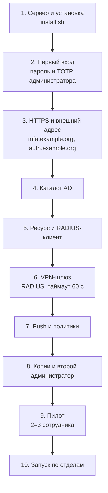

# Сценарий: внедрение с нуля

*Для кого: администратор, который вводит MFA Gate в работу в организации.*

Сценарий ведёт от пустого сервера до первых сотрудников, которые входят в VPN с подтверждением на телефоне. Каждый этап ссылается на подробную инструкцию; здесь важен порядок и то, чем закончить этап, прежде чем переходить к следующему.

## Зачем это нужно

Большинство затруднений при внедрении — из-за неверного порядка. Телефоны привязали по IP-адресу, а потом перешли на HTTPS — привязывать заново. Включили второй фактор на шлюзе до того, как сотрудники его настроили, — утром никто не может войти. Сценарий расставляет этапы так, чтобы каждый опирался на готовый предыдущий.

## Когда пригодится

- Первое внедрение MFA Gate.
- Повторное внедрение на новом сервере после пробной установки.

## Что потребуется

- Сервер Ubuntu или Debian с `sudo`: [Требования к серверу](Требования-к-серверу.md).
- Два DNS-имени: внутреннее `mfa.example.org` и внешнее `auth.example.org`, а также сертификат публичного центра сертификации для внешнего.
- Сервисная учётная запись Active Directory для чтения каталога, адреса контроллеров домена.
- Доступ к настройкам VPN-шлюза или администратор шлюза рядом.
- Два-три пилотных сотрудника с Android-телефонами; для остальных — приложение с одноразовыми кодами.
- Проект Firebase организации, если нужны мгновенные push-уведомления.

## Порядок



Этапы 3 и 4 можно поменять местами. Этап 3 обязательно идёт раньше этапа 9: адрес сервера телефон берёт из QR-кода при привязке.

## Как это сделать

### Этап 1. Установка

```bash
sudo git clone https://github.com/calleograph/mfa-gate.git /opt/mfa-gate
cd /opt/mfa-gate
sudo ./install.sh
```

**Чем закончить:** итоговый блок `Готово. MFA Gate 0.3.1 установлен.`, временный пароль сохранён, `sudo mfagatectl status` показывает сервисы `healthy`. Подробно — [Быстрая установка All-in-One](Быстрая-установка-All-in-One.md).

Пока нет HTTPS, работайте с панелью только из изолированной сети или через SSH-туннель: [Работа по HTTP](Работа-по-HTTP.md).

### Этап 2. Первый вход

Войдите в `/admin/` под `admin`, смените временный пароль, подключите TOTP. Сохраните мастер-ключ вне сервера.

**Чем закончить:** повторный вход спрашивает код из приложения, `sudo mfagatectl diagnose` без строк `FAIL`. Подробно — [Первоначальная настройка](Первоначальная-настройка.md).

### Этап 3. HTTPS и внешний адрес

Настройте reverse proxy на два имени: `mfa.example.org` — кабинет и панель только из внутренней сети и VPN, `auth.example.org` — только `/api/device/` из Интернета. В `deploy/.env` задайте `MFA_GATE_PUBLIC_URL=https://mfa.example.org`, `MFA_GATE_DEVICE_URL=https://auth.example.org`, `MFA_GATE_HTTP_BIND=127.0.0.1` и выполните `sudo mfagatectl start`.

**Чем закончить:** в диагностике `OK   Адрес портала: https://mfa.example.org` и `OK   Адрес для телефонов: https://auth.example.org`; снаружи `https://auth.example.org/admin/` отвечает `404`. Подробно — [Сценарий: переход на HTTPS и внешний адрес](Сценарий-Переход-на-HTTPS-и-внешний-адрес.md).

### Этап 4. Каталог

Откройте **Панель → LDAP / AD**, подключите каталог по LDAPS, выполните пошаговую диагностику. Решите, каким группам разрешена самостоятельная настройка в кабинете и из каких сетей (`MFA_GATE_PORTAL_ENROLL_GROUPS`, `MFA_GATE_PORTAL_ENROLL_NETWORKS`).

**Чем закончить:** диагностика каталога проходит все шаги; пилотный сотрудник входит в личный кабинет доменным паролем. Подробно — [Подключение Active Directory](Подключение-Active-Directory.md) и [Первичная настройка сотрудниками](Первичная-настройка-сотрудниками.md).

### Этап 5. Ресурс и RADIUS-клиент

Создайте ресурс «VPN» и RADIUS-клиент с адресом шлюза. Выберите, кто проверяет доменный пароль: MFA Gate или сам шлюз. Секрет клиента показывается один раз — передайте его администратору шлюза.

**Чем закончить:** на **Обзоре** отмечены шаги **Добавьте защищаемый ресурс** и **Подключите RADIUS-клиент**. Подробно — [Настройка RADIUS](Настройка-RADIUS.md).

### Этап 6. VPN-шлюз

На шлюзе укажите RADIUS-сервер — адрес сервера MFA Gate, UDP 1812, общий секрет, метод PAP. Таймаут RADIUS поставьте больше времени ожидания push (45 с), рекомендуется 60 с; RADIUS Accounting выключите. Откройте UDP 1812 на сервере MFA Gate только адресам шлюзов.

Пока второй фактор не настроен ни у кого, не переключайте на MFA Gate всех пользователей шлюза: начните с отдельной группы или профиля для пилота, если шлюз это позволяет.

**Чем закончить:** в **Панель → История входов** появляется запрос со шлюза, пусть даже с отказом **Нет второго фактора**. Подробно — [Подключение VPN](Подключение-VPN.md), [Шлюзы с собственной проверкой пароля](Шлюзы-с-собственной-проверкой-пароля.md), [Сценарий: подключение VPN-шлюза](Сценарий-Подключение-VPN-шлюза.md).

Профили шлюзов составлены по документации и проверены сквозными тестами протокола; на настоящих шлюзах их ещё не проверяли.

### Этап 7. Push и политики

Подключите Firebase Cloud Messaging, чтобы запросы приходили на телефон сразу. Без него приложение получает запросы, пока оно открыто. Политики добавляйте только для исключений: без них второй фактор нужен всем — это безопасное значение по умолчанию.

**Чем закончить:** в диагностике `OK   Доставка push: провайдеры: …`. Подробно — [Настройка Push](Настройка-Push.md), [Политики доступа](Политики-доступа.md).

Доставка через Firebase реализована, но на настоящем проекте Firebase не проверялась.

### Этап 8. Копии и второй администратор

Включите ежедневную копию и перенос копий с сервера. Добавьте второго главного администратора: он поможет, если первый потеряет телефон.

**Чем закончить:** появилась копия `…-daily`; второй администратор вошёл в панель со своим вторым фактором. Подробно — [Резервное копирование](Резервное-копирование.md), [Создание администратора](Создание-администратора.md).

### Этап 9. Пилот

Пилотные сотрудники входят в личный кабинет `https://mfa.example.org/`, привязывают телефон или настраивают приложение с кодами, создают резервные коды. Затем входят в VPN.

**Чем закончить:** каждый пилотный сотрудник вошёл в VPN с подтверждением; в истории — успешные записи. Отдельно проверьте подтверждение с телефона в мобильной сети, с выключенным Wi-Fi: так телефон идёт на внешний адрес. Подробно — [Первый день с MFA Gate](Первый-день-с-MFA-Gate.md), [Регистрация Android-устройства](Регистрация-Android-устройства.md).

Приложение на реальных телефонах не проверено, поэтому пилот на устройствах ваших сотрудников особенно важен: проверьте фоновые уведомления и экономию заряда.

### Этап 10. Запуск по отделам

Подключайте сотрудников группами: группа в каталоге, разрешение на самостоятельную настройку, памятка, срок, контроль по **Обзору** — сколько пользователей ещё без фактора. Подробно — [Сценарий: подключение отдела](Сценарий-Подключение-отдела.md).

## Что получится

- Сервер MFA Gate работает по HTTPS на двух адресах, копии делаются каждую ночь.
- VPN-шлюз спрашивает MFA Gate о каждом входе.
- Сотрудники входят в VPN паролем и подтверждением на телефоне или кодом.
- Два главных администратора, у каждого свой второй фактор.

## Если не получается

| Что видно | Почему | Что сделать |
|---|---|---|
| Запросов со шлюза нет в истории | неверный адрес или секрет, UDP 1812 закрыт, пакет без Message-Authenticator | [Решение проблем входа в VPN](Решение-проблем-входа-в-VPN.md) |
| Сотрудник подтверждает, а VPN уже показал ошибку | таймаут RADIUS на шлюзе меньше 45 с | поставьте 60 с |
| Телефон не получает запросы из дома | нет внешнего адреса или телефон привязан по старому адресу | этап 3, затем перепривязка |
| Сотрудник не может настроить фактор в кабинете | он не из разрешённой сети или группы | [Первичная настройка сотрудниками](Первичная-настройка-сотрудниками.md) |

## Что дальше

- [Руководство администратора](Руководство-администратора.md)
- [Сценарий: подключение отдела](Сценарий-Подключение-отдела.md)
- [Сценарий: восстановление после сбоя](Сценарий-Восстановление-после-сбоя.md)
