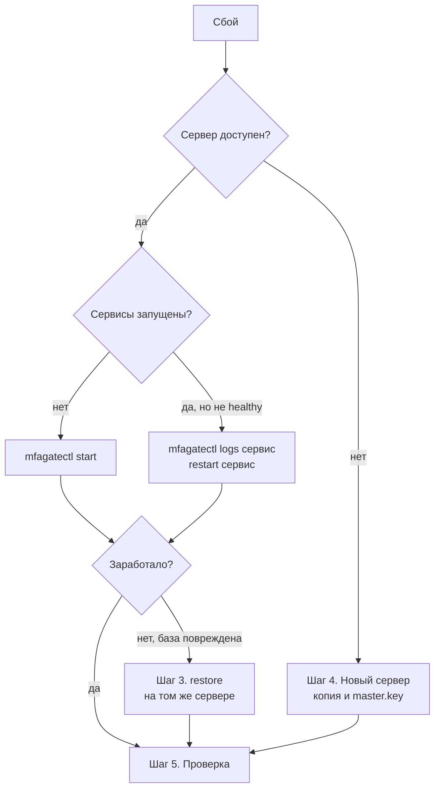

# Сценарий: восстановление после сбоя

*Для кого: администратор сервера MFA Gate.*

Сценарий помогает определить, что сломано, и выбрать самое малое действие, которое вернёт вход в VPN: от перезапуска одного сервиса до развёртывания на новом сервере из копии и мастер-ключа. Пока MFA Gate недоступен, сотрудники не могут войти в VPN, поэтому действовать нужно быстро, но без лишних шагов, которые теряют данные.

## Зачем это нужно

При сбое легко сделать хуже: восстановить базу из копии, когда хватило бы перезапуска, и потерять привязки телефонов за последние сутки. Или пересоздать установку и получить новый мастер-ключ, с которым старые копии уже не прочитать. Сценарий идёт от безопасных действий к необратимым.

## Когда пригодится

- Сотрудники не могут войти в VPN, в журнале шлюза — таймауты RADIUS.
- Панель не открывается.
- Обновление завершилось сбоем.
- Повреждён диск или сервер потерян целиком.

## Что потребуется

- Доступ к серверу с `sudo` или новый сервер.
- Для восстановления из копии: каталог копии (`db.dump`, `SHA256SUMS`, `manifest`), мастер-ключ, файл `deploy/.env`.
- Для восстановления базы — решение руководителя: всё, что появилось после времени копии, будет потеряно.

## Как это сделать

### Шаг 1. Соберите сведения

Команда ничего не меняет, а архив пригодится, если придётся обращаться за помощью.

```bash
sudo mfagatectl status
sudo mfagatectl diagnose
df -h /opt
```

**Что увидите:** состояние сервисов, проверки приложения с отметками `OK`, `WARN`, `FAIL` и путь к архиву `deploy/backups/diag-<время>.tar.gz`. В архиве — сводка, последние 300 строк журнала каждого сервиса и `.env` с замаскированными паролями и ключами. Если значение секрета всё же попало бы в архив, команда архив не создаёт.

Если сервер недоступен целиком, переходите к шагу 4.

### Шаг 2. Выберите действие



| Что случилось | Действие | Данные теряются |
|---|---|---|
| Один сервис не `healthy` | `sudo mfagatectl logs <сервис>`, затем `sudo mfagatectl restart <сервис>` | нет |
| Сервер перезагрузился, контейнеры не поднялись | `sudo systemctl status docker`, затем `sudo mfagatectl start` | нет |
| Контейнеры удалены | `sudo mfagatectl start` или `cd /opt/mfa-gate && sudo ./install.sh` | нет |
| Диск заполнен | освободить место: старые копии `pre-*`, архивы `diag-*`, `sudo docker image prune`; затем `start` | нет |
| `FAIL Мастер-ключ` | вернуть файл `deploy/data/secrets/master.key` из сохранённой копии, `sudo mfagatectl start` | нет |
| Обновление отменилось само | система осталась на прежней версии; разобраться по журналам и повторить | нет |
| После обновления система работает плохо | `git checkout` прежнего тега и `sudo mfagatectl rollback`: [Обновление](Обновление.md) | всё после обновления |
| База повреждена, сервер цел | шаг 3 | всё после копии |
| Сервер или диск потерян | шаг 4 | всё после копии |

Сервисы `radius` и `worker` обновляют отметку о работе каждые 10 секунд, пока видят базу. Если база недоступна, они перестают быть `healthy`, а `/health/ready` отвечает ошибкой 503. Когда база вернётся, сервисы продолжают работу без перезапуска.

### Шаг 3. Восстановите базу на том же сервере

**Условия:** решение о потере данных принято; мастер-ключ на сервере тот же, с которым сделана копия; контейнер `postgres` работает.

```bash
sudo ls -1t /opt/mfa-gate/deploy/backups | grep -v '^diag-' | head
sudo mfagatectl restore /opt/mfa-gate/deploy/backups/20261119T023000Z-daily
```

**Что увидите:** `восстановлено; прежняя база сохранена как mfa_gate_prev`.

Копия разворачивается в отдельную базу, и только потом рабочая подменяется. Если копия не читается, рабочая база не тронута. Прежняя база остаётся под именем `mfa_gate_prev` — если выбрали не ту копию, её можно вернуть. Подробно — [Восстановление](Восстановление.md).

### Шаг 4. Восстановите сервис на новом сервере

1. **Подготовьте адрес.** Если у прежнего сервера было DNS-имя, направьте его на новый сервер. Тогда телефоны, привязанные по имени, и шлюзы продолжат работать. Если шлюзы обращались к IP-адресу, дайте новому серверу тот же адрес или поменяйте адрес RADIUS-сервера на каждом шлюзе.
2. **Получите ту же версию**, что в строке `version=` файла `manifest`:

   ```bash
   sudo git clone https://github.com/calleograph/mfa-gate.git /opt/mfa-gate
   sudo git -C /opt/mfa-gate checkout v0.3.1
   ```

3. **Верните конфигурацию и мастер-ключ до установки:**

   ```bash
   cd /opt/mfa-gate/deploy
   sudo install -m 600 /root/restore/.env .env
   sudo install -d -m 700 data/secrets
   sudo install -m 644 /root/restore/master.key data/secrets/master.key
   sudo sha256sum data/secrets/master.key | cut -c1-16
   ```

   Отпечаток должен совпасть со строкой `master_key_sha256=` в `manifest`. Сохранённый `.env` подходит целиком: новая база создастся с паролем из него.

4. **Установите:**

   ```bash
   cd /opt/mfa-gate && sudo ./install.sh
   ```

   На этапе «Конфигурация» должно быть `найдена существующая конфигурация … — секреты и настройки сохраняются`.

5. **Восстановите копию:**

   ```bash
   sudo mfagatectl restore /root/restore/20261119T023000Z-daily
   ```

6. **Верните окружение:** reverse proxy и сертификаты ([HTTPS через reverse proxy](HTTPS-через-reverse-proxy.md)), правила межсетевого экрана для UDP 1812, `compose.override.yml` и файл учётных данных FCM, если был push ([Настройка Push](Настройка-Push.md)). После их возврата выполните `sudo mfagatectl start`.
7. **Включите расписание копий** на новом сервере: [Резервное копирование](Резервное-копирование.md).

### Шаг 5. Проверьте результат

```bash
sudo mfagatectl status
sudo mfagatectl diagnose
```

Затем вручную:

- войдите в панель под прежним администратором — с прежним паролем и вторым фактором;
- сравните число пользователей и устройств на **Обзоре** с тем, что было;
- выполните пробный вход в VPN с подтверждением на телефоне;
- откройте **Панель → История входов**: запросы со шлюзов идут.

### Шаг 6. Сообщите сотрудникам

Если база восстановлена из копии, сотрудники, которые привязали телефон или настроили приложение с кодами после времени копии, должны сделать это заново. Найти их можно в **Панель → Пользователи** с фильтром **Нет фактора**. Если меняли `MFA_GATE_DEVICE_URL` или `MFA_GATE_PUBLIC_URL`, перепривязать нужно все телефоны.

## Что получится

- Сервисы `healthy`, диагностика без `FAIL`.
- Администраторы входят как раньше, сотрудники входят в VPN.
- Известно, какие данные потеряны и кому нужно повторить настройку.
- Расписание копий работает и на новом сервере.

## Если не получается

| Что видно | Почему | Что сделать |
|---|---|---|
| `копия сделана с другим мастер-ключом: верните прежний data/secrets/master.key` | ключ на сервере не тот | положите сохранённый ключ и повторите |
| `контрольная сумма копии не совпала` | копия повреждена | возьмите предыдущую копию |
| `pg_restore не выполнен, рабочая база не тронута` | дамп не читается | возьмите предыдущую копию |
| `после восстановления сервисы не стали healthy: ./mfagatectl logs` | версия кода не подходит к копии | установите версию из `manifest` |
| Администратор не может войти, телефон потерян вместе с сервером | второй фактор администратора был на утраченном устройстве | [Аварийный доступ администратора](Аварийный-доступ-администратора.md) |
| Мастер-ключ утерян | копию нельзя расшифровать | только новая установка: каталог, RADIUS-клиенты с новыми секретами на шлюзах, перепривязка всех телефонов |

## Что дальше

- [Восстановление](Восстановление.md)
- [Резервное копирование](Резервное-копирование.md)
- [Решение проблем установки и обновления](Решение-проблем-установки-и-обновления.md)
- [Диагностика](Диагностика.md)
