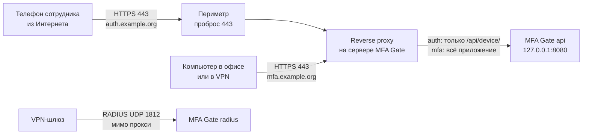

# Сценарий: переход на HTTPS и внешний адрес

*Для кого: администратор MFA Gate вместе с сетевым администратором.*

Сценарий переводит установку с `http://192.0.2.10:8080` на два адреса: внутренний `https://mfa.example.org/` для кабинета и панели и внешний `https://auth.example.org` для телефонов. В конце сотрудники могут подтверждать вход в VPN из дома, а кабинет и панель по-прежнему недоступны из Интернета.

## Зачем это нужно

Телефон должен подтвердить вход **до** того, как поднимется VPN: подтверждение и есть условие подключения. Значит, из дома телефон обращается к серверу через Интернет. Публиковать наружу весь MFA Gate нельзя, поэтому снаружи открыт только Device API — небольшой набор адресов, по которым телефоны забирают запросы и отправляют подписанные решения. Всё остальное остаётся внутри.

## Когда пригодится

- После первичной установки, до привязки первых телефонов.
- Пилот проходил в офисе по одному адресу, а теперь сотрудники будут входить из дома.
- Меняется имя сервера.

## Что потребуется

От сетевого администратора:

- DNS: `mfa.example.org` во внутренней зоне → адрес сервера; `auth.example.org` во внешней зоне → внешний адрес периметра.
- Проброс `auth.example.org:443` с периметра на сервер MFA Gate с сохранением адреса клиента; порт 80 — если сертификат выпускается по HTTP-01.
- Список внутренних сетей и пула адресов VPN — для ограничения внутреннего имени.

Сертификаты:

- для `auth.example.org` — только от публичного центра сертификации, например Let's Encrypt. Приложение на телефоне доверяет лишь системным центрам сертификации Android;
- для `mfa.example.org` — корпоративный УЦ или публичный с проверкой DNS-01.

Кроме того: права `sudo` на сервере и окно в несколько минут, когда сервисы перезапустятся.

## Как устроена публикация



Если имена в двух адресах различаются, MFA Gate сам отвечает 404 на запросы к внешнему имени вне `/api/device/` и `/health/`. Это второй рубеж на случай ошибки в прокси, а не замена ограничения в прокси. Подробно — [Сетевая схема и публикация](Сетевая-схема-и-публикация.md).

## Как это сделать

### Шаг 1. Подготовьте сеть

Передайте сетевому администратору **Панель → Адреса и публикация**: там все компоненты вашей установки с адресами, протоколами и правилами. Дождитесь DNS-записей и проброса.

**Что увидите:** `getent hosts mfa.example.org` на сервере возвращает его адрес; снаружи `auth.example.org` разрешается во внешний адрес периметра.

### Шаг 2. Перечислите, что придётся перепривязать

Адрес сервера телефон берёт из QR-кода. После смены адреса уже привязанные телефоны продолжат ходить по старому. Посмотрите, сколько их:

- **Панель → Устройства** — все телефоны;
- **Панель → Обзор**, счётчик **активных факторов** — телефоны и TOTP.

Приложения-аутентификаторы (TOTP) от адреса сервера не зависят, их перенастраивать не нужно. Если телефонов ещё нет, этот шаг пропустите.

Учтите: с момента переключения и до перепривязки такие телефоны не получают запросов, и их владельцы не смогут подтвердить вход в VPN. Заранее предупредите сотрудников и предложите тем, у кого есть только телефон, создать резервные коды в личном кабинете: [Резервные коды](Резервные-коды.md). Для VPN резервные коды не действуют, но по ним сотрудник войдёт в кабинет и сам привяжет телефон заново. Лучше всего переключаться в нерабочее время и сразу перепривязывать телефоны.

### Шаг 3. Настройте reverse proxy

Возьмите готовый файл `/opt/mfa-gate/deploy/proxy/nginx.conf` или `/opt/mfa-gate/deploy/proxy/Caddyfile`, замените имена, сети и пути к сертификатам, включите сайт. Пример nginx проходит `nginx -t` без правок на штатном nginx Ubuntu 24.04 и Debian 12; штатный сайт `/etc/nginx/sites-enabled/default` удалите. Пошагово, с поправками на другие версии nginx — [HTTPS через reverse proxy](HTTPS-через-reverse-proxy.md), шаги 2а и 2б.

**Что увидите:** `nginx -t` — `test is successful` или `caddy validate` — `Valid configuration`.

### Шаг 4. Переключите MFA Gate

```bash
cd /opt/mfa-gate/deploy
sudo cp .env .env.before-https
sudo sed -i -e 's|^MFA_GATE_PUBLIC_URL=.*|MFA_GATE_PUBLIC_URL=https://mfa.example.org|' \
            -e 's|^MFA_GATE_HTTP_BIND=.*|MFA_GATE_HTTP_BIND=127.0.0.1|' .env
sudo grep -q '^MFA_GATE_DEVICE_URL=' .env || echo 'MFA_GATE_DEVICE_URL=' | sudo tee -a .env >/dev/null
sudo sed -i 's|^MFA_GATE_DEVICE_URL=.*|MFA_GATE_DEVICE_URL=https://auth.example.org|' .env
sudo mfagatectl start
```

**Что увидите:** `==> запущено`. С этого момента панель по `http://192.0.2.10:8080` не открывается — только по `https://mfa.example.org/admin/`. Копия `.env.before-https` нужна, чтобы быстро вернуться, если что-то пошло не так.

### Шаг 5. Проверьте изнутри и снаружи

Из внутренней сети:

```bash
curl -fsS https://mfa.example.org/health/ready; echo
sudo mfagatectl diagnose | grep -E 'Адрес (портала|для телефонов)'
sudo ss -ltnp 'sport = :8080'
```

**Что увидите:** `"status":"ok"`; строки `OK   Адрес портала: https://mfa.example.org` и `OK   Адрес для телефонов: https://auth.example.org`; порт 8080 слушает только `127.0.0.1`.

Из Интернета, например с ноутбука через мобильную сеть:

| Проверка | Ожидаемый результат |
|---|---|
| `curl -s -o /dev/null -w '%{http_code}\n' https://auth.example.org/admin/` | `404` |
| то же для `/`, `/api/v1/`, `/api/docs` | `404` |
| `curl -s https://auth.example.org/api/device/v1/requests` | JSON-ошибка MFA Gate, а не страница прокси |
| `https://mfa.example.org/` | не открывается: таймаут, отказ TLS или `403` |

Войдите в панель и откройте **Журнал**: в событии входа должен быть ваш адрес, а не адрес прокси.

### Шаг 6. Перепривяжите телефоны

Для каждого телефона из шага 2 выберите один способ:

- **сотрудник сам** — в личном кабинете `https://mfa.example.org/` привязывает телефон заново по новому QR-коду. Для входа в кабинет ему нужен второй фактор. Старый телефон по прежнему адресу до сервера уже не достучится, поэтому подойдут приложение-аутентификатор или резервный код. Если ни того ни другого нет, телефон привязывает администратор;
- **администратор** — **Панель → Пользователи → карточка → Привязать телефон**, показать сотруднику QR-код. Код одноразовый и действует 24 часа; не пересылайте его по почте и в мессенджерах.

После привязки нового отзовите старую запись: карточка → **Телефоны → Отозвать**. В приложении старый сервер сотрудник может удалить.

Проверка: сотрудник с выключенным Wi-Fi входит в VPN и подтверждает запрос.

### Шаг 7. Обновите интеграции

- Собственные приложения на REST API и скрипт OpenVPN: адрес `https://mfa.example.org`. На внешнем имени REST API нет.
- Закладки и памятки для сотрудников: кабинет — `https://mfa.example.org/`, панель — `https://mfa.example.org/admin/`.
- RADIUS на шлюзах не меняется.

### Если нужно вернуться

```bash
cd /opt/mfa-gate/deploy
sudo cp .env.before-https .env
sudo mfagatectl start
```

Телефоны, уже привязанные по новому адресу, после возврата работать не будут — их придётся перепривязать снова. Поэтому возвращайтесь только до шага 6.

## Что получится

- Кабинет и панель доступны по `https://mfa.example.org/` из внутренней сети и VPN.
- Снаружи открыт только `https://auth.example.org/api/device/`.
- Телефоны подтверждают входы из любой сети.
- Диагностика не предупреждает об адресах.

## Если не получается

| Что видно | Почему | Что сделать |
|---|---|---|
| `duplicate default server` в `nginx -t` | штатный сайт `default` тоже объявляет `default_server` | удалите `/etc/nginx/sites-enabled/default` |
| `unknown directive "ssl_reject_handshake"` в `nginx -t` | nginx старше 1.19.4, например штатный в Ubuntu 22.04 | удалите блок с `ssl_reject_handshake` |
| Телефон не привязывается к `auth.example.org` | сертификат не от публичного УЦ или неполная цепочка | Let's Encrypt, файл `fullchain.pem` |
| Из дома запросы не доходят, в офисе доходят | телефон привязан по старому или внутреннему адресу | шаг 6 |
| `https://auth.example.org/admin/` открывает панель | прокси не передаёт `Host` или совпадают имена в двух адресах | `proxy_set_header Host $host;`, проверьте `.env` |
| Внутреннее имя открывается из Интернета | нет ограничения по адресам источника | `allow`/`deny` в nginx или `remote_ip` в Caddy |
| В журнале адрес периметра вместо адреса телефона | проброс не сохраняет адрес клиента | настройте DNAT без подмены источника |
| Подтверждение на 30–40-й секунде обрывается | таймаут чтения прокси меньше 40 с | `proxy_read_timeout 75s;` |

## Что дальше

- [HTTPS через reverse proxy](HTTPS-через-reverse-proxy.md)
- [Адреса и публикация](Адреса-и-публикация.md)
- [Регистрация Android-устройства](Регистрация-Android-устройства.md)
- [Если телефон потерян или заменён](Если-телефон-потерян-или-заменён.md)
