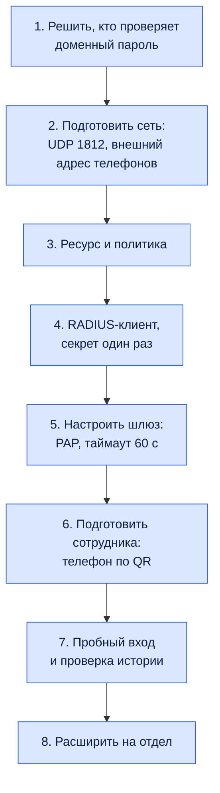

# Сценарий: подключение VPN-шлюза

*Для кого: администратор MFA Gate вместе с сетевым администратором.*

Сценарий проводит от пустого списка RADIUS-клиентов до первого входа сотрудника в VPN с подтверждением на телефоне. Он связывает в одну последовательность настройки, которые подробно описаны на отдельных страницах. Рассчитывайте на час работы, если MFA Gate уже установлен и каталог подключён.

Адреса в примере: сервер MFA Gate `192.0.2.10`, VPN-шлюз `198.51.100.1`, внутреннее имя `mfa.example.org`, внешнее имя для телефонов `auth.example.org`, тестовый сотрудник `ivanov` (Иван Иванов).

## Исходное положение

- MFA Gate установлен и открывается по `https://mfa.example.org`: [Быстрая установка All-in-One](Быстрая-установка-All-in-One.md), [HTTPS через reverse proxy](HTTPS-через-reverse-proxy.md).
- Каталог подключён, диагностика каталога проходит: [Подключение Active Directory](Подключение-Active-Directory.md).
- В разделе **RADIUS-клиенты** пусто.
- У вас роль **Главный администратор** или **Администратор**, у сетевого администратора — доступ к шлюзу и межсетевому экрану.

## Ход работ

## Шаг 1. Решите, кто проверяет доменный пароль

Посмотрите, как шлюз обращается к внешнему RADIUS-серверу.

| Шлюз | Вариант в MFA Gate |
|---|---|
| пересылает логин и пароль по PAP | **MFA Gate**: пароль проверяет MFA Gate в каталоге |
| сам проверяет пароль, а внешний сервер спрашивает только второй фактор: «только логин» или «логин и одноразовый код» | **Сам шлюз**: [Шлюзы с собственной проверкой пароля](Шлюзы-с-собственной-проверкой-пароля.md) |
| умеет только CHAP, MS-CHAPv2 или EAP | не подойдёт: нужен PAP |

Дальше сценарий описан для варианта **MFA Gate**. Отличия для варианта **Сам шлюз** отмечены в шагах.

Проверьте ещё два свойства шлюза: можно ли поднять таймаут RADIUS до 60 с и показывает ли VPN-клиент запрос кода (Access-Challenge). Без первого сотрудник не успеет подтвердить вход на телефоне. Без второго не смогут войти сотрудники, у которых есть только TOTP. Таблица совместимости: [Подключение VPN](Подключение-VPN.md).

## Шаг 2. Подготовьте сеть

Сделайте вместе с сетевым администратором:

1. Правило: UDP 1812 на `192.0.2.10` только с `198.51.100.1`. Порты Docker фильтруются в цепочке `DOCKER-USER`.
2. Если шлюз на другой площадке — туннель IPsec или WireGuard для RADIUS.
3. Внешнее имя `auth.example.org`: запись DNS, публичный сертификат, проброс TCP 443 на прокси, публикация только `/api/device/`.
4. В `/opt/mfa-gate/deploy/.env`: `MFA_GATE_DEVICE_URL=https://auth.example.org`, затем `sudo mfagatectl start`.

**Что увидите:** экран **Панель → Интеграции → Адреса и публикация** без предупреждения «Телефоны ходят на внутренний адрес…».

Внешний адрес задавайте до привязки телефонов: он попадает в QR-код. Подробно: [Сетевая схема и публикация](Сетевая-схема-и-публикация.md).

## Шаг 3. Создайте ресурс и проверьте политику

1. **Панель → Интеграции → Ресурсы → Добавить ресурс**: **Название** `VPN офис`, **Тип** **VPN**.
2. **Панель → Контроль → Политики**. Если ни одна политика не подходит, действует правило по умолчанию: второй фактор обязателен, способы push и TOTP. Для пилота этого достаточно.

**Что увидите:** уведомление «Ресурс создан». Политики: [Политики доступа](Политики-доступа.md).

## Шаг 4. Добавьте RADIUS-клиент

**Панель → Интеграции → RADIUS-клиенты → Добавить клиент**:

| Поле | Значение |
|---|---|
| **Название** | `Шлюз VPN в офисе` |
| **Ресурс** | `VPN офис` |
| **Адрес шлюза** | `198.51.100.1` |
| **NAS-Identifier** | пусто |
| **Кто проверяет доменный пароль** | **MFA Gate** (для шлюза с собственной проверкой — **Сам шлюз**) |
| **Общий секрет** | пусто |

Нажмите **Создать**.

**Что увидите:** окно «Секрет RADIUS-клиента «Шлюз VPN в офисе»». Скопируйте **Общий секрет** и передайте сетевому администратору защищённым способом: секрет показывается один раз. Если он потерялся, в меню клиента есть **Сменить секрет**. Клиент начинает принимать запросы не позже чем через 15 с.

## Шаг 5. Настройте шлюз

На шлюзе добавьте RADIUS-сервер аутентификации:

| Параметр | Значение |
|---|---|
| Адрес и порт | `192.0.2.10`, `1812` |
| Общий секрет | из шага 4 |
| Метод | PAP |
| Таймаут | 60 с |
| Повторы | 1–3 |
| Accounting | выключен |
| Calling-Station-Id | передавать, если есть такая настройка |

Назначьте сервер группе или профилю VPN для пилотных сотрудников. Для шлюза с собственной проверкой пароля добавьте MFA Gate как сервер второго фактора и выберите режим «только логин».

**Что увидите:** после первого же запроса со шлюза у клиента в столбце **Последний запрос** появится время.

## Шаг 6. Подготовьте тестового сотрудника

1. **Панель → Доступ → Пользователи**, найдите или заведите `ivanov` из каталога.
2. В карточке сотрудника нажмите **Привязать телефон** и покажите сотруднику QR-код. Или пусть сотрудник сам войдёт в личный кабинет из офисной сети и привяжет телефон.
3. На телефоне сотрудника установите MFA Gate Authenticator и отсканируйте QR-код: [Как подключить телефон](Как-подключить-телефон.md).

**Что увидите:** в карточке `ivanov` привязанный телефон. Для варианта **Сам шлюз** этот шаг обязателен: в этом режиме MFA Gate не создаёт сотрудника из каталога.

## Шаг 7. Пробный вход

1. `ivanov` подключается к VPN с верным паролем.
2. На телефон приходит «Запрос на вход» с ресурсом `VPN офис` и адресом.
3. Сотрудник нажимает «Подтвердить» и подтверждает биометрией.
4. Туннель поднимается.

Затем проверьте отказы:

| Действие | Ожидаемый результат | Где проверить |
|---|---|---|
| «Отклонить» на телефоне | отказ сразу | **История входов**: «Push отклонён» |
| неверный пароль | отказ сразу, push не приходит | «Каталог не принял пароль»; для варианта **Сам шлюз** записи нет |
| не отвечать на телефоне | отказ примерно через 45 с | «Нет ответа на push» |
| подтвердить на 35-й секунде | вход проходит | туннель поднят |

**Что увидите:** в **Панель → Контроль → История входов** записи с каналом «RADIUS», ресурсом `VPN офис`, клиентом `Шлюз VPN в офисе`. В **Журнале** нет «Неверный RADIUS-аутентификатор».

Если что-то пошло не так, начните с [Решения проблем входа в VPN](Решение-проблем-входа-в-VPN.md).

## Шаг 8. Расширьте на отдел

1. Сотрудники отдела подключают факторы сами в личном кабинете: [Первичная настройка сотрудниками](Первичная-настройка-сотрудниками.md).
2. При необходимости настройте политику для группы отдела.
3. Переключите на шлюзе группу VPN отдела на сервер MFA Gate.
4. Первые дни следите за отчётом **Панель → Контроль → Проблемы входа**.

Порядок для группы целиком: [Сценарий: подключение отдела](Сценарий-Подключение-отдела.md).

## Итог

| Что | Где проверить |
|---|---|
| RADIUS-клиент принимает запросы | **RADIUS-клиенты**, столбец **Последний запрос** |
| Телефоны получают запросы из любой сети | пробный вход с телефона в мобильной сети без Wi-Fi |
| Шлюз ждёт ответа достаточно долго | подтверждение на 30–40-й секунде проходит |
| Отказы видны с причинами | **История входов**, **Проблемы входа** |

Настройки конкретных шлюзов на настоящем оборудовании не проверялись: протокол RADIUS покрыт сквозными тестами собственным клиентом. Пробный вход из шага 7 — обязательная часть внедрения. Подробно: [Что проверено](Что-проверено.md).

## Что дальше

- [Подключение VPN](Подключение-VPN.md)
- [Шлюзы с собственной проверкой пароля](Шлюзы-с-собственной-проверкой-пароля.md)
- [Сценарий: подключение отдела](Сценарий-Подключение-отдела.md)
- [История входов и журнал аудита](История-входов-и-журнал-аудита.md)
