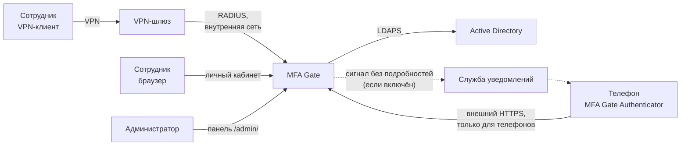

# Что такое MFA Gate

*Для кого: руководитель, специалист по безопасности, администратор и сотрудник, который впервые слышит о MFA Gate.*

MFA Gate — открытая система второго фактора для VPN и внутренних сервисов организации. Она ставится на собственный сервер организации и работает с её Active Directory. После внедрения одного пароля для входа в VPN мало: вход нужно подтвердить на телефоне или ввести одноразовый код.

## Зачем это нужно

Пароль — самое слабое звено удалённого доступа. Его подбирают, выманивают поддельными письмами, берут из утечек чужих сайтов, где сотрудник использовал тот же пароль. Тот, кто узнал пароль, подключается к VPN так же, как сам сотрудник, и попадает во внутреннюю сеть.

Второй фактор закрывает эту возможность. Кроме того, что сотрудник знает (пароль), нужно то, что у него есть (телефон). Без телефона пароль бесполезен, а попытка входа видна сотруднику: на телефон приходит запрос, который он не ждал.

## Как это выглядит для сотрудника

1. Один раз сотрудник открывает в браузере личный кабинет, входит рабочей учётной записью и подключает телефон: сканирует QR-код с экрана. Там же он сохраняет резервные коды на случай потери телефона.
2. При каждом входе в VPN он, как и раньше, вводит логин и пароль в привычном VPN-клиенте.
3. Телефон показывает запрос: куда входят, с какого адреса, когда. Сотрудник нажимает **Подтвердить** и прикладывает палец. VPN подключается.

Вместо подтверждения на телефоне можно пользоваться шестизначными кодами в любом приложении-аутентификаторе, в том числе на iPhone. Как устроен вход и что при этом уходит в интернет, описано в статье [Как работает вход с подтверждением](Как-работает-вход-с-подтверждением.md).

## Из чего состоит

| Часть | Кто пользуется | Что делает |
| --- | --- | --- |
| Личный кабинет, например `https://mfa.example.org/` | сотрудники | подключение телефона и приложения с кодами, резервные коды, история своих входов |
| Панель администратора, `https://mfa.example.org/admin/` | администраторы, операторы, аудиторы | сотрудники и их телефоны, VPN-шлюзы, политики доступа, история входов, журнал действий |
| Сервисы проверки | VPN-шлюзы, внутренние приложения, телефоны | RADIUS для шлюзов, REST API для своих приложений, отдельный интерфейс для телефонов |
| Приложение MFA Gate Authenticator | сотрудники с Android-телефонами | подтверждение входа отпечатком или PIN, одноразовые коды без интернета |

MFA Gate не строит VPN-туннель и не заменяет VPN-шлюз. Шлюз по-прежнему подключает сотрудника и шифрует его трафик, а MFA Gate отвечает шлюзу «пустить» или «не пускать». Пока ответа «пустить» нет, доступа в сеть нет.

## Где хранятся данные

Всё хранится на сервере организации: учётные записи, привязанные телефоны, секреты одноразовых кодов, история входов, журнал действий администраторов. Секреты в базе зашифрованы мастер-ключом. Доменный пароль проверяет Active Directory, MFA Gate его не сохраняет.

Облачного посредника нет. Наружу уходит немногое:

- телефон связывается с сервером организации по внешнему адресу, например `https://auth.example.org`, и по нему доступна только часть системы, которая обслуживает телефоны;
- если администратор включил доставку уведомлений через Firebase Cloud Messaging, через Google проходит только сигнал «есть новый запрос» — без логина, адреса и других подробностей;
- сервер обращается к GitHub, чтобы проверить и скачать обновления.

Облачные MFA-сервисы устроены иначе: сведения о каждом входе сотрудников проходят через чужую инфраструктуру, а при недоступности облака вход останавливается. MFA Gate обходится без внешнего сервиса: даже уведомления можно доставлять без Google, через собственное соединение приложения с сервером. Платы за пользователя нет: код открыт под лицензией Apache 2.0.

## Кому подходит

MFA Gate рассчитан на организацию, у которой есть:

- VPN-шлюз, который проверяет вход по RADIUS и передаёт пароль способом PAP, или сервер OpenVPN;
- Active Directory или другой LDAP-каталог (без каталога можно завести учётные записи вручную в панели);
- сервер с Ubuntu 22.04 и новее или Debian 12 и администратор, который его сопровождает;
- сотрудники с телефонами: Android 8.0 и новее для подтверждения нажатием или любой телефон для одноразовых кодов.

Если что-то из этого не совпадает, прочитайте статью [Когда продукт не подходит](Когда-продукт-не-подходит.md).

## Что проверено

Проверены установка на чистый Ubuntu, обновление и откат на тестовом сервере, вход по RADIUS с подтверждением на телефоне в сквозных тестах, личный кабинет с настоящим каталогом.

Ещё не проверены на настоящей инфраструктуре: конкретные модели VPN-шлюзов (протокол покрыт сквозными тестами), настоящий Active Directory (проверено на OpenLDAP), приложение на реальных телефонах и доставка уведомлений через Firebase. Подробности — в статье [Что проверено](Что-проверено.md).

## Что дальше

- [Возможности](Возможности.md) — полный перечень функций с ограничениями
- [Как работает вход с подтверждением](Как-работает-вход-с-подтверждением.md)
- [Маршрут администратора](Маршрут-администратора.md) — с чего начать внедрение
- [Маршрут сотрудника](Маршрут-сотрудника.md) — что прочитать сотруднику
