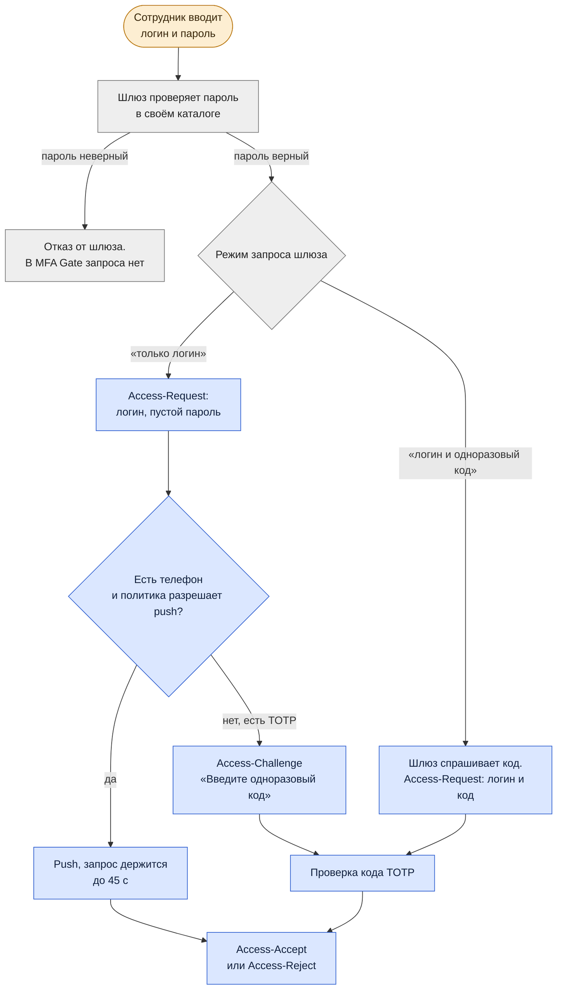

# Шлюзы с собственной проверкой пароля

*Для кого: сетевой администратор и администратор MFA Gate.*

Некоторые VPN-шлюзы сами проверяют доменный пароль сотрудника, а у внешнего RADIUS-сервера спрашивают только второй фактор. Такой шлюз подключается к MFA Gate с вариантом **Сам шлюз** в поле **Кто проверяет доменный пароль**. После настройки шлюз проверяет логин и пароль, MFA Gate — подтверждение на телефоне или одноразовый код, и туннель поднимается, только когда пройдены оба шага.

## Зачем это нужно

Обычно MFA Gate получает от шлюза логин и пароль по PAP и проверяет пароль в каталоге сам. Шлюз с собственной проверкой пароля так не умеет: пароль он оставляет себе, а внешнему серверу отправляет только логин или логин и код. Без отдельного режима MFA Gate отклонял бы такие запросы как «нет пароля». Вариант **Сам шлюз** говорит MFA Gate: этому клиенту можно доверить проверку пароля, спрашивай только второй фактор.

## Когда пригодится

- В настройках шлюза второй фактор задаётся отдельно от проверки пароля: «сервер двухфакторной аутентификации», «RADIUS-сервер второго фактора» и подобные названия.
- Шлюз предлагает режимы запроса к RADIUS вроде «только логин» и «логин и одноразовый код».
- Шлюз уже подключён к Active Directory, и переносить проверку пароля в MFA Gate вы не хотите.

Если шлюз умеет просто переслать логин и пароль по PAP, выбирайте вариант **MFA Gate**: так проще и надёжнее. Общий порядок: [Подключение VPN](Подключение-VPN.md).

## Как это работает

Как MFA Gate читает поле пароля (`User-Password`) у клиента с вариантом **Сам шлюз**:

| Что прислал шлюз | Что делает MFA Gate |
|---|---|
| пусто | второй фактор: push с удержанием запроса до решения, а если телефона нет — Access-Challenge для кода TOTP |
| 6–8 цифр | проверяет как код TOTP |
| любое другое значение | не проверяет как пароль и ошибкой не считает; дальше как пустое |

Последовательность по шагам: [Архитектура: последовательности входа](Архитектура-Последовательности-входа.md).

## Два режима запроса шлюза

| Режим шлюза | Что уходит в MFA Gate | Push | Код TOTP | Что нужно от шлюза |
|---|---|---|---|---|
| «Только логин» | логин и пустой пароль | да | да, через Access-Challenge, если телефона нет | показать сотруднику Reply-Message и окно ввода кода |
| «Логин и одноразовый код» | логин и код, который шлюз спросил сам | нет | да | своё окно ввода кода; текст подсказки, если шлюз позволяет его задать, например «Код из приложения MFA Gate» |

Режим «только логин» подходит большинству: сотрудники с телефоном подтверждают вход, сотрудники с TOTP вводят код. Режим «логин и одноразовый код» выбирайте, если все сотрудники пользуются кодами, а push не нужен.

## Чему вы доверяете

Вариант **Сам шлюз** снимает с MFA Gate проверку пароля для этого клиента. Кто может отправить RADIUS-пакет от имени такого клиента, тот может вызвать push сотруднику или проверить код без пароля. Поэтому:

- **Ставьте вариант только шлюзу, который действительно проверяет пароль** до запроса в MFA Gate. Иначе любой, кто знает логин, получит возможность отправить сотруднику push.
- **Один шлюз — один клиент** с точным адресом, не сеть адресов.
- **Длинный случайный секрет.** Оставьте поле **Общий секрет** пустым — MFA Gate сгенерирует его сам.
- **Message-Authenticator обязателен.** Не отключайте `MFA_GATE_RADIUS_REQUIRE_MESSAGE_AUTHENTICATOR`.
- **UDP 1812 только с адреса шлюза.** Между площадками — IPsec или WireGuard.

Глобального пропуска проверки пароля в MFA Gate нет: вариант действует только у конкретного клиента. Блокировка, политики, история и журнал работают как обычно. Пока такой клиент есть, экран **Адреса и публикация** показывает предупреждение. Обоснование: [ADR 0016](https://github.com/calleograph/mfa-gate/blob/main/docs/adr/0016-first-factor-per-radius-client.md).

## Что потребуется

- Шлюз, который сам проверяет доменный пароль и умеет обращаться к внешнему RADIUS-серверу за вторым фактором по **PAP**.
- Возможность задать на шлюзе таймаут ответа RADIUS **не меньше 60 с**. Многие шлюзы по умолчанию ждут 3–5 с, с таким значением push не успевает.
- Адрес, с которого RADIUS-пакеты шлюза приходят на сервер MFA Gate после NAT, например `198.51.100.1`.
- Роль **Главный администратор** или **Администратор** в панели MFA Gate.
- Сотрудники, **уже известные MFA Gate** и с подключённым вторым фактором (ниже — почему).

## Где найти

- **Панель → Интеграции → RADIUS-клиенты → Добавить клиент** — поле **Кто проверяет доменный пароль**.
- В шлюзе — настройки второго фактора или двухфакторной аутентификации, раздел с внешними RADIUS-серверами. Название раздела зависит от производителя.

## Как это сделать

1. **Подготовьте сотрудников.** Пароль в этом режиме до MFA Gate не доходит, поэтому учётную запись из каталога MFA Gate сам не заведёт. Сотрудник должен быть известен заранее и иметь второй фактор:
   - сотрудник входит в [личный кабинет](Личный-кабинет-сотрудника.md) из офисной сети и подключает телефон или приложение с кодами;
   - или администратор заводит его в **Панель → Доступ → Пользователи** с источником из каталога и выдаёт QR-код привязки.

   Логин на шлюзе и в MFA Gate должен совпадать. Если шлюз передаёт логин в виде `CORP\ivanov` или `ivanov@corp.example.org`, MFA Gate найдёт доменную запись `ivanov` по короткому имени.

   **Что увидите:** в карточке сотрудника есть привязанный телефон или TOTP.

2. **Создайте ресурс**, если его ещё нет: **Панель → Интеграции → Ресурсы → Добавить ресурс**, **Тип** **VPN**, например `VPN офис`.

3. **Добавьте RADIUS-клиент.** **Панель → Интеграции → RADIUS-клиенты → Добавить клиент**:

   | Поле | Значение |
   |---|---|
   | **Название** | `Шлюз с проверкой пароля` |
   | **Ресурс** | `VPN офис` |
   | **Адрес шлюза** | `198.51.100.1` |
   | **Кто проверяет доменный пароль** | **Сам шлюз** |
   | **Общий секрет** | пусто — MFA Gate сгенерирует |

   Нажмите **Создать**.

   **Что увидите:** окно с общим секретом. Скопируйте его: он показывается один раз. В списке под названием клиента появится пометка «пароль проверяет шлюз».

4. **Добавьте MFA Gate на шлюзе** как RADIUS-сервер второго фактора:

   | Параметр шлюза | Значение |
   |---|---|
   | Адрес сервера | `192.0.2.10` |
   | Порт | `1812` или ваш `MFA_GATE_RADIUS_PORT` |
   | Общий секрет | из шага 3 |
   | Таймаут ответа | **60 с**; если шлюз позволяет, до 120 с |
   | Число попыток | 1–3 |
   | Режим запроса | «только логин» или «логин и одноразовый код» |
   | Текст запроса кода | для режима с кодом, например `Код из приложения MFA Gate` |

   Почему 60 с: MFA Gate ждёт ответа на телефоне до `MFA_GATE_PUSH_TIMEOUT`, по умолчанию 45 с. Таймаут шлюза должен быть больше. Повторы шлюза безопасны: MFA Gate узнаёт повтор и второй push не отправляет.

5. **Назначьте второй фактор** нужным группам или профилям VPN на шлюзе: выберите добавленный RADIUS-сервер.

   Встроенные механизмы второго фактора самого шлюза (его собственные коды, SMS) для этих пользователей не нужны: второй фактор даёт MFA Gate.

6. **Откройте сеть.** UDP 1812 на сервер MFA Gate — только с адреса шлюза. Телефоны подтверждают вход до подключения VPN, поэтому Device API должен быть доступен из интернета: [Сетевая схема и публикация](Сетевая-схема-и-публикация.md).

## Что получится

Сотрудник вводит логин и пароль в VPN-клиенте. Шлюз проверяет пароль. В режиме «только логин» на телефон приходит запрос, сотрудник подтверждает — туннель поднимается. В режиме «логин и одноразовый код» шлюз сам спрашивает код, MFA Gate его проверяет.

В **Истории входов** MFA Gate видны только попытки, где пароль уже принят шлюзом. Ошибки пароля видит только шлюз.

## Как проверить

1. Режим «только логин»: вход под `ivanov` → запрос на телефоне → «Подтвердить» → VPN подключается.
2. «Отклонить» на телефоне → отказ сразу, в **Истории входов** причина «Push отклонён».
3. Неверный пароль → отказ от шлюза, push не приходит, в **Истории входов** MFA Gate записи нет.
4. Нет ответа на телефоне → отказ примерно через 45 с, а не раньше по таймауту шлюза.
5. Сотрудник только с TOTP: шлюз показывает запрос кода, кириллица читается, код принимается, повтор того же кода отклоняется.
6. Режим «логин и одноразовый код»: шлюз спрашивает код с вашим текстом, вход проходит, в истории способ «TOTP-код».
7. В **Истории входов** канал «RADIUS», ресурс `VPN офис`, клиент `Шлюз с проверкой пароля`, адрес сотрудника, если шлюз передаёт Calling-Station-Id.
8. В **Журнале** нет «Неверный RADIUS-аутентификатор».

## Что проверено

Режим покрыт сквозными тестами: пустой пароль даёт push, «не код» даёт запрос кода у сотрудника без телефона, верный код принимается сразу, неверный отклоняется. Режимы «только логин» и «логин и одноразовый код» проверены имитацией RADIUS-пакетов по общедоступному описанию таких шлюзов. **На настоящем шлюзе с собственной проверкой пароля этот профиль ещё не проверяли.** Перед внедрением пройдите список выше: передаёт ли шлюз Message-Authenticator и Calling-Station-Id, как показывает Reply-Message и читается ли кириллица. Подробно: [Что проверено](Что-проверено.md).

## Если не получается

| Что видно | Почему | Что сделать |
|---|---|---|
| Отказ, в **Истории входов** причина «Пользователь не найден» | сотрудник не известен MFA Gate: в этом режиме он не создаётся из каталога | пусть сотрудник войдёт в личный кабинет или заведите его в **Пользователях** |
| Отказ, причина «Нет второго фактора» | у сотрудника нет телефона и TOTP | привяжите телефон или выдайте TOTP |
| Отказ «Неверный или уже использованный одноразовый код.» при верном коде в режиме «логин и одноразовый код» | политика ресурса не разрешает TOTP или часы сервера ушли больше чем на 30 с | разрешите способ TOTP в [политике](Политики-доступа.md), проверьте NTP на сервере |
| Сотрудник подтвердил вход, а VPN-клиент уже показал ошибку | таймаут шлюза меньше времени ответа | поставьте 60 с |
| Шлюз пишет «сервер не отвечает» | неверный адрес клиента, секрет или фильтр UDP 1812 | проверьте **Последний запрос** у клиента, событие «Неверный RADIUS-аутентификатор» в **Журнале** |
| Отказ «Нет имени или пароля» или «Неверный логин или пароль…», хотя шлюз пароль принял | у клиента выбран вариант **MFA Gate**, и MFA Gate проверяет пустой пароль | выберите **Сам шлюз** |
| Запрос кода не появляется у сотрудника только с TOTP | шлюз не показывает Access-Challenge | переключите шлюз в режим «логин и одноразовый код» |

## Что дальше

- [Сценарий: подключение VPN-шлюза](Сценарий-Подключение-VPN-шлюза.md)
- [Подключение VPN](Подключение-VPN.md)
- [Настройка RADIUS](Настройка-RADIUS.md)
- [Решение проблем входа в VPN](Решение-проблем-входа-в-VPN.md)
